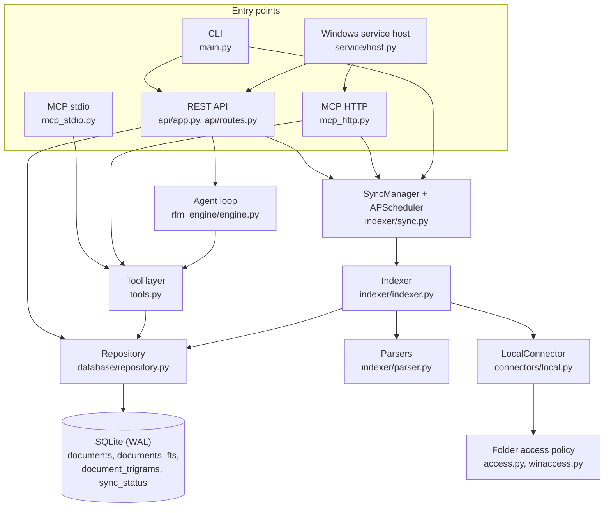
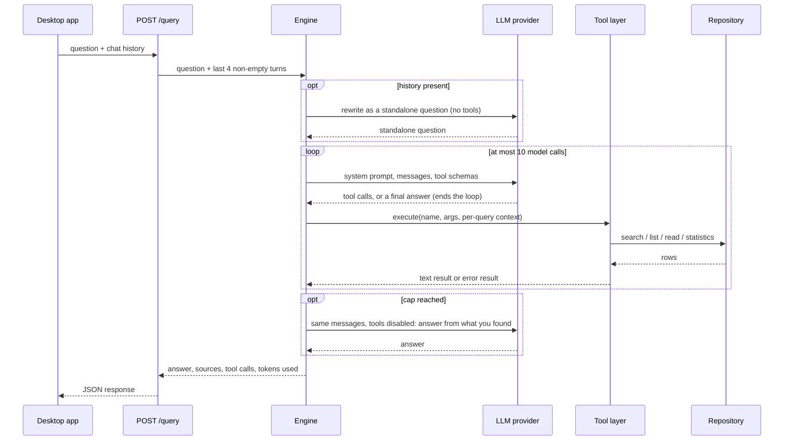

# Architecture

This document describes how RootMind is put together, which guardrails the
agent loop has, and which trade-offs were made. Paths are relative to
`backend/src/rootmind/` unless they start with `backend/`, `desktop/`,
`scripts/`, `packaging/` (the folder at the repository root) or `.github/`.
In the [Desktop app](#desktop-app) section, `src/...` and `src-tauri/...` are
relative to `desktop/`.

- [Components](#components)
- [Deployment modes](#deployment-modes)
- [Interfaces between the parts](#interfaces-between-the-parts)
- [Background service](#background-service)
- [Folder access policy](#folder-access-policy)
- [Packaging](#packaging)
- [The agent loop](#the-agent-loop)
- [The tool layer](#the-tool-layer)
- [Retrieval and indexing](#retrieval-and-indexing)
- [Data model](#data-model)
- [Configuration](#configuration)
- [REST API](#rest-api)
- [Desktop app](#desktop-app)
- [Testing and evals](#testing-and-evals)
- [Design decisions](#design-decisions)
- [How this would map to a server deployment](#how-this-would-map-to-a-server-deployment)
- [Known gaps and next steps](#known-gaps-and-next-steps)

## Components



| Component | Code | Responsibility |
|---|---|---|
| Connector | `connectors/local.py` | Walks one folder, applies include and exclude patterns, reads files, computes a SHA-256 per file, keeps every resolved path inside the folder root, never follows links or junctions out of it, asks the folder access policy before it enters a folder or reads a file, and raises when the folder is unreachable |
| Folder access policy | `access.py`, `winaccess.py` | Decides which folders and files a backend may read. Unrestricted everywhere except in the Windows service, where reads are confined to the installing account's unelevated rights |
| Parsers | `indexer/parser.py` | Extract text per file extension; insert `[Page N]`, `=== Slide N ===` and `=== Sheet: Name ===` markers |
| Indexer | `indexer/indexer.py` | Skips unchanged files by hash, enforces the size limit, stores text and records parse errors per file; reports each file as indexed, skipped or error |
| Sync manager | `indexer/sync.py` | Full and incremental syncs, one at a time per database; the background schedule; pruning of removed folders |
| Repository | `database/repository.py`, `database/models.py` | SQLite schema, FTS5 search, trigram fuzzy search, windowed reads, location lookup |
| Tool layer | `tools.py` | The five read-only tools: schemas, argument validation, execution, result formatting |
| Agent loop | `rlm_engine/engine.py` | Provider adapters, the bounded tool loop, condensing follow-up questions, sources |
| REST API | `api/app.py`, `api/routes.py`, `auth.py` | Localhost API for the desktop app with an optional bearer token; config hot reload |
| MCP servers | `mcp_stdio.py`, `mcp_http.py` | The same tools for external MCP clients |
| CLI | `main.py` | One command tree: `api`, `index`, `rebuild-trigrams`, `mcp`, `mcp-http`, `service`; bind and token resolution |
| Windows service | `service/` | `service install`, `uninstall` and `status`, and the service host that the Service Control Manager starts |
| Desktop app | `desktop/` | Tauri 2 UI; a client of the Windows service over REST: reads its state, connects with its token, repairs it and switches MCP over HTTP |
| Installer | `desktop/src-tauri/installer/` | Per-machine NSIS installer; sets up the Windows service for the signed-in account and removes it on uninstall |

## Deployment modes

| Mode | Started by | Home (`RLM_HOME`) | Address | REST token | MCP |
|---|---|---|---|---|---|
| **RootMind service** (the app's backend) | The Service Control Manager, at boot; the installer sets it up | `%ProgramData%\RootMind` | `127.0.0.1:8000`, or a port from 18300–18399 when 8000 is taken | `data\rest_token.txt` | Service `RootMind-MCP-HTTP` (on by default) on 3000 or 18400–18499, token in `data\api_token.txt` |
| **Custom** (Settings → Advanced) | You | Whatever that backend uses | The address you enter (loopback only, because of the app's CSP) | Optional, entered by you | Not managed by the app |
| **Command line** (development, other setups) | You (`rootmind api`, `uv run ...`, `rootmind-backend.exe api`) | `RLM_HOME`, or the working directory | `--host`/`--port`, then `RLM_HOST`/`RLM_PORT`, then `api.*` in `config.yaml`, then `127.0.0.1:8000` | Off unless `RLM_API_TOKEN` or `--require-token` | `rootmind mcp` / `rootmind-mcp`, `rootmind mcp-http` / `rootmind-mcp-http` |

Since 2.0 the desktop app has no backend of its own. The installer always
sets up the RootMind service (see [Packaging](#packaging)), and the app is a
client of it. A backend at another address, such as `rootmind api` from a
source checkout or a uv install, is for development and other setups.

```
%ProgramFiles%\RootMind\                          the app, per machine (the folder can be changed in the installer)
  |-- RootMind.exe                                the desktop app, a client of the service
  '-- backend\rootmind-backend.exe + _internal\   onedir build (Tauri resources): `service install`
                                                  (installer, Repair) and `service status --json`
%ProgramFiles%\RootMind Service\<version>-<id>\   rootmind-backend.exe, _internal\   (admin-only; the services run this copy)
%ProgramData%\RootMind\                           config.yaml, data\, logs\, tmp\

RootMind.exe
  |-- service: reads SCM state and PID, the ImagePath (port), the TCP table (listener PID)
  |            and data\rest_token.txt; elevates `service install` for Repair and MCP on or off
  '-- custom:  your URL and optional token
```

**Choosing the backend.** When the app starts, `decideBackend()` in
`desktop/src/state/bootstrap.ts` (a pure, unit-tested function) picks the
backend from the stored choice and the build type:

1. A stored custom backend (`rlm.backendMode` = `custom`) wins.
2. A debug build (and the browser preview) never connects to the installed
   service on its own, because the service holds the user's real index and
   settings. The backend dialog asks for an address (the stored one, else
   `http://127.0.0.1:8000` for `rootmind api` from source), and nothing is
   contacted until you connect.
3. Otherwise, the first start included, the RootMind service. Whether it can
   be used is found out by the connectivity check, which names the problem
   (see [Desktop app](#desktop-app)).

`localStorage` holds `rlm.backendMode` (`auto` for the service, a value kept
from 1.x, or `custom`), and `rlm.baseUrl` and `rlm.token` only for a custom
backend; the service's token is never stored. "Use the RootMind service"
under Settings → Advanced and in the dialog of a custom backend returns to
`auto`.

**MCP servers.** The stdio server is started by the MCP client as a child
process. The HTTP server is a separate process on `127.0.0.1:3000`, or the
`RootMind-MCP-HTTP` service. Both only serve by default; `--index` also runs
the background indexer in the HTTP server, which is only safe when no REST
API indexes the same database: each indexing process prunes the folders
missing from its own copy of the config. SQLite runs in WAL mode, so they can
read while another process writes. The HTTP server re-reads the folder list
on the next tool call after `config.yaml` changed (size and modification
time); the stdio server reads it at startup. With `--index` the in-process
indexer keeps the folders it started with until a restart.

For the installed app, use MCP over HTTP. The service's database lives in a
folder that your account can only read, and SQLite readers in WAL mode need
to write, so `rootmind-backend.exe mcp` from the app's folder cannot open it.
Claude Desktop starts only stdio servers; the release asset `rootmind.mcpb`
(an MCP Bundle, source in `packaging/mcpb/`) is one: a Node.js bridge that
Claude Desktop runs with its built-in Node. It reads the MCP port and token
file from `"%ProgramFiles%\RootMind\backend\rootmind-backend.exe" service
status --json`, forwards each JSON-RPC line from stdin to `POST /mcp` with the
bearer token and writes the answers to stdout. When RootMind cannot be used
(not installed, MCP over HTTP off, service stopped, token of another account,
no connection) it answers each request with a JSON-RPC error that says what
to do, and it looks the service up again after a connection error, so it
follows a new port. The stdio server is meant for a source checkout or a uv
install with its own `config.yaml`.

## Interfaces between the parts

These contracts are shared by the backend, the desktop app, the installer and
the CI scripts.

**Backend executable**

| Item | Value |
|---|---|
| Build output | `backend/dist/rootmind-backend/` with `rootmind-backend.exe` and `_internal\` |
| In the installer | `$INSTDIR\backend\rootmind-backend.exe`, always `%ProgramFiles%\RootMind\backend\` (resource map from `desktop/src-tauri/binaries/rootmind-backend/`) |
| Release assets | `RootMind-Setup-x64.exe`; `rootmind-backend-windows-x64.zip` with the folder `rootmind-backend/`; `SHA256SUMS.txt` |
| `--version` | `rootmind-backend <version>` (`rootmind <version>` from a Python install); the last word is the version in PEP 440 normal form |
| Commands | `api`, `index`, `rebuild-trigrams`, `mcp`, `mcp-http`, `service install\|uninstall\|status`, and `service run backend\|mcp-http` (started by the Service Control Manager, not listed in the help) |
| `api` options | `--host`, `--port` (0 = a free port, which the log names), `--require-token`. The options of the removed built-in backend, `--exit-with-parent` and `--import-config`, are refused (exit 2) |
| `service install` options | `--port N\|auto`, `--mcp-http` / `--no-mcp-http`, `--mcp-port N\|auto`, `--mcp-token-from FILE`, `--user-sid SID`, `--no-start` |
| Installer | Installs with `service install --port auto --mcp-port auto --user-sid <signed-in account>`; uninstalls with `service uninstall`, `--purge` when the app data is to be deleted |
| Token files | `<RLM_HOME>/data/rest_token.txt` (REST), `<RLM_HOME>/data/api_token.txt` (MCP) |
| Open routes with a token | `GET`/`HEAD` on `/` (with `"auth": "bearer"` or `"none"`) and `/health`; everything else 401 |
| Service names | `RootMind-Backend`, `RootMind-MCP-HTTP` |

The commands `mcp`, `mcp-http` and `service` are handed to their own entry
points before logging and the config are set up, with the rest of the command
line unchanged, so `mcp` keeps stdout clean for JSON-RPC. Without a command,
`rootmind` and `rootmind-backend.exe` run `api`.

**Desktop commands** (Rust, `desktop/src-tauri/src/`; camelCase over IPC):

| Command | Returns | What it does |
|---|---|---|
| `app_mode` | `{version, dev}` | Build information |
| `service_info` | `ServiceInfo` | Installed, ours, state, port and URL, whether the token is readable and the service belongs to this account, whether this account can approve an elevation (`canElevate`), and why the service cannot be used (`blockedReason`); the same for MCP, with its endpoint. Starts no process |
| `service_connect` | `{ok, url, token}` or `{ok: false, reason}` | Checks the listener (below) and only then reads the token |
| `service_update` | `{ok: true, backend}` or `{ok: false, cancelled, code, backend}` | Repair and "Update service": elevated `service install --port auto --mcp-port auto --user-sid <SID>`, run with the backend installed with the app, `%ProgramFiles%\RootMind\backend\` (the app's version); only when that is missing, with the service's registered copy under `%ProgramFiles%\RootMind Service\` (the backend's, else the MCP service's); with neither, the error "Reinstall RootMind" |
| `service_set_mcp({enabled})` | same as `service_update` | Elevated `service install --mcp-http --mcp-port auto` or `service install --no-mcp-http`, run with the program in the ImagePath under `%ProgramFiles%\RootMind Service\` |
| `service_mcp_token` | string | Reads `data\api_token.txt` while the MCP service is ours |
| `service_details` | string | `service status --json` (not elevated, from the app's backend folder, stopped after 30 seconds) and the last 60 lines of `logs\install.log` |

In the results, `code` is the service exit code, or 1223 when the approval
was cancelled. Only one change runs at a time. The webview cannot reach any
other command that starts a process: the app has no shell plugin, and its own
commands need no capability entry.

## Background service

**Services.**

| Service | Account | Runs |
|---|---|---|
| `RootMind-Backend` | LocalSystem, start automatic | REST API and indexer, with the folder access policy of the installing account |
| `RootMind-MCP-HTTP` (on by default) | `NT SERVICE\RootMind-MCP-HTTP` (virtual account, unrestricted service SID, only `SeChangeNotifyPrivilege`), start automatic | MCP over HTTP from the same index, without the scheduler |

Both restart after 5, 30 and 60 seconds on failure (reset after one day). A
stop because of a config, token or access error reports service-specific
code 2 and is not restarted. The registered command lines (ImagePath) are
quoted and carry no secrets:

```
"C:\Program Files\RootMind Service\2.0.0-0a1b2c3d\rootmind-backend.exe" service run backend --port 8000 --user-sid S-1-5-21-1-2-3-1001
"C:\Program Files\RootMind Service\2.0.0-0a1b2c3d\rootmind-backend.exe" service run mcp-http --port 3000
```

A service counts as "ours" when its program lies under
`%ProgramFiles%\RootMind Service\`. The Python package (`service/imagepath.py`)
and the desktop app (`desktop/src-tauri/src/imagepath.rs`) parse these lines
with the same rules and the same test strings.

**Who sets it up.** The installer runs `service install` for the account that
is signed in to Windows, and the uninstaller runs `service uninstall` (see
[Packaging](#packaging)). The app runs `service install` again for Repair and
to switch MCP over HTTP. On a machine without the app, `service install` from
the release zip sets the service up with a default config without folders;
folders are then added through `POST /config` with the REST token, in
`config.yaml` from an elevated prompt, or with the app.

**Why the services run from their own copy.** The installer places the
backend in `%ProgramFiles%\RootMind\backend\`, but the services run from a copy
in `%ProgramFiles%\RootMind Service\<version>-<id>\` (`service/install.py`).
That costs a second copy of the program (about 85 MB) and keeps three
properties that the app's folder cannot give:

- The copy is always admin-only and checked. A LocalSystem service must never
  run a program that a non-administrator can replace.
  `layout.install_program` creates the copy with its own protected access
  list and verifies it after copying. The source is checked as well: the
  installer accepts no other folder than `%ProgramFiles%\RootMind` (exit 10),
  and `service install` refuses to copy from a folder that accounts other
  than administrators can change (exit 10).
- Updates are atomic for the service. The installer replaces the app's files
  while the old service keeps running from its copy; `service install` stops
  it only once the new copy is complete, and a failure before the services
  are registered restarts the old version. Running from the app's folder
  would mean stopping the services before the installer extracts anything,
  and an interrupted extraction would leave an automatic-start LocalSystem
  service pointing at a half-written program.
- The installer closes programs that run from the app's folder, matched by
  path (Restart Manager). A service process there would be terminated, and
  its failure actions would restart it in the middle of the extraction.

**Service host** (`service/host.py`). `service run <role>` hosts one service
through pywin32's `ServiceFramework`. It sets `RLM_HOME` and the working
directory to `%ProgramData%\RootMind` (from the known-folder API), points
`TEMP`/`TMP` of the backend at its `tmp\` folder, removes `RLM_API_TOKEN`,
`MCP_API_TOKEN`, `CONFIG_PATH`, `RLM_DEV`, `RLM_HOST` and `RLM_PORT` from its
environment, and sends stdout, stderr and logging to a rotating log (10 MB,
5 files) in `logs\backend\` or `logs\mcp-http\`. Both check that the
configured database lies under `data\` (the MCP role: under `data\db\`,
where its account may write) and stop with a config error otherwise. The
backend reads the token from
`data\rest_token.txt` (created if missing), and builds
`create_app(api_token=..., folder_access=WindowsUserAccess(sid))`. The MCP role
reads `data\api_token.txt` and builds the MCP app without the scheduler. Both
bind `127.0.0.1:<port>` exclusively and run uvicorn; a stop request reports
STOP_PENDING and lets the normal shutdown stop the scheduler, a running sync
and the database.

**`service install`** (`service/install.py`, elevated, release build only):

1. Checks: Windows and the onedir release build (else exit 2 with the
   download address of the release zip), elevated (5), `--user-sid` equal to
   the approving account (8), and an access context for that account (9).
   When the program will be copied (step 6), the folder it comes from and
   every folder above it must be safe from accounts other than
   administrators: no other account may write there, or move, replace or
   re-permission what it holds (10). With User Account Control off, the
   approving administrator account counts like Administrators, since files it
   creates are owned by it.
2. A service with our name that is not ours: exit 3, with the `sc.exe`
   commands to remove it; it is never changed. Our own services switch to
   update mode: port, MCP setting and MCP port come from the ImagePath, and
   another account's service is refused (8). MCP over HTTP is on for a new
   install unless `--no-mcp-http` is given; an update keeps the current
   setting unless `--mcp-http` or `--no-mcp-http` is given.
3. Ports: no flag means 8000 and 3000 strictly (busy: exit 4); `auto` falls
   back to 18300–18399 and 18400–18499. The installer passes `auto` for both.
   Updates keep the ports.
4. In update mode, stops the services and waits for their processes, so
   nothing writes into the data folder while it is checked.
5. Creates or validates the data folder (exit 6 when an existing folder is not
   protected) and sets its permissions, each through a handle that does not
   follow a reparse point. New files are owned by Administrators, also when
   User Account Control is off.
6. Copies the program into a new version folder, unless it already runs from
   the registered one (switching MCP on or off from the app).
7. Writes a default config (only `database.path`) when there is none. A
   database outside `data\db\`, in a config edited by hand, is moved there
   with `config.import_config()`, and the index is rebuilt.
8. Creates missing tokens; `--mcp-token-from FILE` sets the MCP token. Existing
   tokens are kept.
9. Registers or updates the services; `--no-mcp-http` removes the MCP service.
10. Starts them and waits until each one runs and answers `/health`. Before
    any request with a token it checks, like the app, that the service's own
    process owns the listening socket (`service/listeners.py`). Then it checks
    a 401 without and a 200 with the token, and the same for MCP `initialize`
    (failure: exit 7; the services stay installed so their logs can be read).
11. Deletes older version folders and appends the result to `logs\install.log`.

A failure before step 9 restarts the services that were running.
`service uninstall [--purge]` stops and deletes both services, deletes the
version folders and `data\rest_token.txt`, and with `--purge` the data folder
(not elevated: 5; not installed: 0; not ours: 3). It touches the data folder
only when it passes the same check as for a reinstall. `service status [--json]`
needs no elevation:

```json
{"installed": true, "ours": true, "state": "running", "port": 8000, "version": "2.0.0",
 "binary": "C:\\Program Files\\RootMind Service\\2.0.0-0a1b2c3d\\rootmind-backend.exe",
 "user_sid": "S-1-5-21-...", "token_file": "C:\\ProgramData\\RootMind\\data\\rest_token.txt",
 "token_readable": true,
 "mcp_http": {"installed": true, "state": "running", "port": 3000,
              "token_file": "C:\\ProgramData\\RootMind\\data\\api_token.txt", "token_readable": true},
 "warnings": []}
```

Warnings: "service is not ours", "service is stopped", "token not readable for
this account", "MCP service is not ours", "MCP service is stopped", and, for
the service's own account, a hint with the uninstall command when RootMind is
no longer installed (no uninstall entry in HKLM, and no 1.x entry in HKCU).

**Exit codes** of `service install`, `uninstall` and `status`:

| Code | Meaning |
|---|---|
| 0 | OK |
| 1 | Unexpected error (also an unprotected `%ProgramFiles%\RootMind Service`) |
| 2 | Usage error, not Windows, or not the release build |
| 3 | A service with RootMind's name exists that RootMind did not install |
| 4 | Port in use |
| 5 | Not elevated |
| 6 | Data folder refused |
| 7 | The services did not pass the health check |
| 8 | Account mismatch: the approving account is not the account in `--user-sid`, or the service belongs to another account |
| 9 | The access context for the account could not be built |
| 10 | The folder the program would be copied from can be changed by accounts other than administrators |

The installer exits with the code of `service install` when that step fails,
with 8 on its own when it runs as another account than the signed-in one, and
with 10 on its own when its install folder is not `%ProgramFiles%\RootMind`.
The app shows 1223 when the approval prompt was cancelled. Program and data
locations and their permissions are described in
[SECURITY.md](SECURITY.md#background-service).

**Connecting from the app** (`desktop/src-tauri/src/service.rs`, `win/`). The
app reads the ImagePath from the registry and the state from the Service
Control Manager without elevation. Before it reads the token, it compares the
service's process ID with the owner of the listening socket on its port
(`GetExtendedTcpTable`); a mismatch returns `listener_mismatch` and no token.
Elevated commands run through `ShellExecuteExW` with the `runas` verb, the
arguments are built and quoted in Rust, and the app waits up to 10 minutes
for the result. Repair and "Update service" elevate the backend installed
with the app in `%ProgramFiles%\RootMind\backend\`, so an update brings the service
to the app's version; only when that backend is missing do they use the
service's registered copy under `%ProgramFiles%\RootMind Service\`. Switching MCP
over HTTP elevates the copy that the backend service's ImagePath names. Both
locations are admin-only, and `service install` refuses a source folder that
other accounts can change (exit 10). A launch that
Windows security refuses (Smart App Control, WDAC or antivirus: Windows error
codes 225, 226, 1260 and 4550–4599) is reported as blocked.

**Settings → RootMind service** (`desktop/src/screens/ServiceSection.tsx`) is
read-only: a status badge, the address and the service's version. When the
service cannot be used, it names the problem (not installed, stopped, another
program on its port, another account's service, a service RootMind did not
install, no answer) and offers **Repair** where that helps: for a missing,
stopped or unresponsive service, on an administrator account. A banner with
**Update service** appears when the service runs an older version than the
app. The checkbox **Serve MCP over HTTP (for Claude Desktop, n8n and other agents)**
switches the MCP service (one administrator approval). While it is on, the
section shows the **MCP endpoint** with **Copy** and **Copy token**, and the
values for **n8n (MCP Client Tool)** with **Copy**, which fills in the token,
plus the link **Reach MCP from n8n**. The token is read from Rust on each
copy and never shown. After a failed change, **Details** shows the output of
`service_details`. While a custom backend is in use, the section reports what
`service_info` shows.

## Folder access policy

`access.py` defines the protocol every connector reads through:

```python
class FolderAccess(Protocol):
    def check_root(self, path: str | Path) -> Path: ...            # canonical root, or FolderNotAllowed
    def may_descend(self, directory: Path, root: Path) -> bool: ...
    def open_file(self, path: Path, root: Path) -> BinaryIO: ...   # PermissionError, or ValueError outside root
```

`Unrestricted` (`UNRESTRICTED`) keeps the plain behaviour: resolve the path,
enter every folder, `open(path, "rb")`. The command line (`rootmind api`,
`index`) and the MCP servers use it. `LocalConnector` calls `check_root` once,
`may_descend` before it enters a folder and `open_file` for every read and
hash. Under any other policy it never follows a link itself: it resolves
paths lexically instead of with `Path.resolve()`, examines every component
below the root with `lstat` before it uses a file (a link counts as missing),
and walks with `os.scandir` without looking at link targets, which `os.walk`
would do. `create_connectors(config, access, errors)` records folders that
cannot be used, `GET /connectors` lists them with `"available": false` and the
reason, and under a restricting policy `POST /config` checks every new folder
before it saves (400 with the reason); folders that are already configured
stay.

`winaccess.WindowsUserAccess(user_sid)` is the background service's policy. It
answers one question: can this account read the file without elevation? It
builds an AuthZ client context for the SID with the groups that UAC filters
made deny-only, checks the root's path and final path against the refused
locations, and checks every folder and file on its open handle, opened
without following a link at the path itself: the final path must lie under
the root's final path, and `AuthzAccessCheck` must grant
list or read access on the handle's security descriptor. Results are cached
per security descriptor (4,096 entries) and AuthZ calls are serialized. Any
error denies. [SECURITY.md](SECURITY.md#background-service) lists the refused
locations and what follows from the model.

## Packaging

**Backend.** `backend/packaging/rootmind-backend.spec` builds a PyInstaller
onedir folder: `rootmind-backend.exe` (console) and `_internal\`. It contains
the REST API, the CLI, both MCP servers and, on Windows, the service host
(pywin32). The interpreter runs in UTF-8 mode, so logs and pipes are UTF-8.
The executable carries a Windows version resource (product RootMind, the
package version). Builds set `PYTHONHASHSEED=0` and `SOURCE_DATE_EPOCH` and
install from the lockfile without development tools. The measured build has
about 910 files and 84 MB; in the smoke test the API answers about 1 to 2
seconds after start. `backend/packaging/entry.py` runs `api` when the
executable gets no arguments.

- `backend/packaging/smoke-test.ps1` checks a build: `--version`, the API with
  and without a token (the token never reaches the output), that the options
  of the removed built-in backend (`--exit-with-parent`, `--import-config`)
  are refused, indexing of every document format in the eval corpus, that
  both LLM client libraries load, and MCP over HTTP and stdio.
- `backend/packaging/tree_hash.py` computes the tree hash (SHA-256 over the
  sorted `<path>\t<sha256>` lines of every file). CI uses it to make sure the
  installer and the zip contain exactly the tested build.

**Installer.** `scripts/prepare_backend.py` copies the build to
`desktop/src-tauri/binaries/rootmind-backend/` (gitignored) and checks its
tree hash, its size and `--version`. The overlay
`desktop/src-tauri/tauri.release.conf.json` maps that folder to
`$INSTDIR\backend\`. Without the overlay there is no backend, so `cargo
check`, `pnpm tauri dev` and the desktop CI work without a backend build.

The NSIS installer installs per machine (`installMode: perMachine`): always
into `%ProgramFiles%\RootMind`, with an uninstall entry in HKLM and one
administrator (UAC) prompt. It is built from
`desktop/src-tauri/installer/installer.nsi` (`bundle.windows.nsis.template`):
Tauri's NSIS template for the locked Tauri CLI with two changes, each marked
"RootMind:" in the file:

- No reinstall page. Running the installer over an installed version (older,
  newer or the same) replaces it in place without questions, as Tauri's
  updater does: the installed version's uninstaller never runs, so app data,
  shortcuts and the service stay.
- No folder page when the app is installed (`SkipIfPassiveOrInstalled`): an
  update goes to the installed folder, so it cannot leave the installed
  version behind in another one.

`scripts/nsis_template.py --write` regenerates the file from the template of
the tauri-bundler that the locked `@tauri-apps/cli` uses, and refuses when an
anchor of a change is missing or not unique. It needs network access;
release.yml runs `--check`, and the offline test
`scripts/tests/test_nsis_template.py` fails when the locked CLI is not the one
the file was made for, so CI fails until a Tauri CLI update refreshes it.
After the build, release.yml checks the rendered script: per machine, no
reinstall page, the folder page skipped for an update, and the hooks
included.

`desktop/src-tauri/installer/hooks.nsh` sets up the service. Installing runs
these steps:

1. **Account check**, before anything changes. The installer compares the
   account it runs as (`GetUserNameEx`) with the user of its Windows session
   (`WTSQuerySessionInformation`), by SID when both can be looked up, else by
   name. When they differ, for example when an administrator approved the
   prompt for a signed-in standard account, it shows a message and exits
   with 8 without changing anything: the service reads with the installing
   account's rights and only that account can read its token, so the
   signed-in account could not use it. Without a session user (session 0: a
   service, a deployment tool, SSH) there is nothing to compare, and
   `service install` takes the account the installer runs as.
2. **Install folder check.** The template has no folder page, and the install
   folder must be `$PROGRAMFILES64\RootMind` (case-insensitive, a trailing
   backslash ignored): the service is set up from the backend in that folder,
   so it has to be a folder that only administrators can change. Any other
   folder (`/D=`, or a changed install location in HKLM) is refused with a
   message and exit code 10 before anything changes.
3. Closes the app and the programs that run from `$INSTDIR\backend\` (an MCP
   client's `rootmind-backend.exe mcp`) through Tauri's Restart Manager
   check, which matches by path and so never touches the service's copy.
4. Removes a RootMind 1.x installation of this account (per user, HKCU
   uninstall entry, `%LOCALAPPDATA%\RootMind`): its `uninstall.exe /S` runs
   as the signed-in account and not elevated
   (`nsis_tauri_utils::RunAsUser`), because it lies in a folder that account
   can change; the installer waits up to 2 minutes for the entry to
   disappear. A silent 1.x uninstall keeps a 1.x background service, which
   step 7 then updates with its folders, settings and index. The 1.x
   built-in backend's folders, settings, API keys and index are not
   imported; its folder `%LOCALAPPDATA%\io.github.cgaeking.rootmind\backend`
   is left in place, and chats stay.
5. Removes the whole `$INSTDIR\backend\` folder (when it holds the backend
   executable), so an update leaves no files the new version does not ship,
   such as the previous version's package metadata.
6. Copies the files (Tauri's template).
7. Runs `"$INSTDIR\backend\rootmind-backend.exe" service install --port auto
   --mcp-port auto --user-sid <SID of the signed-in account>`, with its output
   in the installer's details list. A new install chooses free ports and
   turns MCP over HTTP on; an update keeps the ports, the MCP setting, the
   tokens and the data. If this step fails, the app stays installed: a
   message names the cause (3 foreign service, 4 no free port, 6
   `%ProgramData%\RootMind` not protected, 7 the service did not start or
   answer, 8 another account's service, 9 the access check could not be set
   up, 10 the install folder can be changed by other accounts, otherwise an
   unexpected error), points to the details list and
   `%ProgramData%\RootMind\logs\install.log`, and the installer exits with
   that code. After fixing the cause, run the installer again or use Repair.

**Update.** Running the installer of a newer version (or the same one)
updates in place: the app is closed first, the files are replaced while the
service keeps running from its own copy, and step 7 updates the service,
keeping ports, tokens, settings and index. Tauri's updater would run the old
uninstaller with `/UPDATE`; such an uninstall keeps the service. The app has
no updater.

**Uninstall** (Windows Settings → Apps). The uninstaller is elevated, closes
the app, and, unless it runs with `/UPDATE`, removes the services: it reads
the ImagePath of `RootMind-Backend` (else `RootMind-MCP-HTTP`), accepts it
only as an existing
`$PROGRAMFILES64\RootMind Service\<one folder>\rootmind-backend.exe`, falls
back to `$INSTDIR\backend\rootmind-backend.exe`, and runs `service uninstall`
with it. With **Delete the application data** ticked it runs
`service uninstall --purge`, which also deletes `%ProgramData%\RootMind`, and
Tauri's template deletes `%APPDATA%\io.github.cgaeking.rootmind` (chats) and
`%LOCALAPPDATA%\io.github.cgaeking.rootmind` of the account that runs the
uninstaller. A silent uninstall (`/S`) leaves the box unticked: it removes the
services but never deletes data. If `service uninstall` fails, a message
gives the command to run later from an elevated prompt.

**Repair.** Settings → RootMind service → **Repair**, and **Update service**,
run `service install --port auto --mcp-port auto --user-sid <SID>` elevated,
with the backend installed with the app in `%ProgramFiles%\RootMind\backend\`, so
the service ends up at the app's version. Only when that backend is missing
do they use the service's registered copy under `%ProgramFiles%\RootMind Service\`
(the backend's, else the MCP service's), which repairs the service at its
current version; with neither, the app asks to reinstall RootMind. On an
installed service this is an update that keeps ports, MCP setting, tokens and
data; a missing service is installed again.

`bundle.publisher` is "Christian Gäking"; it names the "Installed apps" entry
that winget matches. The winget manifest declares a machine-scope installer
that elevates itself (`Scope: machine`, `ElevationRequirement: elevatesSelf`,
install location `%ProgramFiles%\RootMind`). The release workflow measures the
installer and states its size in the release notes. Build commands are in the
README ([Build the installer yourself](README.md#build-the-installer-yourself)).

**Claude Desktop bundle.** `release.yml` packs `packaging/mcpb/` with the
mcpb CLI into `rootmind.mcpb` (manifest, icon and the bridge; Node's standard
library only, no `node_modules`) after the bridge's tests, and publishes it
with the release, in `SHA256SUMS.txt` and with an attestation. It is not
signed with `mcpb sign`. Details: [packaging/mcpb/README.md](packaging/mcpb/README.md).

**Versions.** `backend/pyproject.toml`, `desktop/package.json` (which
`tauri.conf.json` reads), `desktop/src-tauri/Cargo.toml` and
`packaging/mcpb/manifest.json` carry the same
version. `scripts/check_versions.py` compares them in PEP 440 normal form, and
with `--tag` also the release tag. The release steps are in
[CONTRIBUTING.md](CONTRIBUTING.md#releasing).

## The agent loop

`KnowledgeBaseEngine.query(question, history=None)` in `rlm_engine/engine.py`.



**Provider adapters.** Two loops share the tool layer:

- `_loop_anthropic` uses the Messages API with native tool use. The assistant
  turn is appended unchanged, because the API expects its `tool_use` blocks
  back exactly as sent. Tool results go back in one user turn, with
  `is_error: true` on failures.
- `_loop_openai` uses Chat Completions and serves both OpenAI and xAI; xAI is
  the same SDK with `base_url` set to xAI's OpenAI-compatible endpoint. Tool
  arguments arrive as JSON strings and are parsed by the tool layer. Chat
  Completions has no error flag on tool messages, so error results start with
  `Error:`. `_openai_chat_create` handles two known parameter quirks of newer
  models by retrying once with the parameter the error message names
  (`max_completion_tokens` instead of `max_tokens`, and an explicit
  `reasoning_effort`); any other error is raised.

**Condense step.** Follow-up questions such as "And its warranty?" are first
rewritten into a standalone question by one cheap, tool-less call. Only the
rewritten question enters the tool loop, so the cost per loop iteration does
not grow with the chat length. If condensing fails, the original question is
used. The REST API keeps only the last four non-empty turns of the history it
receives.

**Stop conditions.**

- Anthropic: any `stop_reason` other than `tool_use` is final (`end_turn`,
  `max_tokens`, `stop_sequence`, `refusal`, `pause_turn`). A response without
  any `tool_use` block is final as well. The loop never sends an empty user
  turn.
- OpenAI-compatible: a message without `tool_calls` is final.
- A final response without text is reported as "the model stopped without
  producing an answer", with the stop reason (`finish_reason` on
  OpenAI-compatible APIs, e.g. `content_filter`).
- An answer cut off by the output token limit (`max_tokens`, or `length` on
  OpenAI-compatible APIs) is returned with a note that it was cut off.
- The response lists why each LLM call stopped (`stop_reasons`), so the live
  evals can show truncation.

**Guardrails.**

| Guardrail | Value | Where |
|---|---|---|
| Model calls that may use tools | 10 (`DEFAULT_MAX_ITERATIONS`) | `engine.py` |
| After the cap | One more call with tools declared but disabled (`tool_choice` none) and a prompt to answer from what was found; if that fails, a fixed message | `engine.py` |
| Tool calls per model turn | 8 (`MAX_TOOL_CALLS_PER_TURN`); further calls in the same turn get an error result and do not run | `engine.py` |
| Tool output per question | 200,000 characters (`MAX_TOOL_RESULT_CHARS`); after that, tool calls get an error result asking the model to answer | `engine.py` |
| Timeout per LLM request | `llm.timeout_seconds`, default 120 s, passed to the SDK client with 1 retry (`LLM_MAX_RETRIES`); timeouts become `LLMTimeoutError` (REST: 504), other provider errors `LLMProviderError` (502) with a short message | `engine.py`, `api/routes.py` |
| Missing API key | `LLMConfigError` before any call (REST: 400) | `engine.py` |
| Blocking calls | LLM and SQLite calls run in worker threads (`asyncio.to_thread`), so one long question does not block the API | `engine.py` |
| Output tokens | 16,000 per loop call, 8,000 for the fallback, 2,000 for condensing, 1,000 for titles; thinking tokens of reasoning models count against these | `engine.py` |
| Request size | Question up to 10,000 characters; history turns are cut to 2,000 characters each for the condense step | `api/routes.py`, `engine.py` |
| Read window | At most 50,000 characters per `read_document` call, also when only `start_char` is given | `tools.py` |
| Result limits | Search 1 to 50 results (default 10), list 1 to 200 (default 50), fuzzy similarity 0.1 to 1.0; out-of-range values are clamped | `tools.py` |
| Invalid arguments | Wrong types, negative or inverted windows and malformed JSON become error results the model can read and correct | `tools.py` |
| Per-question state | A fresh `ToolContext` per question, so concurrent questions never share sources | `tools.py`, `engine.py` |
| Folder scope | Tools only return documents of folders in the current config | `tools.py` |
| Injection framing | Document text is wrapped in `<document>` and `<snippet>` tags; tag-like text inside (any letter case, opening or closing) is escaped, file names in result headers are kept to one line without tags, and the system prompt says to treat it as data | `tools.py`, `engine.py` |

There is no overall time budget per question. In the worst case, a question
makes 12 sequential LLM calls (condense, 10 loop calls, fallback), each of
which can take `timeout_seconds` x 2 (one retry). The desktop app gives up
after 15 minutes.

**Tool errors.** `tools.execute` never raises. Unknown tools, invalid
arguments and exceptions inside the repository become error results, and the
loop continues; the model usually corrects itself on the next turn. Only
provider errors (and timeouts) end a question with an error.

**Sources.** The engine records every search hit (document, position, page)
and every read window in the `ToolContext`:

- Documents the model read are the sources. The cited location is the page,
  slide or sheet of a search hit that lies inside the window that was read.
  The suggested read window starts up to 3,000 characters before the hit, so
  the window start would often be the previous page. Without such a hit, the
  location of the window start is cited; a read from the beginning of a
  document cites no location.
- If the model only searched or listed, the surfaced documents are used
  instead, preferring those whose file name appears in the answer (at most
  30).

## The tool layer

`tools.py` is the single registry. `TOOLS` holds the schemas in Anthropic
format; `openai_tools()` and `mcp_tools()` derive the other two formats from
it, and a test asserts that the agent loop, MCP stdio and MCP HTTP expose
identical tools. An import-time check makes sure every schema has exactly one
executor.

| Tool | Purpose |
|---|---|
| `search_documents` | FTS5 search. Returns file name, id, type, size, location, a snippet, and for each hit a suggested `read_document` window (3,000 characters before, 1,000 after) |
| `search_fuzzy` | Trigram search for misspelled terms |
| `list_documents` | Metadata only, optionally filtered by file type or a file-name substring |
| `read_document` | The text of a document or a character window of it, with a hint where to continue |
| `get_statistics` | Counts, file types, total size |

All tools are read-only. None of them writes, deletes, runs commands or makes
network requests. That bounds what a successful prompt injection can make the
agent do (see [SECURITY.md](SECURITY.md)). Document text inside the
`<document>` and `<snippet>` wrappers is escaped so that it cannot open or
close a wrapper tag, in any letter case. Error results always start with
`Error:`, because Chat Completions has no error flag on tool messages.

## Retrieval and indexing

**FTS5 index.** `documents_fts` is a standalone FTS5 table with the columns
`doc_id` (unindexed), `file_name` and `content`, using the `unicode61`
tokenizer with `remove_diacritics 0`. Query text is reduced to word
characters, spaces and hyphens, and every remaining term is quoted, so FTS5
operators such as `AND`, `NEAR` or `*` in a user query are matched literally
and malformed queries never reach SQLite as syntax.

**Search strategies.** `search_fulltext` runs several MATCH queries from
precise to broad, each with a weight: the exact phrase for multi-word queries
(3.0), all terms (2.5), all terms as prefixes (2.0), any term as a prefix
(1.0), and each term as a file-name prefix (0.5). A document's score is its
best weighted BM25 score. Each strategy ranks a fixed 1,000 candidates,
independent of the requested limit, so a larger limit only appends results.
The desktop's "load more" depends on that. Snippets are computed afterwards
for the returned results only, each from the most precise strategy that found
the document.

**Positions and locations.** For each hit, the repository looks up the
character position of the search phrase in the stored text, exact first and
then case-insensitive. The position feeds the suggested read window. The
location label is the last page, slide or sheet marker before that position.
Plain text, Markdown and DOCX have no markers and get no location.

**Fuzzy search.** `document_trigrams` stores trigrams of each file name and of
the first 1,000 distinct words (in document order) from the first 50,000
characters of each document. Similarity is the share of the query's trigrams
that a document contains; status, folder and type filters run in SQL before
the limit. It helps with typos ("lantren" finds "lantern"), not with synonyms.

**Indexing.** A sync lists the files of each folder and hashes each file
(SHA-256). An incremental sync skips files whose hash is unchanged; a full
sync parses everything again. Files are processed one after another in the
sync's worker thread. New or changed files are parsed and stored; files over
`max_file_size_mb` (default 50) are recorded as skipped, and files that fail
to parse are recorded with an error message while the sync continues. The
page count of PDFs and the slide count of presentations come from the
parser's markers. Both kinds of sync remove files that disappeared and
documents of folders that are no longer configured. A folder that cannot be
listed (an unplugged drive, an offline share) raises instead of looking
empty: its index is kept and the error is shown in its sync status. Deletes
run in batches of 500 ids across the documents, FTS and trigram tables.
Text files are decoded as UTF-8, UTF-16 only with a byte order mark, then
Windows-1252, then Latin-1.

**Concurrency and scheduling.**

- Only one sync runs at a time per database file. The "running" flag and its
  lock belong to the database, not to a `SyncManager`, so the manager that a
  config reload creates still sees a sync of the replaced one. A second
  `POST /index/refresh` gets 409, and a scheduled run is skipped.
- Syncs run in their own worker thread, so `/health` and the rest of the API
  stay responsive during indexing. `/index/progress` reports the running sync.
- The scheduler (APScheduler) runs an incremental sync about 30 seconds after
  start, then every `sync_interval_hours`, or on the cron expression in
  `sync_schedule` when the interval is 0.
- `RLM_DISABLE_SCHEDULER` turns this off for processes that should only serve.

**Config hot reload.** `POST /config` validates the merged config, writes
`config.yaml` atomically (temporary file, then rename; a `.bak` of the
previous file; owner-only on Linux and macOS) and rebuilds the
config-dependent state: connectors, indexer, sync manager, scheduler and
engine. Saves are serialized. The new state is built completely before it
replaces the old one; if that fails, the old state keeps running and the
response says a restart is needed. Documents of folders that were removed
from the config are pruned right away. A running sync is cancelled at the
next file when the folders or indexer settings changed. The old LLM client is
not closed, because a question that is still running may be using it. Fields
the client leaves out keep their stored values.

## Data model

| Table | Content |
|---|---|
| `documents` | One row per file: id (shortened SHA-256 of connector name and relative path), connector name, relative path, file name and type, size, timestamps, content hash, **full extracted text**, length, status (for example `indexed`, `skipped` or `error`) and error message |
| `documents_fts` | FTS5 index over file name and **full text** (it stores its own copy) |
| `document_trigrams` | Trigrams per document, from file name and content |
| `sync_status` | Last sync times and counts per folder |

The database holds the full text of every indexed file, twice. Treat
`index.db` like the documents themselves: anyone who can read the file can
read the text of everything indexed.

## Configuration

`config.yaml` is loaded from `RLM_HOME`, or from the working directory when
`RLM_HOME` is unset. Start from
[`backend/config.example.yaml`](backend/config.example.yaml); it documents
each field. Sections:

- `llm`: `provider` (`anthropic`, `openai` or `xai`), `model`,
  `timeout_seconds`, and optionally `api_keys` per provider. Keys saved through
  the desktop app are stored here in plain text.
- `database.path`: relative paths resolve against `RLM_HOME` or the working
  directory.
- `connectors`: one entry per folder (`name`, `type: local`, `path`, optional
  `include` and `exclude`). Relative folder paths resolve against the working
  directory, so use absolute paths. The background service refuses relative
  paths.
- `indexer`: schedule, size limit, global include and exclude patterns.
- `api`: host and port for `rootmind api` (and `rootmind` without a command)
  when neither `--host`/`--port` nor `RLM_HOST`/`RLM_PORT` are given. The
  service gets its port on the command line.

| Environment variable | Used by | Effect |
|---|---|---|
| `ANTHROPIC_API_KEY`, `OPENAI_API_KEY`, `XAI_API_KEY` | backend | Provider keys, used when `config.yaml` has no key for that provider. Also read from a `.env` file in the working directory |
| `CONFIG_PATH` | MCP servers | Config file when `--config` is not given (the `rootmind` CLI always defaults to `config.yaml`). Also read from `.env` |
| `RLM_HOME` | all backend processes | Folder for `config.yaml` and `data/`; created if missing. Never indexed itself |
| `RLM_API_TOKEN` | `rootmind api` | REST bearer token; turns authentication on. Set but empty: exit 2. Removed from the process environment after reading |
| `RLM_HOST`, `RLM_PORT` | `rootmind api`, `rootmind`, `rootmind-backend.exe` | Bind address when `--host`/`--port` are not given; they take precedence over `api.*` in `config.yaml`. An invalid `RLM_PORT`: exit 2 |
| `RLM_DISABLE_SCHEDULER` | REST API | Serve only; never index in this process (the MCP servers serve only unless started with `--index`) |
| `RLM_DEV` | REST API | Also allow the Vite dev server origins (`localhost:1420`) for `pnpm tauri dev` against a `rootmind api` started by hand |
| `MCP_API_TOKEN` | MCP HTTP | Bearer token. If set but empty, the server refuses to start. Removed from the process environment after reading |
| `MCP_ALLOWED_ORIGINS` | MCP HTTP | Extra browser origins to accept, comma-separated |
| `MCP_HTTP_HOST`, `MCP_HTTP_PORT` | MCP HTTP | Bind address, default `127.0.0.1:3000` |

The background service sets `RLM_HOME` itself and ignores `RLM_API_TOKEN`,
`MCP_API_TOKEN`, `CONFIG_PATH`, `RLM_DEV`, `RLM_HOST` and `RLM_PORT`, so a
variable set for the whole machine cannot change its token or its files.

## REST API

FastAPI app on `127.0.0.1`: port 8000 from the command line by default, and
the service's port (8000, or one from 18300–18399) for the Windows service. The desktop app uses a subset of these endpoints (see
`desktop/src/api/rlm.ts`). Requests from non-loopback addresses get 403.

**Authentication.** `create_app(config, api_token=..., folder_access=...)`
adds a pure ASGI middleware when a token is given. It is the innermost
middleware, so the checks run in the order loopback peer (403), CORS (which
answers preflights; 401 responses carry CORS headers), `Host` header (400),
token (401). Only `GET`/`HEAD` on `/` and `/health` are open. The token is
read from the `Authorization` header only (scheme case-insensitive) and
compared in constant time; WebSocket connections without it are closed with
code 1008. While a token is required, `/docs`, `/redoc` and `/openapi.json`
do not exist. Where the token comes from:

1. `RLM_API_TOKEN`, if set (empty: exit 2);
2. with `--require-token`, `<RLM_HOME>/data/rest_token.txt`, created with
   `secrets.token_urlsafe(32)` if missing (empty file: exit 2);
3. otherwise no authentication, with a warning in the log.

`auth.py` holds the token helpers that the REST API and the MCP HTTP server
share. The two tokens are separate secrets in separate files.

| Endpoint | Purpose |
|---|---|
| `GET /`, `GET /health` | Name, version and `auth` (`"bearer"` or `"none"`); liveness. Both open |
| `GET /status`, `GET /statistics` | Sync status and document counts |
| `GET /documents`, `GET /documents/{id}` | Paged document list (limit 1 to 1,000, offset), metadata |
| `GET /documents/{id}/content` | Text, optionally a `start`/`end` range |
| `GET /documents/{id}/path` | Absolute path for opening the file, resolved through the folder's connector (so it cannot leave the folder) |
| `POST /search`, `GET /search` | Full-text search (limit 1 to 1,000 and 1 to 100); `with_snippets` / `snippets=true` adds snippets, hit positions and pages |
| `POST /index/refresh` | Start an incremental or full sync in the background; 409 if one is running, 404 for an unknown folder |
| `GET /index/status`, `GET /index/progress`, `GET /index/recent` | Sync progress and recently indexed files |
| `GET /connectors`, `GET /connectors/{name}` | Configured folders and their status; folders that cannot be used appear with `"available": false` and an `error` |
| `POST /query` | Ask a question (the agent loop). Returns `answer`, `sources` (with `page`), `tool_calls`, `tokens_used`, `stop_reasons`. 400 without an API key, 422 for an empty or oversized question, 502 for provider errors, 504 on LLM timeout |
| `POST /chat/title` | Short title for a conversation (one LLM call); same error codes |
| `GET /config`, `POST /config` | Editable config with masked API keys; save and hot reload. Under a restricting folder access policy, a folder the policy refuses gets 400 and nothing is saved |
| `POST /llm/models` | Model list from the provider, using the key in the request or the stored key; 502 or 504 when the provider fails |

How the API is protected, and what remains open, is described in
[SECURITY.md](SECURITY.md#rest-api).

## Desktop app

- **REST client.** The React app (`desktop/src/`) calls the backend through a
  small typed client (`src/api/client.ts`, `src/api/rlm.ts`, `src/types/`)
  with a 15-second default timeout per request and 15 minutes for questions.
  It sends `Authorization: Bearer` only when it has a token, and never to
  `GET /health` and `GET /`, which the connectivity check calls before it
  knows who answers. The CSP only allows `localhost` and `127.0.0.1`.
- **Backends.** `src/state/bootstrap.ts`, `src/hooks/useBackendBootstrap.ts`
  and `src/state/backendActions.ts` choose between the RootMind service and a
  custom address (see [Deployment modes](#deployment-modes)) and run the
  service changes the app offers (Repair, MCP over HTTP). `src/api/backend.ts`
  wraps the Rust commands, and `src/state/service.ts` holds the pure helpers:
  which problem the service has, whether Repair can fix it, the messages for
  the exit codes, and version comparison.
- **Connection state.** A heartbeat checks the backend every 5 seconds: with a
  token, one authenticated `GET /status`. In service mode every check goes
  through `service_connect`, which repeats the listener check and clears the
  address and token when it fails. A 401 makes the service mode fetch the
  current token again, and a custom backend ask for one. While a repair or an
  MCP change runs, the state is "switching", so the heartbeat does not react
  to the service going down on purpose. A dialog offers the next step: for
  the service, what is wrong, **Repair** where it helps, **Check again**, or
  a backend at another address; for a custom backend, the address and token,
  or **Use the RootMind service**.
- **Stale data.** Settings, Folders and Status load their data for the backend
  that is live (`src/hooks/useLiveBackend.ts`), reset it when the backend
  changes, drop answers from a previous backend, and refuse to save settings
  that were loaded from another backend.
- **Screens.** Chat (with sources that open the file or reveal it in
  Explorer, and hints when no folder, no API key or no index exists yet),
  Folders (changes are saved at once; a folder the backend refuses is taken
  back with the reason, and the folders the service cannot read are marked
  "Not accessible to the RootMind service: ..."), Settings (appearance and
  language, RootMind service, provider, model, keys, schedule, Advanced for a
  custom backend, and About with the app and backend versions) and Status.
- **Rust side.** `src-tauri/src/app.rs` reports the build information and
  locates the backend that ships with the app; `service.rs` and `win/` read
  the service state, check the listener, read the token files and run the
  elevated `service install`; `args.rs` quotes command-line arguments,
  `imagepath.rs` and `tcptable.rs` parse the ImagePath and the TCP table; and
  `conversations.rs` stores each conversation as a JSON file in the app data
  folder. Every command that takes a conversation id validates it with
  `safe_id` (ASCII letters, digits, `-` and `_`, at most 100 characters), so
  an id cannot escape that folder. Every `unsafe` block states why it is
  sound (clippy enforces the comment). A second launch focuses the running
  window (`tauri-plugin-single-instance`), so two windows never write the
  same chat history.
- **Permissions.** `src-tauri/capabilities/default.json` grants only what the
  UI uses. Opening files is limited to the document types the backend indexes;
  `src-tauri/tests/opener_scope.rs` checks this against `parser.py`. The app
  has no shell plugin: Rust starts the backend program itself, unelevated only
  for `service status --json`, and elevated for `service install`.
- **Language.** English and German labels live in `src/i18n/`; both files
  must have the same keys, which the type checker and a test enforce.
  Settings → Appearance → Language switches at runtime between *System* (the
  default, which follows the Windows display language as the webview reports
  it), *English* and *Deutsch*. The choice is stored per user in
  `localStorage` and applies without a restart.

## Testing and evals

**Unit and integration tests** (`backend/tests/`):

- Offline by construction. An autouse fixture replaces the Anthropic and
  OpenAI client constructors with functions that raise, removes API keys and
  the `RLM_API_TOKEN`, `RLM_HOST` and `RLM_PORT` variables, and gives every
  test its own `RLM_HOME` and working directory, so a developer's `.env` or
  `config.yaml` is never read.
- The engine takes an optional `client`. Tests pass `FakeAnthropic` or
  `FakeOpenAI` from `tests/fakes.py`: a script of responses, exceptions or
  callables, with every call's arguments recorded. That makes the loop
  deterministic: tests assert on the exact messages sent, the number of calls,
  `tool_choice` on the fallback call, and the sources.
- API tests use FastAPI's `TestClient` with the real lifespan. MCP tests drive
  the stdio server through the official MCP client in-process and the HTTP
  server through `TestClient`. Command-line tests start `rootmind api` on
  port 0 in a subprocess, read the port from its log and check the token, and
  check that the removed options `--exit-with-parent` and `--import-config`
  are refused.
- The authentication tests run every route of the app without a token and
  expect 401 except for the open ones, so a new route cannot be left open by
  accident.
- The folder access policy is tested on Windows against folders and files with
  crafted permissions, junctions and hard links. The service logic (command
  lines, exit codes, ports, update and uninstall) runs against fake Service
  Control Manager and file system adapters on every OS; the permission
  layout is checked against real temporary folders on Windows.
- A small corpus with one file per format (PDF with two pages, XLSX with two
  sheets, PPTX with three slides, DOCX, CSV, Markdown, text) is generated for
  the tests.
- Bugs found by the tests have regression tests, for example ranking that
  changed with the page size, a partial `POST /config` that removed stored
  keys and folders, and citations that pointed one page early.

**Executable, service and installer** (Windows, in CI):

- `backend/packaging/smoke-test.ps1` checks every onedir build (see
  [Packaging](#packaging)).
- `backend/tests/e2e/service_e2e.ps1` installs the services on the elevated
  CI runner and checks the refusals (foreign service, busy port, wrong
  account, unprotected data folder), an install with MCP over HTTP on by
  default, the accounts, privileges and quoted command lines, the
  permissions of the program and data folders, both tokens, read confinement
  (a file only administrators can read is not found by search; system
  folders and shares are refused), the MCP folder reload, restart and update,
  switching MCP over HTTP off and on again from the Program Files copy (as
  the app does; the MCP token is kept), and uninstall with and without
  `--purge`. It refuses to run outside CI.
- `desktop/scripts/installer-smoke.ps1` runs the per-machine installer on the
  elevated CI runner, silently (`/S`, as winget runs it) and passively (`/P`).
  A fresh install creates the HKLM "Installed apps" entry and the install
  folder `%ProgramFiles%\RootMind`, which standard accounts cannot change, with
  the tested backend's tree hash; both services run for this account from
  the admin-only copy, answer 401 without and 200 with their tokens, keep a
  folder added through the REST API, and `service status --json` reports no
  warnings. A silent update from a simulated older version and a passive
  reinstall of the same version keep the install folder, the uninstall entry
  (so the old uninstaller never ran), the app data, the ports, both tokens
  and the service's data, leave no stale backend files, and move the services
  to a new program copy. A silent uninstall removes the services, their
  program copy, the entry and the app, and keeps the service's data folder
  without the REST token. The refusal of an installer approved by another
  account is not covered (the runner has one account); the hooks are
  checked statically by `scripts/tests/test_nsis_template.py`.
- `scripts/tests/` covers the release scripts, the NSIS template and the
  installer hooks.

**Desktop.** ESLint and the TypeScript compiler; vitest with happy-dom for
the backend choice, the store, the client's token handling, the connectivity
check, the stale-data guards (including a render test of Settings switching
backends), the service problems and result messages, the RootMind service
section, the backend dialog and the label files; Rust tests for argument
quoting, exit-code mapping, the ImagePath and TCP table parsers, the order of
the listener check and the token read, token files, `safe_id` and the
file-opening scope, plus Windows-only tests of the Service Control Manager,
TCP table and account bindings. The approval prompts, the installer's
dialogs and its account check are checked by hand before a release (see
[CONTRIBUTING.md](CONTRIBUTING.md#releasing)).

**Evals** (`backend/evals/`, `backend/scripts/run_evals.py`) measure the agent
on a fictional corpus with known answers. Live mode is the eval: it runs a
real model, repeats each case and reports pass rate and consistency (distinct
tool paths and source sets). Dry mode is a retrieval regression test for CI:
a scripted policy with a hand-written query per case stands in for the model,
so it checks the index and the tool layer, not the agent's decisions. See
[backend/evals/README.md](backend/evals/README.md).

## Design decisions

**Full-text search plus an agent instead of embeddings.** Exact terms, codes
and numbers are matched exactly, indexing is cheap and local, and every
retrieval step is visible. The cost is more LLM round trips per question and
no synonym matching; the README has the trade-off table. The repository class
is the seam for a different retrieval backend.

**Always a Windows service.** Since 2.0 the backend always runs as the
Windows service that the installer sets up; the app has no backend of its
own. Indexing continues while the app is closed, the app and MCP clients
use one index, and settings and data live in one place instead of two
homes with an import between them. The costs are below: an administrator
account to install, one account per computer, no network drives or shares,
and parsers that run as SYSTEM.

**Administrator rights to install.** The per-machine installer needs one
administrator approval, and the account signed in to Windows must be the
one that approves it. The service reads with that account's rights and only
that account can read its token, so an approval by another administrator
("over the shoulder") would set up a service the signed-in account cannot
use; the installer refuses it before anything changes. A standard account
can use RootMind only with a backend it starts itself (Settings →
Advanced). RootMind 1.x installed per account without administrator rights;
2.0 cannot.

**A REST token for the service.** The service's token is in a file only its
account, SYSTEM and administrators can read, and the app takes it only after
checking that the service's own process listens on the port, so other
accounts and web pages cannot use the API. A token cannot stop programs of
the same user, which can read it. The plain command line runs without a token
unless asked, so scripts and the curl examples work without one; a token by
default there may come with a future major version. The middleware is pure
ASGI so it also covers WebSockets, and `/` and `/health` stay open so the app
can identify a backend and its `auth` mode.

**LocalSystem with read confinement for the service.** A service has to read
the user's folders while no one is logged in. A dedicated service account
would need its own permission entry on every file of every indexed folder,
could not read folders the user may read but does not own, and would change
how folders are added. LocalSystem can read them without changes, so the
service runs as LocalSystem and confines itself with an AuthZ check to what
the user can read without elevation, failing closed. MCP over HTTP, which
never reads the folders, runs as a virtual account instead. Installing it
needs an administrator account also because its parsers run as SYSTEM: for a
standard account, a parser bug would be a way to SYSTEM.

**A native service host instead of a wrapper.** The executable hosts itself
through pywin32's `ServiceFramework`: no third-party service wrapper to
download and verify, a clean stop through the Service Control Manager, and one
program for the app, the command line and the service.

**Onedir packaging.** The onedir build starts in about 1 to 2 seconds instead
of extracting itself to a temporary folder on every start, leaves nothing
behind in `%TEMP%`, and the service can run it from Program Files as is.

**Bearer token for MCP HTTP.** That server exists for clients that cannot
start a local process, possibly on other machines behind a tunnel, so it
requires a token from the start and fails closed without one. The service
serves it by default, on `127.0.0.1` only: for the installed app it is the
way MCP clients reach the index, which the stdio server cannot open.

**A hand-written MCP HTTP transport.** `mcp_http.py` implements the JSON-RPC
methods it needs on FastAPI (JSON responses on `POST /mcp`, plus the older SSE
transport for clients that still use it). It is small and covered by tests,
and the MCP Python SDK's streamable HTTP client works with it, but it does not
cover the whole streamable HTTP specification (no server-sent event
stream on `GET /mcp`, no sessions, no batches). The stdio server uses the
official MCP SDK.

**Lightweight i18n.** Two label files with identical keys and a live
`labels` binding instead of an i18n library. A language change re-renders the
app layout and every screen, which subscribe to it; code must read labels when
it runs and never copy one into a module-level constant. There are no plural
rules or message formats beyond small label functions.

## How this would map to a server deployment

RootMind is a single-user desktop tool. Running the same design as a shared
service would need:

- **Per-user identity** and authorization on folders and documents. Today one
  token grants everything, and the folder scope is "everything in the config".
- **A server database.** The repository is the seam: PostgreSQL full-text
  search (`tsvector`, `ts_rank`) can replace FTS5, `pg_trgm` can replace the
  trigram table, and `pgvector` could add hybrid retrieval next to it. The
  tool layer and the agent loop only call repository methods, so they would
  not need to change.
- **A job queue** for indexing instead of the in-process scheduler, with
  workers that parse untrusted files in a sandbox.
- **Per-question budgets** in tokens and wall-clock time (tool calls and tool
  output are already capped), and tracing of each loop iteration.
- **Streaming** of partial answers and tool steps to the client.

## Known gaps and next steps

- The release binaries are not code-signed. SmartScreen warns, and Smart App
  Control may block them. The winget submission waits for signed binaries
  (`packaging/winget/README.md`).
- The approval prompts, the installer's dialogs, its refusal of an approval
  by another account, the upgrade from 1.x, and Repair and the MCP switch in
  the app are tested by hand; CI covers the service through its command line
  and the installer in silent and passive mode on a runner with one account.
- Installing needs an administrator account, the service serves one account
  per computer, and it cannot index network drives or shares. Domain accounts
  whose domain cannot be reached may not get an access context, and the
  service then refuses to start.
- The upgrade from 1.x does not carry over the folders, settings, API keys
  or index of the 1.x built-in backend.
- No token rotation command; delete the token file and run `service install`
  again.
- No installers or services for macOS or Linux, and no automatic updates.
- The text of each document is stored twice (documents table and FTS table).
- Incremental syncs hash every file, including unchanged and oversized files.
- Files are parsed one after another; there is no parallel indexing.
- No OCR, no streaming, no total time or token budget per question.
- The MCP stdio server reads the folder list at startup and needs a restart
  after folder changes.
- The MCP HTTP transport could move to the official SDK's streamable HTTP app.
