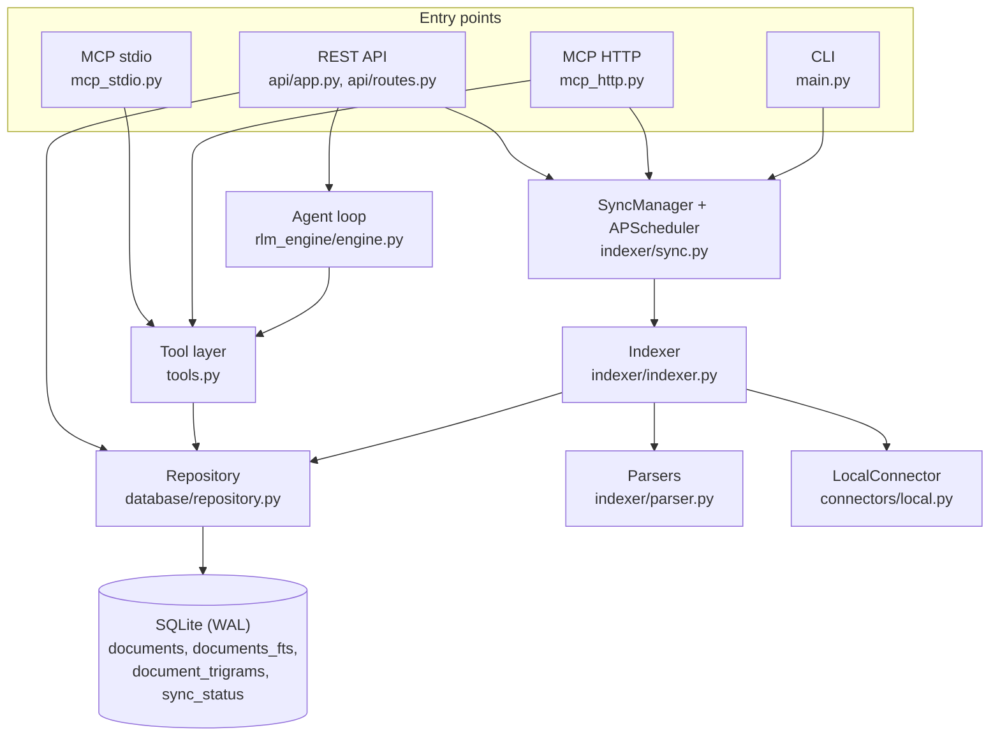
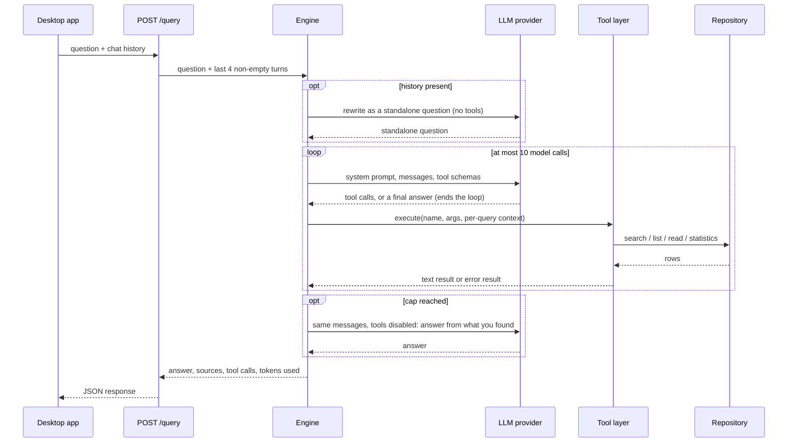

# Architecture

This document describes how RootMind is put together, which guardrails the
agent loop has, and which trade-offs were made. Paths are relative to
`backend/src/rootmind/` unless they start with `backend/` or `desktop/`.

- [Components](#components)
- [Deployments](#deployments)
- [Packaging](#packaging)
- [The agent loop](#the-agent-loop)
- [The tool layer](#the-tool-layer)
- [Retrieval and indexing](#retrieval-and-indexing)
- [Data model](#data-model)
- [Configuration](#configuration)
- [REST API](#rest-api)
- [Desktop app](#desktop-app)
- [Testing and evals](#testing-and-evals)
- [Design decisions](#design-decisions)
- [How this would map to a server deployment](#how-this-would-map-to-a-server-deployment)
- [Known gaps and next steps](#known-gaps-and-next-steps)

## Components



| Component | Code | Responsibility |
|---|---|---|
| Connector | `connectors/local.py` | Walks one folder, applies include and exclude patterns, reads files, computes a SHA-256 per file, keeps every resolved path inside the folder root, never follows links or junctions out of it, and raises when the folder is unreachable |
| Parsers | `indexer/parser.py` | Extract text per file extension; insert `[Page N]`, `=== Slide N ===` and `=== Sheet: Name ===` markers |
| Indexer | `indexer/indexer.py` | Skips unchanged files by hash, enforces the size limit, stores text and records parse errors per file; reports each file as indexed, skipped or error |
| Sync manager | `indexer/sync.py` | Full and incremental syncs, one at a time per database; the background schedule; pruning of removed folders |
| Repository | `database/repository.py`, `database/models.py` | SQLite schema, FTS5 search, trigram fuzzy search, windowed reads, location lookup |
| Tool layer | `tools.py` | The five read-only tools: schemas, argument validation, execution, result formatting |
| Agent loop | `rlm_engine/engine.py` | Provider adapters, the bounded tool loop, condensing follow-up questions, sources |
| REST API | `api/app.py`, `api/routes.py` | Localhost API for the desktop app; config hot reload |
| MCP servers | `mcp_stdio.py`, `mcp_http.py` | The same tools for external MCP clients |
| Desktop app | `desktop/` | Tauri 2 UI; a pure client of the REST API |

## Deployments

**From source.** `uv run rootmind api` runs the REST API and the background
indexer in one process. `uv run rootmind index` runs one incremental sync
(`--full` for a full one) and exits. Config and database live under
`RLM_HOME`, or the working directory when it is unset.

**Windows installer and service (experimental).** The full installer (see
[Packaging](#packaging)) installs the desktop app per machine, plus
`rootmind-backend.exe` (a PyInstaller build of the REST API), the service
scripts and NSSM. An NSIS post-install hook runs
`backend/deploy/windows/_service-backend.ps1 -Install`, which registers the
service `RootMind-Backend`:

- runs as LocalSystem and starts with Windows, so indexing continues while the
  desktop app is closed;
- binds to `127.0.0.1:8000`;
- `RLM_HOME` is `%ProgramData%\RootMind` (`config.yaml`, `data\index.db`,
  `logs\backend-service.log`, rotated at 10 MB). The install step removes
  inherited permissions from that folder and grants access to SYSTEM and
  Administrators only;
- on upgrade, a pre-install hook stops and removes the old service so the
  executable is not locked; uninstall removes the service.

Because the service runs as LocalSystem and its REST API has no
authentication, any local process can point it at a folder it cannot read
itself (see [SECURITY.md](SECURITY.md)). The service setup is therefore
marked experimental and meant for single-user machines. RootMind's own data
folder is never indexed. The install step refuses to register the service
when anything it would run as SYSTEM (executable, NSSM, Python, checkout) is
writable by non-administrators, or when the data folder was created by
someone else or contains links.

The desktop app stores its chat history per user in
`%APPDATA%\io.github.cgaeking.rootmind\conversations`. Without the installer,
`backend/deploy/windows/install-backend-service.bat` installs the same service
from a source checkout (see
[backend/deploy/windows/README.md](backend/deploy/windows/README.md)).

**MCP over stdio.** The MCP client starts `rootmind-mcp` as a child process.
It never indexes; apart from creating the schema in a new database, it only
reads. SQLite runs in WAL mode, so it can read while another process (the
REST API or `rootmind index`) writes.

**MCP over HTTP.** `rootmind-mcp-http` is a separate process on
`127.0.0.1:3000`. Like the stdio server it only serves by default.
`--index` also runs the background indexer there; use it only when no REST
API indexes the same database. Each indexing process prunes the folders
missing from its own copy of the config, so two of them with different
configs would keep deleting each other's folders.

Both MCP servers read the list of configured folders (which the tools may
return documents from) at startup; restart them after changing folders.

The PyInstaller executable contains the REST API and the CLI, but not the MCP
servers; those run from a source checkout. Because the service's data folder
is restricted to SYSTEM and Administrators, an MCP server running as a normal
user cannot use the service's index; give it its own `RLM_HOME`.

## Packaging

The app-only installer needs nothing but the desktop toolchain:

```bash
cd desktop
pnpm install
pnpm tauri build          # per-user NSIS installer; the backend is not included
```

The full installer bundles the backend and installs the Windows service. Build
it on Windows in this order:

```powershell
# 1. Backend executable -> backend/dist/rootmind-backend.exe
cd backend
uv run --group build pyinstaller packaging/rootmind-backend.spec --noconfirm --clean --distpath dist

# 2. NSSM, checked against a pinned SHA-256 -> backend/deploy/windows/tools/nssm.exe
powershell -ExecutionPolicy Bypass -File deploy\windows\fetch-nssm.ps1

# 3. Installer with the overlay config (resources, per-machine install, service hooks)
cd ..\desktop
pnpm install
pnpm tauri build --config src-tauri/tauri.installer.conf.json
```

`desktop/src-tauri/tauri.installer.conf.json` adds the backend files as
resources and enables the hooks in `desktop/src-tauri/installer/hooks.nsh`.
Set `VITE_APP_LANG=de` before step 3 to build the German UI. The versions in
`backend/pyproject.toml`, `desktop/package.json` and
`desktop/src-tauri/Cargo.toml` must match; `scripts/check_versions.py`
checks that in the backend workflow, and the desktop workflow checks the
latter two against the tag. Installers are not code-signed.

The PyInstaller build (with a smoke test of the executable) and the NSSM hash
check of an existing copy have been run locally. The NSSM download, the
overlay build and its service hooks have not yet been verified end to end in
this repository; the full installer is experimental (see
[Deployments](#deployments)).

## The agent loop

`KnowledgeBaseEngine.query(question, history=None)` in `rlm_engine/engine.py`.



**Provider adapters.** Two loops share the tool layer:

- `_loop_anthropic` uses the Messages API with native tool use. The assistant
  turn is appended unchanged, because the API expects its `tool_use` blocks
  back exactly as sent. Tool results go back in one user turn, with
  `is_error: true` on failures.
- `_loop_openai` uses Chat Completions and serves both OpenAI and xAI; xAI is
  the same SDK with `base_url` set to xAI's OpenAI-compatible endpoint. Tool
  arguments arrive as JSON strings and are parsed by the tool layer. Chat
  Completions has no error flag on tool messages, so error results start with
  `Error:`. `_openai_chat_create` handles two known parameter quirks of newer
  models by retrying once with the parameter the error message names
  (`max_completion_tokens` instead of `max_tokens`, and an explicit
  `reasoning_effort`); any other error is raised.

**Condense step.** Follow-up questions such as "And its warranty?" are first
rewritten into a standalone question by one cheap, tool-less call. Only the
rewritten question enters the tool loop, so the cost per loop iteration does
not grow with the chat length. If condensing fails, the original question is
used. The REST API keeps only the last four non-empty turns of the history it
receives.

**Stop conditions.**

- Anthropic: any `stop_reason` other than `tool_use` is final (`end_turn`,
  `max_tokens`, `stop_sequence`, `refusal`, `pause_turn`). A response without
  any `tool_use` block is final as well. The loop never sends an empty user
  turn.
- OpenAI-compatible: a message without `tool_calls` is final.
- A final response without text is reported as "the model stopped without
  producing an answer", with the stop reason (`finish_reason` on
  OpenAI-compatible APIs, e.g. `content_filter`).
- An answer cut off by the output token limit (`max_tokens`, or `length` on
  OpenAI-compatible APIs) is returned with a note that it was cut off.
- The response lists why each LLM call stopped (`stop_reasons`), so the live
  evals can show truncation.

**Guardrails.**

| Guardrail | Value | Where |
|---|---|---|
| Model calls that may use tools | 10 (`DEFAULT_MAX_ITERATIONS`) | `engine.py` |
| After the cap | One more call with tools declared but disabled (`tool_choice` none) and a prompt to answer from what was found; if that fails, a fixed message | `engine.py` |
| Tool calls per model turn | 8 (`MAX_TOOL_CALLS_PER_TURN`); further calls in the same turn get an error result and do not run | `engine.py` |
| Tool output per question | 200,000 characters (`MAX_TOOL_RESULT_CHARS`); after that, tool calls get an error result asking the model to answer | `engine.py` |
| Timeout per LLM request | `llm.timeout_seconds`, default 120 s, passed to the SDK client with 1 retry (`LLM_MAX_RETRIES`); timeouts become `LLMTimeoutError` (REST: 504), other provider errors `LLMProviderError` (502) with a short message | `engine.py`, `api/routes.py` |
| Missing API key | `LLMConfigError` before any call (REST: 400) | `engine.py` |
| Blocking calls | LLM and SQLite calls run in worker threads (`asyncio.to_thread`), so one long question does not block the API | `engine.py` |
| Output tokens | 16,000 per loop call, 8,000 for the fallback, 2,000 for condensing, 1,000 for titles; thinking tokens of reasoning models count against these | `engine.py` |
| Request size | Question up to 10,000 characters; history turns are cut to 2,000 characters each for the condense step | `api/routes.py`, `engine.py` |
| Read window | At most 50,000 characters per `read_document` call, also when only `start_char` is given | `tools.py` |
| Result limits | Search 1 to 50 results (default 10), list 1 to 200 (default 50), fuzzy similarity 0.1 to 1.0; out-of-range values are clamped | `tools.py` |
| Invalid arguments | Wrong types, negative or inverted windows and malformed JSON become error results the model can read and correct | `tools.py` |
| Per-question state | A fresh `ToolContext` per question, so concurrent questions never share sources | `tools.py`, `engine.py` |
| Folder scope | Tools only return documents of folders in the current config | `tools.py` |
| Injection framing | Document text is wrapped in `<document>` and `<snippet>` tags; tag-like text inside (any letter case, opening or closing) is escaped, file names in result headers are kept to one line without tags, and the system prompt says to treat it as data | `tools.py`, `engine.py` |

There is no overall time budget per question. In the worst case, a question
makes 12 sequential LLM calls (condense, 10 loop calls, fallback), each of
which can take `timeout_seconds` x 2 (one retry). The desktop app gives up
after 15 minutes.

**Tool errors.** `tools.execute` never raises. Unknown tools, invalid
arguments and exceptions inside the repository become error results, and the
loop continues; the model usually corrects itself on the next turn. Only
provider errors (and timeouts) end a question with an error.

**Sources.** The engine records every search hit (document, position, page)
and every read window in the `ToolContext`:

- Documents the model read are the sources. The cited location is the page,
  slide or sheet of a search hit that lies inside the window that was read.
  The suggested read window starts up to 3,000 characters before the hit, so
  the window start would often be the previous page. Without such a hit, the
  location of the window start is cited; a read from the beginning of a
  document cites no location.
- If the model only searched or listed, the surfaced documents are used
  instead, preferring those whose file name appears in the answer (at most
  30).

## The tool layer

`tools.py` is the single registry. `TOOLS` holds the schemas in Anthropic
format; `openai_tools()` and `mcp_tools()` derive the other two formats from
it, and a test asserts that the agent loop, MCP stdio and MCP HTTP expose
identical tools. An import-time check makes sure every schema has exactly one
executor.

| Tool | Purpose |
|---|---|
| `search_documents` | FTS5 search. Returns file name, id, type, size, location, a snippet, and for each hit a suggested `read_document` window (3,000 characters before, 1,000 after) |
| `search_fuzzy` | Trigram search for misspelled terms |
| `list_documents` | Metadata only, optionally filtered by file type or a file-name substring |
| `read_document` | The text of a document or a character window of it, with a hint where to continue |
| `get_statistics` | Counts, file types, total size |

All tools are read-only. None of them writes, deletes, runs commands or makes
network requests. That bounds what a successful prompt injection can make the
agent do (see [SECURITY.md](SECURITY.md)). Document text inside the
`<document>` and `<snippet>` wrappers is escaped so that it cannot open or
close a wrapper tag, in any letter case. Error results always start with
`Error:`, because Chat Completions has no error flag on tool messages.

## Retrieval and indexing

**FTS5 index.** `documents_fts` is a standalone FTS5 table with the columns
`doc_id` (unindexed), `file_name` and `content`, using the `unicode61`
tokenizer with `remove_diacritics 0`. Query text is reduced to word
characters, spaces and hyphens, and every remaining term is quoted, so FTS5
operators such as `AND`, `NEAR` or `*` in a user query are matched literally
and malformed queries never reach SQLite as syntax.

**Search strategies.** `search_fulltext` runs several MATCH queries from
precise to broad, each with a weight: the exact phrase for multi-word queries
(3.0), all terms (2.5), all terms as prefixes (2.0), any term as a prefix
(1.0), and each term as a file-name prefix (0.5). A document's score is its
best weighted BM25 score. Each strategy ranks a fixed 1,000 candidates,
independent of the requested limit, so a larger limit only appends results.
The desktop's "load more" depends on that. Snippets are computed afterwards
for the returned results only, each from the most precise strategy that found
the document.

**Positions and locations.** For each hit, the repository looks up the
character position of the search phrase in the stored text, exact first and
then case-insensitive. The position feeds the suggested read window. The
location label is the last page, slide or sheet marker before that position.
Plain text, Markdown and DOCX have no markers and get no location.

**Fuzzy search.** `document_trigrams` stores trigrams of each file name and of
the first 1,000 distinct words (in document order) from the first 50,000
characters of each document. Similarity is the share of the query's trigrams
that a document contains; status, folder and type filters run in SQL before
the limit. It helps with typos ("lantren" finds "lantern"), not with synonyms.

**Indexing.** A sync lists the files of each folder and hashes each file
(SHA-256). An incremental sync skips files whose hash is unchanged; a full
sync parses everything again. Files are processed one after another in the
sync's worker thread. New or changed files are parsed and stored; files over
`max_file_size_mb` (default 50) are recorded as skipped, and files that fail
to parse are recorded with an error message while the sync continues. The
page count of PDFs and the slide count of presentations come from the
parser's markers. Both kinds of sync remove files that disappeared and
documents of folders that are no longer configured. A folder that cannot be
listed (an unplugged drive, an offline share) raises instead of looking
empty: its index is kept and the error is shown in its sync status. Deletes
run in batches of 500 ids across the documents, FTS and trigram tables.
Text files are decoded as UTF-8, UTF-16 only with a byte order mark, then
Windows-1252, then Latin-1.

**Concurrency and scheduling.**

- Only one sync runs at a time per database file. The "running" flag and its
  lock belong to the database, not to a `SyncManager`, so the manager that a
  config reload creates still sees a sync of the replaced one. A second
  `POST /index/refresh` gets 409, and a scheduled run is skipped.
- Syncs run in their own worker thread, so `/health` and the rest of the API
  stay responsive during indexing. `/index/progress` reports the running sync.
- The scheduler (APScheduler) runs an incremental sync about 30 seconds after
  start, then every `sync_interval_hours`, or on the cron expression in
  `sync_schedule` when the interval is 0.
- `RLM_DISABLE_SCHEDULER` turns this off for processes that should only serve.

**Config hot reload.** `POST /config` validates the merged config, writes
`config.yaml` atomically (temporary file, then rename; a `.bak` of the
previous file; owner-only on Linux and macOS) and rebuilds the
config-dependent state: connectors, indexer, sync manager, scheduler and
engine. Saves are serialized. The new state is built completely before it
replaces the old one; if that fails, the old state keeps running and the
response says a restart is needed. Documents of folders that were removed
from the config are pruned right away. A running sync is cancelled at the
next file when the folders or indexer settings changed. The old LLM client is
not closed, because a question that is still running may be using it. Fields
the client leaves out keep their stored values.

## Data model

| Table | Content |
|---|---|
| `documents` | One row per file: id (shortened SHA-256 of connector name and relative path), connector name, relative path, file name and type, size, timestamps, content hash, **full extracted text**, length, status (for example `indexed`, `skipped` or `error`) and error message |
| `documents_fts` | FTS5 index over file name and **full text** (it stores its own copy) |
| `document_trigrams` | Trigrams per document, from file name and content |
| `sync_status` | Last sync times and counts per folder |

The database holds the full text of every indexed file, twice. Treat
`index.db` like the documents themselves: anyone who can read the file can
read the text of everything indexed.

## Configuration

`config.yaml` is loaded from `RLM_HOME`, or from the working directory when
`RLM_HOME` is unset. Start from
[`backend/config.example.yaml`](backend/config.example.yaml); it documents
each field. Sections:

- `llm`: `provider` (`anthropic`, `openai` or `xai`), `model`,
  `timeout_seconds`, and optionally `api_keys` per provider. Keys saved through
  the desktop app are stored here in plain text.
- `database.path`: relative paths resolve against `RLM_HOME` or the working
  directory.
- `connectors`: one entry per folder (`name`, `type: local`, `path`, optional
  `include` and `exclude`). Relative folder paths resolve against the working
  directory, so use absolute paths.
- `indexer`: schedule, size limit, global include and exclude patterns.
- `api`: host and port for `rootmind` without a subcommand.

| Environment variable | Used by | Effect |
|---|---|---|
| `ANTHROPIC_API_KEY`, `OPENAI_API_KEY`, `XAI_API_KEY` | backend | Provider keys, used when `config.yaml` has no key for that provider. Also read from a `.env` file in the working directory |
| `CONFIG_PATH` | MCP servers | Config file when `--config` is not given (the `rootmind` CLI always defaults to `config.yaml`). Also read from `.env` |
| `RLM_HOME` | all backend processes | Folder for `config.yaml` and `data/`; created if missing. Never indexed itself |
| `RLM_DISABLE_SCHEDULER` | REST API | Serve only; never index in this process (the MCP servers serve only unless started with `--index`) |
| `RLM_DEV` | REST API | Also allow the Vite dev server origins (`localhost:1420`) for `pnpm tauri dev` |
| `MCP_API_TOKEN` | MCP HTTP | Bearer token. If set but empty, the server refuses to start |
| `MCP_ALLOWED_ORIGINS` | MCP HTTP | Extra browser origins to accept, comma-separated |
| `MCP_HTTP_HOST`, `MCP_HTTP_PORT` | MCP HTTP | Bind address, default `127.0.0.1:3000` |
| `RLM_HOST`, `RLM_PORT` | `rootmind-backend.exe` | Bind address when the executable starts without arguments, default `127.0.0.1:8000` |
| `VITE_APP_LANG` | desktop build | `de` builds the German UI; English is the default |

## REST API

FastAPI app on `127.0.0.1:8000`; OpenAPI docs at `/docs`. The desktop app
uses a subset of these endpoints (see `desktop/src/api/rlm.ts`). Requests from
non-loopback addresses get 403.

| Endpoint | Purpose |
|---|---|
| `GET /`, `GET /health` | Name and version; liveness |
| `GET /status`, `GET /statistics` | Sync status and document counts |
| `GET /documents`, `GET /documents/{id}` | Paged document list (limit 1 to 1,000, offset), metadata |
| `GET /documents/{id}/content` | Text, optionally a `start`/`end` range |
| `GET /documents/{id}/path` | Absolute path for opening the file, resolved through the folder's connector (so it cannot leave the folder) |
| `POST /search`, `GET /search` | Full-text search (limit 1 to 1,000 and 1 to 100); `with_snippets` / `snippets=true` adds snippets, hit positions and pages |
| `POST /index/refresh` | Start an incremental or full sync in the background; 409 if one is running, 404 for an unknown folder |
| `GET /index/status`, `GET /index/progress`, `GET /index/recent` | Sync progress and recently indexed files |
| `GET /connectors`, `GET /connectors/{name}` | Configured folders and their status |
| `POST /query` | Ask a question (the agent loop). Returns `answer`, `sources` (with `page`), `tool_calls`, `tokens_used`, `stop_reasons`. 400 without an API key, 422 for an empty or oversized question, 502 for provider errors, 504 on LLM timeout |
| `POST /chat/title` | Short title for a conversation (one LLM call); same error codes |
| `GET /config`, `POST /config` | Editable config with masked API keys; save and hot reload |
| `POST /llm/models` | Model list from the provider, using the key in the request or the stored key; 502 or 504 when the provider fails |

The API has no authentication. How it is protected, and what remains open, is
described in [SECURITY.md](SECURITY.md).

## Desktop app

- **A pure REST client.** The React app (`desktop/src/`) calls the backend
  through a small typed client (`src/api/client.ts`, `src/api/rlm.ts`,
  `src/types/`) with a 15-second default timeout per request and 15 minutes
  for questions. It never starts or stops the backend. The backend URL is
  configurable, but the CSP only allows `localhost` and `127.0.0.1`.
- **Connection state.** A heartbeat checks `/health` every 5 seconds. When the
  backend is unreachable, a modal explains how to start it.
- **Screens.** Chat (with sources that open the file or reveal it in
  Explorer), folders, settings (provider, model, keys, schedule) and status.
- **Rust side.** `src-tauri/src/conversations.rs` stores each conversation as
  a JSON file in the app data folder. Every command that takes a conversation
  id validates it with `safe_id` (ASCII letters, digits, `-` and `_`, at most
  100 characters), so an id cannot escape that folder.
- **Permissions.** `src-tauri/capabilities/default.json` grants only what the
  UI uses. Opening files is limited to the document types the backend indexes;
  `src-tauri/tests/opener_scope.rs` checks this against `parser.py`.
- **Language.** Labels are selected at build time (`src/i18n/`); English is
  the default and `VITE_APP_LANG=de` builds German. There is no runtime
  switch.

## Testing and evals

**Unit and integration tests** (`backend/tests/`):

- Offline by construction. An autouse fixture replaces the Anthropic and
  OpenAI client constructors with functions that raise, removes API keys, and
  gives every test its own `RLM_HOME` and working directory, so a developer's
  `.env` or `config.yaml` is never read.
- The engine takes an optional `client`. Tests pass `FakeAnthropic` or
  `FakeOpenAI` from `tests/fakes.py`: a script of responses, exceptions or
  callables, with every call's arguments recorded. That makes the loop
  deterministic: tests assert on the exact messages sent, the number of calls,
  `tool_choice` on the fallback call, and the sources.
- API tests use FastAPI's `TestClient` with the real lifespan. MCP tests drive
  the stdio server through the official MCP client in-process and the HTTP
  server through `TestClient`.
- A small corpus with one file per format (PDF with two pages, XLSX with two
  sheets, PPTX with three slides, DOCX, CSV, Markdown, text) is generated for
  the tests.
- Bugs found by the tests have regression tests, for example ranking that
  changed with the page size, a partial `POST /config` that removed stored
  keys and folders, and citations that pointed one page early.

**Evals** (`backend/evals/`, `backend/scripts/run_evals.py`) measure the agent
on a fictional corpus with known answers. Live mode is the eval: it runs a
real model, repeats each case and reports pass rate and consistency (distinct
tool paths and source sets). Dry mode is a retrieval regression test for CI:
a scripted policy with a hand-written query per case stands in for the model,
so it checks the index and the tool layer, not the agent's decisions. See
[backend/evals/README.md](backend/evals/README.md).

**Desktop:** ESLint, the TypeScript compiler, `cargo clippy`, and Rust tests
for `safe_id` and the file-opening scope. There are no UI tests.

## Design decisions

**Full-text search plus an agent instead of embeddings.** Exact terms, codes
and numbers are matched exactly, indexing is cheap and local, and every
retrieval step is visible. The cost is more LLM round trips per question and
no synonym matching; the README has the trade-off table. The repository class
is the seam for a different retrieval backend.

**An unauthenticated REST API on localhost.** The desktop app and the backend
run on the same machine for the same user. A token would have to be stored
where the same user (and any process of theirs) could read it anyway. Instead,
the API binds to 127.0.0.1, refuses non-loopback peers and checks `Host` and
`Origin`. The consequence is the single-user assumption described in
[SECURITY.md](SECURITY.md); it is also why the LocalSystem service setup is
experimental.

**Bearer token for MCP HTTP.** That server exists for clients that cannot
start a local process, possibly on other machines behind a tunnel, so it
requires a token from the start and fails closed without one.

**A hand-written MCP HTTP transport.** `mcp_http.py` implements the JSON-RPC
methods it needs on FastAPI (JSON responses on `POST /mcp`, plus the older SSE
transport for clients that still use it). It is small and covered by tests,
and the MCP Python SDK's streamable HTTP client works with it, but it does not
cover the whole streamable HTTP specification (no server-sent event
stream on `GET /mcp`, no sessions, no batches). The stdio server uses the
official MCP SDK.

**Build-time i18n.** Two label files with identical keys and a build switch
keep every component free of language state. Switching languages means a
separate build.

**NSSM for the Windows service.** A Python process cannot be a Windows service
without extra code. NSSM wraps the existing executable, handles log rotation,
and is fetched at build time with a pinned hash.

## How this would map to a server deployment

RootMind is a single-user desktop tool. Running the same design as a shared
service would need:

- **Auth on every API**, per-user identity, and authorization on folders and
  documents. Today the folder scope is "everything in the config".
- **A server database.** The repository is the seam: PostgreSQL full-text
  search (`tsvector`, `ts_rank`) can replace FTS5, `pg_trgm` can replace the
  trigram table, and `pgvector` could add hybrid retrieval next to it. The
  tool layer and the agent loop only call repository methods, so they would
  not need to change.
- **A job queue** for indexing instead of the in-process scheduler, with
  workers that parse untrusted files in a sandbox.
- **Per-question budgets** in tokens and wall-clock time (tool calls and tool
  output are already capped), and tracing of each loop iteration.
- **Streaming** of partial answers and tool steps to the client.

## Known gaps and next steps

- The text of each document is stored twice (documents table and FTS table).
- Incremental syncs hash every file, including unchanged and oversized files.
- Files are parsed one after another; there is no parallel indexing.
- No OCR, no streaming, no total time or token budget per question.
- MCP servers read the folder list at startup and need a restart after
  folder changes.
- The REST API has no authentication, which makes the LocalSystem service
  setup unsafe on shared machines. A per-user backend (started at logon or by
  the desktop app) or a bearer token kept in an owner-only file would remove
  that limitation.
- The MCP HTTP transport could move to the official SDK's streamable HTTP app.
- The full installer path needs an end-to-end test and code signing.
