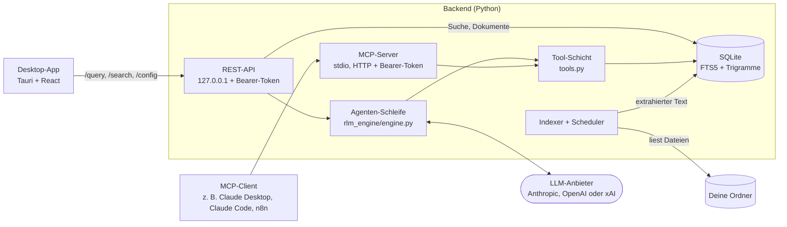

<p align="center">
  
</p>

# RootMind

[English](README.md) | **Deutsch**

[](https://github.com/cgaeking/rootmind/releases/latest)
[](https://github.com/cgaeking/rootmind/actions/workflows/backend.yml?query=branch%3Amain)
[](https://github.com/cgaeking/rootmind/actions/workflows/desktop.yml?query=branch%3Amain)
[](LICENSE)
[](#installation)
[](https://github.com/cgaeking/rootmind/releases)

[Installation](#installation) · [MCP-Clients verbinden](#mcp-clients-verbinden) · [So funktioniert es](#so-funktioniert-es) · [Warum eine Tool-Schleife](#warum-eine-tool-schleife-statt-embedding-rag) · [Sicherheit](#sicherheitsmodell-in-kürze) · [Einschränkungen](#einschränkungen)

**Stell deinen Dokumenten eine Frage. Du bekommst die Antwort mit der Seite, aus der sie stammt.**

RootMind indiziert die Ordner, die du auswählst, auf deinem eigenen Rechner
(PDF, Word, Excel, PowerPoint, CSV, Markdown und Textdateien). Wenn du eine
Frage stellst, durchsucht ein Sprachmodell diesen Index und liest die
Textstellen, die es anfordert. Die Antwort nennt ihre Quellen bis hinunter zu
Seite, Folie oder Tabellenblatt. Es gibt kein Embedding-Modell und keine
Vektordatenbank: Die Indizierung ist eine einfache Volltextsuche in SQLite,
und das Modell steuert die Suche.

https://github.com/user-attachments/assets/d3cc0249-a550-4de5-ae6b-55c1291a282f

- **Antworten mit Quellen.** Jede Antwort nennt ihre Dateien und, wo es sich
  bestimmen lässt, Seite, Folie oder Tabellenblatt.
- **Deine Dateien bleiben auf deinem Rechner.** Indizierung und Suche laufen
  lokal und brauchen weder ein LLM noch einen API-Key. Beim Beantworten einer
  Frage gehen die Frage und die Auszüge, die das Modell liest, an den von dir
  konfigurierten Anbieter (Anthropic, OpenAI oder xAI). Mit einem lokalen
  [Ollama](https://ollama.com)-Server als Anbieter verlässt nichts deinen Rechner
  (siehe [Lokale Modelle mit Ollama](#lokale-modelle-mit-ollama)).
- **Es liest gezielt, es kippt nicht alles hinein.** Statt ganze Dokumente in
  einen Chat zu kopieren, sucht das Modell und liest gezielte Ausschnitte;
  jeder Schritt ist ein sichtbarer Tool-Aufruf. Der Preis sind mehr
  Modellaufrufe als bei klassischem RAG, siehe
  [Warum eine Tool-Schleife statt Embedding-RAG](#warum-eine-tool-schleife-statt-embedding-rag).
- **Aus deinen anderen Werkzeugen nutzbar.** Dieselben lesenden Tools stehen
  über MCP bereit, für Claude Desktop, Claude Code, n8n und andere Agenten.
- **Windows und Linux.** Die Desktop-App gibt es auf Deutsch und Englisch; die
  Lizenz ist MIT.

### In wenigen Minuten ausprobieren

1. Lade
   **[RootMind-Setup-x64.exe](https://github.com/cgaeking/rootmind/releases/latest/download/RootMind-Setup-x64.exe)**
   (Windows 10 oder 11) oder das [.deb, .rpm oder AppImage](#installation-unter-linux)
   (Linux) herunter.
2. Starte RootMind und füge unter **Ordner** einen Ordner mit deinen Dokumenten
   hinzu.
3. Öffne **Chat**, hake **Nur Suche** an und such los. Dafür ist kein API-Key
   nötig. Für Antworten trägst du unter **Einstellungen** einen Key ein und
   nimmst den Haken bei **Nur Suche** wieder heraus.

Der [Schnellstart](docs/QUICKSTART.de.md) hat die Details.

## Was es ist

Das Repository hat zwei Teile:

- **Backend** (Python, FastAPI): Indexer, Volltextsuche, die Agenten-Schleife,
  eine REST-API auf localhost und MCP-Server über stdio und HTTP.
- **Desktop-App** (Tauri 2 mit React und TypeScript, dazu eine Rust-Shell):
  eine Chat- und Suchoberfläche für Windows und Linux, auf Deutsch und
  Englisch. Unter Windows richtet ihr Installer das Backend als Windows-Dienst
  ein, unter Linux richtet die App es als systemd-Benutzerdienste deines
  Kontos ein. Die App spricht mit diesem Dienst.

> **Status:** Dies ist ein persönliches Projekt. Es wird nicht kommerziell
> gepflegt, und es gibt keine Support-Zusage. Issues und Pull Requests sind
> willkommen und werden nach bestem Bemühen beantwortet.

## Installation

Jedes [Release](https://github.com/cgaeking/rootmind/releases/latest) enthält
diese Downloads für Windows (x64); die Linux-Pakete beschreibt
[Installation unter Linux](#installation-unter-linux):

- **[RootMind-Setup-x64.exe](https://github.com/cgaeking/rootmind/releases/latest/download/RootMind-Setup-x64.exe)**,
  für die meisten, unter Windows 10 oder 11: die Desktop-App und ihr
  Windows-Dienst. Starte die Datei und bestätige die Administrator-Abfrage
  einmal; Python ist nicht nötig. Sie installiert die App nach
  `%ProgramFiles%\RootMind` und richtet den
  [RootMind-Dienst](#der-rootmind-dienst) für das Konto ein, das bei Windows
  angemeldet ist.
- **[rootmind-backend-windows-x64.zip](https://github.com/cgaeking/rootmind/releases/latest/download/rootmind-backend-windows-x64.zip)**,
  für die Kommandozeile und Server: das Backend allein, ohne die App (siehe
  [Installation für Entwicklung und Server](#installation-für-entwicklung-und-server)).
- **[rootmind.mcpb](https://github.com/cgaeking/rootmind/releases/latest/download/rootmind.mcpb)**,
  RootMind für Claude Desktop, nach der App zu installieren (siehe
  [RootMind in Claude Desktop nutzen](#rootmind-in-claude-desktop-nutzen)).

Zur Installation brauchst du ein Administratorkonto. Der Dienst gehört dem
Konto, das RootMind nutzt, deshalb richtet der Installer ihn nur ein, wenn er
als das bei Windows angemeldete Konto läuft. Der Installationsordner ist immer
`%ProgramFiles%\RootMind`, ein Ordner, den nur Administratoren ändern können;
einen anderen (etwa mit `/D=`) lehnt der Installer mit Exit-Code 10 ab.

**Stille und verwaltete Installationen.** winget, Intune, Configuration
Manager und ähnliche Werkzeuge führen den Installer oft still (`/S`) als
SYSTEM aus. Dann, und wenn ein Administrator die Abfrage bestätigt, während
ein anderes Konto angemeldet ist, installiert der Installer die App, aber
nicht den Dienst, und endet mit 0. Der Dienst wird eingerichtet, wenn das
Konto, das RootMind nutzt, die App zum ersten Mal öffnet: RootMind meldet „Der
RootMind-Dienst ist noch nicht eingerichtet“, und **Einrichten** richtet ihn
mit einer Bestätigung als Administrator für dieses Konto ein. Ein
Standardkonto kann ihn nicht einrichten; dafür braucht es ein
Administratorkonto, das RootMind selbst nutzt. Konnte der Installer den
Dienst aus einem anderen Grund nicht einrichten, endet er ebenfalls mit 0, und
RootMind zeigt das Problem und **Reparieren**. Das Ergebnis steht im
Deinstallationseintrag `HKLM\Software\Microsoft\Windows\CurrentVersion\Uninstall\RootMind`
(`RootMindServiceSetup`: `installed`, `skipped` oder `failed`, dazu
`RootMindServiceSetupReason` und bei einem Fehler `RootMindServiceSetupCode`).
Updates, die als SYSTEM laufen, aktualisieren einen vorhandenen Dienst an Ort
und Stelle.

Der Installer ist noch nicht codesigniert. Windows SmartScreen zeigt eventuell
„Der Computer wurde durch Windows geschützt“: Wähle **Weitere Informationen**
und dann **Trotzdem ausführen**. Ist Smart App Control aktiv, blockiert es den
Installer oder das Programm des RootMind-Dienstes eventuell ohne diese Wahl.
Smart App Control kennt keine Ausnahme für eine einzelne App; signierte
Releases, die geplant sind, vermeiden das (siehe die
[Code-Signing-Richtlinie](CODE_SIGNING.md), englisch).

Starte danach RootMind und füge unter **Ordner** einen Ordner hinzu. Die
Indizierung beginnt innerhalb etwa einer Minute, und die Suche funktioniert
ohne API-Key, sobald der Ordner indiziert ist. Um Fragen zu stellen, trage
unter **Einstellungen** einen API-Key für Anthropic, OpenAI oder xAI ein oder wähle **Ollama** für ein lokales Modell, und
speichere ihn. Der Dienst hält den Index aktuell, auch während die App
geschlossen ist.

Die App folgt der Anzeigesprache von Windows (Deutsch oder Englisch);
Einstellungen → **Darstellung** → **Sprache** stellt sie um. Die Namen aus der
Oberfläche stehen in dieser README so, wie die deutsche Oberfläche sie zeigt.
Einstellungen → **Über RootMind** zeigt die Versionen von App und Backend und
verlinkt Releases und Issues.

### Installation unter Linux

Jedes Release enthält auch die App für Linux auf x86-64 mit glibc 2.35 oder
neuer (Ubuntu 22.04, Debian 12, Fedora 38, openSUSE Tumbleweed und neuer).
Wähle das Paket für deine Distribution:

| Distribution | Download | Installation |
| --- | --- | --- |
| Ubuntu, Debian und Ableger | [RootMind-amd64.deb](https://github.com/cgaeking/rootmind/releases/latest/download/RootMind-amd64.deb) | `sudo apt install ./RootMind-amd64.deb` |
| Fedora, openSUSE Tumbleweed | [RootMind-x86_64.rpm](https://github.com/cgaeking/rootmind/releases/latest/download/RootMind-x86_64.rpm) | `sudo dnf install ./RootMind-x86_64.rpm` (openSUSE: `sudo zypper install ./RootMind-x86_64.rpm`) |
| Jede andere Distribution | [RootMind-x86_64.AppImage](https://github.com/cgaeking/rootmind/releases/latest/download/RootMind-x86_64.AppImage) | `chmod +x RootMind-x86_64.AppImage`, dann starten |

Die Pakete installieren die App und ihr Backend nach `/usr/lib/RootMind` und
ziehen WebKitGTK 4.1 nach; nur dieser Schritt braucht root. Das AppImage
braucht keine Installation; es braucht FUSE 2 (das Paket `libfuse2`, unter
Ubuntu 24.04 `libfuse2t64`). Prüfe den Download mit
`sha256sum --check --ignore-missing SHA256SUMS.txt` (siehe
[Downloads prüfen](#downloads-prüfen)).

**Starten** kannst du RootMind über das App-Menü oder im Terminal mit:

```sh
rootmind-desktop
```

Das .deb und das .rpm zeigen diesen Befehl bei der Installation an. Das
AppImage startet, wenn du die Datei ausführst.

**Windows-Subsystem für Linux.** Unter Windows 11 läuft RootMind auch in WSL,
das Fenster erscheint auf dem Windows-Desktop (WSLg). Der Dienst braucht in
WSL systemd: Trage Folgendes in `/etc/wsl.conf` ein, führe dann in Windows
`wsl --shutdown` aus und öffne die Distribution neu. Ohne systemd meldet
RootMind, dass es seinen Dienst nicht einrichten kann.

```ini
[boot]
systemd=true
```

**Was beim ersten Start passiert.** RootMind richtet seinen Hintergrunddienst
für dein Konto ein, ohne Rückfrage und ohne root: zwei
systemd-Benutzerdienste, `rootmind-backend.service` (REST-API und Indizierung)
und `rootmind-mcp-http.service` (MCP über HTTP), in
`~/.config/systemd/user/`. Sie starten eine Kopie des Backends in
`~/.local/share/rootmind/runtime/`, damit der Dienst weiterläuft, wenn das
AppImage geschlossen oder verschoben wird, und halten ihre Daten in
`~/.local/share/rootmind`. Startet eine neuere Version der App, bringt sie den
Dienst auf ihre Version. Scheitert die Einrichtung, sagt RootMind warum, und
**Einrichten** (oder **Reparieren**) versucht es erneut; Einstellungen →
**RootMind-Dienst** → **Details** zeigt den Zustand des Dienstes und das Ende
seiner `logs/install.log`. Danach fügst du wie unter Windows unter **Ordner**
einen Ordner hinzu.

Die Dienste starten, wenn du dich anmeldest, und enden mit deiner letzten
Sitzung. Damit sie auch laufen, wenn niemand angemeldet ist, zum Beispiel für
n8n auf demselben Computer, schalte einmal Lingering für dein Konto ein:

```sh
loginctl enable-linger "$USER"
```

**Aktualisieren:** Installiere das Paket der neuen Version (wie oben, oder
`sudo dnf upgrade ./RootMind-x86_64.rpm`) oder ersetze das AppImage; RootMind
aktualisiert seinen Dienst beim Start.

**Deinstallieren:** zuerst den Dienst, dann die App:

```sh
# .deb und .rpm (beim AppImage: ~/.local/share/rootmind/runtime/*/rootmind-backend)
/usr/lib/RootMind/backend/rootmind-backend service uninstall
sudo apt remove root-mind        # oder: sudo dnf remove root-mind
```

`service uninstall` hält die beiden Benutzerdienste an, entfernt sie und die
Programmkopie und behält Einstellungen, API-Keys, Index und MCP-Token in
`~/.local/share/rootmind`; `service uninstall --purge` löscht auch diese. Die
Chats liegen in `~/.local/share/io.github.cgaeking.rootmind`.

### Umstieg von 1.x

RootMind 1.x wurde pro Konto installiert und betrieb sein Backend in der App,
solange der Hintergrunddienst nicht eingeschaltet war. Der Installer von 2.0
entfernt eine 1.x-Installation deines Kontos von selbst. Ordner,
Einstellungen, API-Keys und Index des eingebauten Backends von 1.x werden
nicht übernommen: Füge deine Ordner und deinen API-Key erneut hinzu. War in
1.x der Hintergrunddienst eingeschaltet, wird er aktualisiert und behält
seine Ordner, Einstellungen und seinen Index. Die Chats bleiben in beiden
Fällen erhalten.

### Downloads prüfen

Jedes Release nennt in seinen Release Notes die Größe des Installers und
liefert `SHA256SUMS.txt` sowie eine Build-Provenance-Attestierung für jede
Datei. Der Hash muss mit der Zeile der Datei in `SHA256SUMS.txt`
übereinstimmen:

```powershell
(Get-FileHash .\RootMind-Setup-x64.exe -Algorithm SHA256).Hash.ToLower()
```

```sh
sha256sum --check --ignore-missing SHA256SUMS.txt
gh attestation verify RootMind-Setup-x64.exe --repo cgaeking/rootmind
```

### Aktualisieren und deinstallieren

Zum Aktualisieren startest du den Installer der neuen Version und bestätigst
die Abfrage. Er ersetzt die installierte Version an Ort und Stelle, ohne
weitere Rückfragen, und aktualisiert den Dienst; Ports, Tokens,
Einstellungen, Index und Chats bleiben erhalten. Läuft die App, bittet der
Installer darum, sie vorher zu schließen.

Deinstalliere RootMind über Windows-Einstellungen → Apps. Dabei werden die
RootMind-Dienste entfernt. Ihre Daten (Einstellungen, API-Keys, Index, Tokens
und Logs) bleiben in `%ProgramData%\RootMind`, außer du setzt den Haken bei
**Lösche die Anwendungsdaten** (englisch: **Delete the application data**);
dann werden sie und deine Chats ebenfalls gelöscht. Eine stille
Deinstallation (`/S`, wie Paketmanager sie ausführen) entfernt die Dienste
ebenfalls, löscht aber nie Daten. Um die Daten später zu löschen, entferne
`%ProgramData%\RootMind` in einer Eingabeaufforderung als Administrator.

### Der RootMind-Dienst

Das Backend von RootMind läuft als Windows-Dienst `RootMind-Backend`. Er hält
den Index aktuell, während die App geschlossen ist, und startet mit Windows;
die App ist ein Client dieses Dienstes. Einstellungen → **RootMind-Dienst**
zeigt seinen Zustand, seine Adresse und Version, bietet **Einrichten** an,
wenn der Dienst noch nicht eingerichtet ist (nach einer stillen oder
verwalteten Installation), und **Reparieren**, wenn er gestoppt ist oder nicht
antwortet (je eine Bestätigung als Administrator). Läuft der Dienst in einer älteren Version als die App,
bringt **Dienst aktualisieren** ihn auf die Version der App. Beides startet
das mit der App installierte Backend in `%ProgramFiles%\RootMind\backend`,
das nur Administratoren ändern können.

- Der Dienst gehört dem Konto, das RootMind installiert hat. Andere Konten
  auf demselben Computer können ihn nicht nutzen; um RootMind auf ein anderes
  Konto umzuziehen, deinstalliere es und installiere es von diesem Konto aus
  neu.
- Er läuft als LocalSystem, liest aber **nur Ordner und Dateien, die dein
  Konto ohne Administratorrechte öffnen kann**. Netzlaufwerke und Freigaben,
  Systemordner und die Profile anderer Benutzer stehen ihm nicht zur
  Verfügung, und die Ansicht **Ordner** markiert einen Ordner, den er nicht
  lesen kann.
- Seine REST-API verlangt ein Token. Das Token liegt in
  `%ProgramData%\RootMind\data\rest_token.txt`, das nur dein Konto, SYSTEM und
  Administratoren lesen können. Die App nutzt es erst, nachdem sie geprüft
  hat, dass der Prozess des Dienstes selbst auf dem Port lauscht.
- Ein zweiter Dienst, `RootMind-MCP-HTTP`, stellt MCP über HTTP auf 127.0.0.1
  mit einem eigenen Bearer-Token bereit (siehe
  [MCP-Clients verbinden](#mcp-clients-verbinden)). Er ist standardmäßig
  eingeschaltet; der Haken bei **MCP über HTTP anbieten** schaltet ihn aus und
  wieder ein (eine Bestätigung als Administrator). Darunter gibt ihm
  **Fernzugriff (ngrok)** eine öffentliche HTTPS-Adresse für
  Cloud-Assistenten (standardmäßig aus; siehe [Fernzugriff](#fernzugriff)).
- Die Dienste laufen aus einer eigenen Kopie des Programms unter
  `%ProgramFiles%\RootMind Service\`, die nur Administratoren ändern können,
  und halten ihre Daten in `%ProgramData%\RootMind`.

**Unter Linux** ist derselbe Dienst das Paar systemd-Benutzerdienste deines
Kontos (siehe [Installation unter Linux](#installation-unter-linux)), und
nichts daran braucht root oder eine Bestätigung:

- Er läuft als dein Konto und liest, was dein Konto lesen kann, eingehängte
  Netzwerkfreigaben eingeschlossen. Andere Konten auf dem Computer bekommen
  eigene Dienste (auf anderen Ports), wenn sie RootMind starten.
- Sein REST-Token liegt in `~/.local/share/rootmind/data/rest_token.txt`, das
  nur dein Konto lesen kann (Modus 0600, in Ordnern mit Modus 0700). Die App
  nutzt es erst, nachdem sie geprüft hat, dass der eigene Prozess der Unit auf
  dem Port lauscht.
- MCP über HTTP und der Fernzugriff funktionieren wie unter Windows;
  **MCP über HTTP anbieten** fügt `rootmind-mcp-http.service` ohne Rückfrage
  hinzu oder entfernt ihn.
- `systemctl --user status rootmind-backend` und
  `journalctl --user -u rootmind-backend` zeigen die Unit und ihr
  systemd-Protokoll; RootMinds eigene Logs liegen in
  `~/.local/share/rootmind/logs`.

Einstellungen → **Erweitert** verbindet die App stattdessen mit einem
RootMind-Backend unter einer anderen Adresse.
[SECURITY.md](SECURITY.md#background-service) (englisch) beschreibt das
Sicherheitsmodell.

## MCP-Clients verbinden

MCP-Clients bekommen dieselben lesenden Tools wie der Agent der App und nutzen
ihr eigenes Modell. Verbinde sie mit MCP über HTTP des Dienstes:
Einstellungen → RootMind-Dienst zeigt den **MCP-Endpunkt** und kopiert ihn
und das Token (**Token kopieren**). Für Claude Desktop gibt es ein Bundle,
das beides nicht braucht (siehe
[RootMind in Claude Desktop nutzen](#rootmind-in-claude-desktop-nutzen)).
Claude Code:

```bash
claude mcp add --transport http rootmind http://127.0.0.1:<port>/mcp \
  --header "Authorization: Bearer <token>"
```

Der Port ist 3000, wenn er frei ist, sonst einer aus 18400–18499. Das Token
bleibt über Updates hinweg erhalten, und der Server übernimmt geänderte
Ordner ohne Neustart.

### RootMind in Claude Desktop nutzen

1. Lade
   [rootmind.mcpb](https://github.com/cgaeking/rootmind/releases/latest/download/rootmind.mcpb)
   aus dem [neuesten Release](https://github.com/cgaeking/rootmind/releases/latest)
   herunter.
2. Doppelklicke die Datei. Claude Desktop öffnet sie, zeigt die Tools von
   RootMind und installiert sie, sobald du bestätigst.

Einzurichten ist nichts. Die Erweiterung findet den RootMind-Dienst auf
diesem Computer, liest dort Port und Token für MCP und verbindet sich mit MCP
über HTTP auf 127.0.0.1. Sie braucht ein installiertes RootMind mit
eingeschaltetem **MCP über HTTP anbieten** (Standard; Einstellungen →
RootMind-Dienst), und Claude Desktop muss unter dem Konto laufen, das RootMind
nutzt, denn nur dieses Konto kann das Token lesen. Unter Linux findet sie den
Dienst über `~/.local/share/rootmind/service.json`, das die Programmkopie der
Dienste nennt (kein Geheimnis). Fehlt
etwas, sagt die Fehlermeldung der Erweiterung, was zu tun ist, etwa RootMind
zu installieren oder MCP über HTTP einzuschalten; danach funktioniert die
nächste Anfrage, ohne die Erweiterung neu zu installieren. Nach einer
Reparatur folgt sie dem Dienst selbst auf einen neuen Port. Zum Aktualisieren
installierst du die `rootmind.mcpb` eines neueren Releases. Das Bundle ist
noch nicht signiert, deshalb kennzeichnet Claude Desktop es als nicht
signiert. Quelltext und Funktionsweise:
[packaging/mcpb](packaging/mcpb/README.md) (englisch).

Das Bundle steht auch in der offiziellen
[MCP Registry](https://registry.modelcontextprotocol.io) als
`io.github.cgaeking/rootmind`. Jedes Release (kein Vorabrelease) aktualisiert
den Eintrag mit seiner Download-URL und SHA-256, sodass Clients, die aus der
Registry installieren, das aktuelle Bundle bekommen.

Claude Desktop startet nur lokale (stdio-)MCP-Server; die Erweiterung ist ein
solcher Server und leitet an den HTTP-Endpunkt des Dienstes weiter. Das
Programm im Ordner der App (`rootmind-backend.exe mcp`) kann für die
installierte App nicht als stdio-Server dienen: Es kann den Index des
Dienstes nicht öffnen.
Der stdio-Server ist für eine Installation aus dem Quellcode oder mit uv und
eigener `config.yaml` gedacht (siehe
[3. Die Tools aus einem MCP-Client nutzen](#3-die-tools-aus-einem-mcp-client-nutzen)).

### MCP von n8n aus erreichen

Nutze in n8n den Knoten **MCP Client Tool** mit den Werten, die
Einstellungen → RootMind-Dienst anzeigt; **Kopieren** unter **n8n (MCP Client
Tool)** kopiert sie mitsamt Token:

| Feld | Wert |
|---|---|
| Endpoint | `http://127.0.0.1:<port>/mcp` |
| Server Transport | HTTP Streamable |
| Authentication | Header Auth |
| Header Name | `Authorization` |
| Header Value | `Bearer <token>` |

- **n8n auf demselben Rechner:** Nutze den Endpunkt wie angezeigt.
- **n8n in Docker auf demselben Rechner:** In einem Container ist `127.0.0.1`
  der Container selbst. Nutze `http://host.docker.internal:<port>/mcp`.
  Docker Desktop leitet diesen Namen an den Host weiter. Wird die Verbindung
  abgelehnt, betreibe auf dem Host einen Reverse Proxy, der auf einer Adresse
  lauscht, die der Container erreicht, und an `127.0.0.1:<port>` weiterleitet,
  und halte diese Adresse für andere Rechner geschlossen.
- **n8n auf einem anderen Rechner:** nur über einen Reverse Proxy mit
  TLS-Terminierung oder einen Tunnel (etwa den [Fernzugriff](#fernzugriff))
  vor `127.0.0.1:<port>`. Gib den
  unverschlüsselten HTTP-Port nie frei: Der Server spricht reines HTTP, und
  wer das Token hat, kann jedes indizierte Dokument lesen. Siehe
  [RootMind aus Cloud-Assistenten erreichen](#rootmind-aus-cloud-assistenten-erreichen).

### RootMind aus Cloud-Assistenten erreichen

Assistenten, die auf fremden Servern laufen, etwa Grok Bot, ein in der Cloud
gehostetes n8n oder andere Web-Agenten, erreichen `127.0.0.1` auf deinem
Rechner nicht. Sie brauchen eine öffentliche HTTPS-Adresse, die an den
MCP-Endpunkt weiterleitet; die liefert ein Tunnel auf deinem Rechner: der
eingebaute **Fernzugriff** von RootMind (ngrok) oder ein Tunnel, den du selbst
betreibst (Tailscale Funnel, der ngrok-Agent). In beiden Fällen leitet der
Tunnel nur an MCP über HTTP weiter, und der Client schickt dasselbe Token.

#### Fernzugriff

RootMind kann den Tunnel selbst betreiben. Der MCP-Server des RootMind-Dienstes
(`RootMind-MCP-HTTP`) öffnet ihn mit dem quelloffenen SDK von ngrok; ein
ngrok-Programm musst du nicht installieren. Standardmäßig ist er aus.

1. Lege bei [ngrok.com](https://ngrok.com) ein kostenloses Konto an und
   kopiere deinen Authtoken aus dem Dashboard (**Your Authtoken**). Unter
   **Domains** kannst du eine feste kostenlose Domain reservieren; ohne sie
   vergibt ngrok eine Adresse, die sich ändern kann.
2. Füge in Einstellungen → RootMind-Dienst unter **Fernzugriff (ngrok)** den
   Authtoken und, falls vorhanden, die Domain ein und wähle **Speichern**. Der
   Authtoken wird nie wieder angezeigt: Das Feld zeigt danach nur
   **Gespeichert** (**Ersetzen** und **Entfernen** ändern ihn).
3. Setze den Haken bei **MCP über ngrok aus dem Internet erreichbar machen**
   und bestätige. Der Status wechselt zu **Verbunden** und zeigt den
   **Öffentlichen MCP-Endpunkt** (`https://<domain>/mcp`) mit **Kopieren**.
   Nutze ihn mit dem MCP-Token (**Token kopieren**) im Assistenten, siehe
   [Im Assistenten](#im-assistenten).

Der Fernzugriff braucht **MCP über HTTP anbieten**; schaltest du das aus, ist
auch der Fernzugriff aus. Änderungen brauchen keine Bestätigung als
Administrator, wirken nach wenigen Sekunden und überstehen Neustarts und
Updates: Der Tunnel startet mit dem Dienst. Entfernst du den Haken, ist die
öffentliche Adresse sofort geschlossen. Bricht die Verbindung zu ngrok ab,
verbindet sich der Dienst neu; eine abgelehnte Verbindung (ein falscher
Authtoken, eine Domain, die nicht dir gehört oder schon belegt ist) erscheint
mit der Meldung von ngrok im Status und wird mit wachsenden Pausen (bis zu
fünf Minuten) erneut versucht.

- ngrok erlaubt einen Endpunkt pro Domain. Betreibst du schon einen eigenen
  ngrok-Tunnel auf derselben Domain, beende ihn, bevor du den Fernzugriff
  einschaltest.
- Der Authtoken liegt in `%ProgramData%\RootMind\data\ngrok_authtoken.txt`,
  das nur SYSTEM, Administratoren und das Konto des MCP-Dienstes lesen können;
  er steht nie in `config.yaml`, wird von der API der App nie zurückgegeben
  und nie protokolliert. Eine Deinstallation ohne **Lösche die
  Anwendungsdaten** behält ihn.
- Kostenlose ngrok-Konten haben Volumengrenzen; siehe die Preisseite von ngrok.

#### Eigener Tunnel

**Mit dem ngrok-Agent** (kostenloses Konto, eine feste kostenlose Domain):

1. Lege bei [ngrok.com](https://ngrok.com) ein Konto an, installiere den Agent
   und hinterlege deinen Authtoken:

   ```powershell
   winget install ngrok.ngrok
   ngrok config add-authtoken <dein-ngrok-authtoken>
   ```

2. Notiere im ngrok-Dashboard unter **Domains** deine kostenlose Domain und
   starte den Tunnel zum MCP-Port (3000, außer die Einstellungen zeigen einen
   anderen):

   ```powershell
   ngrok http 3000 --url https://<deine-kostenlose-domain>
   ```

   Damit er nach einem Neustart weiterläuft, lege den Tunnel in der
   Konfigurationsdatei von ngrok an und installiere ihn als Dienst
   (`ngrok service install`; siehe die Doku von ngrok).

**Mit Tailscale Funnel** (kostenloses Tailscale-Konto und App):

```powershell
tailscale funnel --bg 3000
```

Der Befehl zeigt die öffentliche Adresse (`https://<rechner>.<tailnet>.ts.net`)
und lässt den Funnel im Hintergrund weiterlaufen, auch nach einem Neustart.
Beim ersten Mal fragt er, ob Funnel für dein Tailnet erlaubt werden soll.

#### Im Assistenten

Füge einen eigenen MCP-Connector hinzu (oder in n8n den MCP Client Tool) mit:

| Feld | Wert |
|---|---|
| URL | `https://<deine-öffentliche-adresse>/mcp` |
| Transport | HTTP Streamable |
| Authentifizierung | Header `Authorization: Bearer <token>` (Einstellungen → RootMind-Dienst → **Token kopieren**) |

Clients, die nur eine Anmeldung per OAuth anbieten und kein Bearer-Token
schicken können, lassen sich so nicht verbinden.

Beachte:

- Wer das Token hat, kann über den Tunnel jedes indizierte Dokument lesen.
  Halte es geheim; wenn du den Tunnel beendest (oder den Fernzugriff
  ausschaltest), ist der öffentliche Zugang zu.
- Was ein Cloud-Assistent über RootMind liest (Suchtreffer und Dokumenttext),
  geht an den Anbieter dieses Assistenten.
- RootMind lehnt Anfragen ab, die eine Webseite aus einem Browser schickt
  (Anfragen mit nicht-lokalem `Origin`-Header); Anfragen von Server zu Server,
  wie sie der Assistent stellt, sind davon nicht betroffen.

## So funktioniert es



1. **Die Indizierung nutzt kein LLM.** Ein Connector durchläuft jeden
   konfigurierten Ordner. Parser extrahieren Text aus PDF, DOCX, XLSX, PPTX,
   CSV, Markdown und anderen Textdateien. Der Text landet in SQLite: in einer
   Dokumenttabelle, einem FTS5-Index und einer Trigramm-Tabelle für
   tippfehlertolerante Suche. PDF-Seiten, Folien und Tabellenblätter behalten
   Markierungen im Text, sodass sich ein Treffer mit seiner Fundstelle
   zitieren lässt. Unveränderte Dateien werden anhand ihres Inhalts-Hashs
   übersprungen.
2. **Das Modell wählt, was es liest.** Für `POST /query` bietet die Engine dem
   Modell fünf lesende Tools an: `search_documents`, `search_fuzzy`,
   `list_documents`, `read_document` und `get_statistics`. Ein typischer
   Ablauf: suchen, den Bereich um einen Treffer lesen, eventuell mit anderen
   Wörtern erneut suchen, dann antworten.
3. **Die Schleife ist begrenzt.** Die Schleife macht höchstens 10
   Modellaufrufe, die Tools anfordern dürfen. Sucht das Modell danach noch,
   bittet ein letzter Aufruf mit abgeschalteten Tools um eine Antwort aus dem
   bisher Gefundenen. Pro Modell-Zug laufen höchstens 8 Tool-Aufrufe, und die
   Tool-Ergebnisse einer Frage sind auf 200.000 Zeichen begrenzt; Aufrufe
   darüber hinaus bekommen ein Fehlerergebnis, statt zu laufen. Jeder
   LLM-Aufruf hat ein Timeout, ein Lesevorgang liefert höchstens 50.000
   Zeichen, Tool-Fehler gehen als Fehlerergebnis an das Modell zurück, statt
   die Schleife zu beenden, und eine Antwort, die am Ausgabe-Token-Limit
   abgeschnitten wurde, sagt das.
4. **Antworten nennen ihre Quellen.** Die Antwort listet die Dokumente, die das
   Modell gelesen hat, mit Seite, Folie oder Tabellenblatt, wo sich das
   bestimmen lässt, jeden Tool-Aufruf und warum jeder LLM-Aufruf geendet hat.
5. **MCP-Clients bringen ihr eigenes Modell mit.** Über MCP stellt RootMind
   dieselben Tool-Definitionen bereit, und das Modell des Clients entscheidet.
   Suche und Indizierung brauchen nie einen API-Key; nur Fragen
   (`POST /query`), Chat-Titel und die Modell-Liste in den Einstellungen rufen
   den Anbieter auf.

Die Desktop-App spricht mit dem **RootMind-Dienst** auf demselben Computer
oder mit einem **eigenen** Backend unter einer Adresse, die du unter
Einstellungen → **Erweitert** einträgst. Entwicklungs-Builds nutzen den Dienst
nicht und fragen nach einer Backend-Adresse.
[ARCHITECTURE.md](ARCHITECTURE.md#deployment-modes) (englisch) beschreibt die
Details.

## Warum eine Tool-Schleife statt Embedding-RAG

Eine typische RAG-Pipeline zerlegt Dokumente in Abschnitte (Chunks), bettet sie
ein, holt die ähnlichsten Treffer per Vektorähnlichkeit und fügt diese
Abschnitte in den Prompt ein. Das Modell sieht nur, was dieser Abrufschritt
ausgewählt hat.

RootMind hält den vollständigen Text jedes Dokuments in einem Volltextindex
und lässt das Modell die Suche steuern. Es kann suchen, sich die Snippets
ansehen, den Text um einen Treffer lesen und mit anderen Begriffen erneut
suchen, wenn die erste Anfrage danebenliegt. Das wird manchmal RLM-artige oder
agentische Suche genannt. Das Engine-Modul heißt nach dieser Idee
`rlm_engine`; in dieser Codebasis ist es eine begrenzte Tool-Schleife, kein
Modell, das sich rekursiv selbst aufruft.

| Funktioniert gut | Funktioniert weniger gut |
|---|---|
| Exakte Begriffe: Rechnungsnummern, Produktcodes, Namen, Beträge | Synonyme und Umschreibungen: „Urlaub“ findet „bezahlte Freistellung“ nur, wenn das Modell das andere Wort versucht |
| Kein Embedding-Modell und kein Vektorspeicher; die Indizierung parst nur Text und funktioniert offline | Fragen in einer anderen Sprache als die Dokumente |
| Das Modell liest den Kontext um einen Treffer, etwa den Tabellenkopf über einer Zahl, statt eines isolierten Abschnitts | Mehr LLM-Runden pro Frage, also mehr Latenz und Token-Kosten |
| Jeder Suchschritt ist als Tool-Aufruf sichtbar | Die Antwortqualität hängt von der Suchstrategie des Modells ab |

Die Trigramm-Fuzzy-Suche deckt Tippfehler ab, keine Synonyme. Der Eval-Fall
c09 (die Synonym-Falle) hält diese Schwäche sichtbar.

## Installation für Entwicklung und Server

**Mit uv** (jedes Betriebssystem mit Python 3.12 oder neuer; uv installiert
es bei Bedarf):

```bash
uv tool install "git+https://github.com/cgaeking/rootmind@v2.4.0#subdirectory=backend"
rootmind --help        # api, index, rebuild-trigrams, mcp, mcp-http, service
```

Das installiert die Befehle `rootmind`, `rootmind-mcp` und
`rootmind-mcp-http`. Unter Windows funktionieren `rootmind service status` und
`rootmind service uninstall` aus einer solchen Installation, aber
`rootmind service install` wird abgelehnt und gibt die Download-Adresse des
Release-Builds aus. Der Dienst läuft als SYSTEM und darf deshalb nur ein
Programm aus einem Ordner ausführen, den allein Administratoren ändern können;
`service install` kopiert den Release-Build in einen solchen Ordner, während
eine uv- oder pip-Umgebung in einem Ordner liegt, den dein Konto ändern kann.

**Windows-Server oder ein Rechner ohne die App.** Das Release enthält auch das
Backend allein, `rootmind-backend-windows-x64.zip`. Lade es in PowerShell
herunter und prüfe es:

```powershell
$base = "https://github.com/cgaeking/rootmind/releases/latest/download"
Invoke-WebRequest "$base/rootmind-backend-windows-x64.zip" -OutFile rootmind-backend-windows-x64.zip -UseBasicParsing
Invoke-WebRequest "$base/SHA256SUMS.txt" -OutFile SHA256SUMS.txt -UseBasicParsing
$line = Select-String -Path SHA256SUMS.txt -SimpleMatch "rootmind-backend-windows-x64.zip"
$expected = ($line.Line -split '\s+')[0]
$actual = (Get-FileHash rootmind-backend-windows-x64.zip -Algorithm SHA256).Hash.ToLower()
if ($actual -ne $expected) { throw "Checksum mismatch: $actual" }
```

Entpacke es dann, aus einer PowerShell als Administrator des Kontos, dessen
Ordner RootMind indizieren soll (es muss ein lokaler Administrator sein), in
einen Ordner, den nur Administratoren ändern können, und installiere den
Dienst von dort. `service install` lehnt ein Programm in einem Ordner, den
andere Konten ändern können, etwa einem Download-Ordner, mit Exit-Code 10 ab:

```powershell
$dir = Join-Path $env:ProgramFiles "RootMind Backend"
Expand-Archive rootmind-backend-windows-x64.zip -DestinationPath $dir -Force
$exe = Join-Path $dir "rootmind-backend\rootmind-backend.exe"
# installieren oder einen installierten Dienst aktualisieren
& $exe service install
# Zustand, Port, Version und Token-Dateien (funktioniert ohne Administratorrechte)
& $exe service status
# den Dienst entfernen; --purge löscht auch seine Daten
& $exe service uninstall
```

`service install` kopiert das Programm nach
`%ProgramFiles%\RootMind Service\<version>-<id>\`, der entpackte Ordner wird
danach also nicht mehr gebraucht. Der Dienst nutzt Port 8000 und für MCP über
HTTP Port 3000; `--port auto` und `--mcp-port auto` weichen auf 18300–18399
und 18400–18499 aus, wenn diese belegt sind. MCP über HTTP ist bei einer
Neuinstallation eingeschaltet; `--no-mcp-http` lässt es weg. Ein erneutes
`service install` aktualisiert den Dienst und behält seine Ports, die
MCP-Einstellung, Tokens und Daten; `service install --help` listet alle
Optionen. Das REST-Token liegt in `%ProgramData%\RootMind\data\rest_token.txt`
und das MCP-Token in `%ProgramData%\RootMind\data\api_token.txt`.

Ein neu installierter Dienst startet ohne Ordner. Trage sie unter
`connectors` in `%ProgramData%\RootMind\config.yaml` ein (wie in
[`backend/config.example.yaml`](backend/config.example.yaml); die Datei lässt
sich nur in einer Eingabeaufforderung als Administrator ändern) und starte den
Dienst mit `Restart-Service RootMind-Backend` neu, oder schicke sie mit
`POST /config` und dem REST-Token an die REST-API des Dienstes.

Das Zip läuft auch ohne Dienst, zum Beispiel
`rootmind-backend.exe api --require-token` oder
`rootmind-backend.exe mcp-http`.

**Linux-Server oder ein Rechner ohne die App.** Das Release enthält das
Linux-Backend allein, `rootmind-backend-linux-x64.tar.gz` (x86-64, glibc 2.35
oder neuer). Entpacke es als das Konto, dessen Ordner RootMind indizieren soll
(nicht root), in einen Ordner, den nur du ändern kannst, und installiere den
Dienst von dort:

```sh
base=https://github.com/cgaeking/rootmind/releases/latest/download
curl -L -O "$base/rootmind-backend-linux-x64.tar.gz" -O "$base/SHA256SUMS.txt"
sha256sum --check --ignore-missing SHA256SUMS.txt
mkdir -p ~/opt && tar -xzf rootmind-backend-linux-x64.tar.gz -C ~/opt
exe=~/opt/rootmind-backend/rootmind-backend
"$exe" service install      # installieren oder die installierten Dienste aktualisieren
"$exe" service status       # Zustand, Port, Version und Token-Dateien
"$exe" service uninstall    # entfernen; --purge löscht auch die Daten
loginctl enable-linger "$USER"   # auch ohne Anmeldung laufen lassen
```

`service install` kopiert das Programm nach
`~/.local/share/rootmind/runtime/<version>-<id>/` und schreibt die beiden
Units nach `~/.config/systemd/user/`; es braucht den systemd-Benutzermanager
des Kontos, den eine Desktop- oder SSH-Anmeldung startet
(Exit-Code 11 ohne ihn, zum Beispiel unter `su` oder `sudo`). Ports, Optionen
und Tokens sind die von Windows; die Daten liegen in `~/.local/share/rootmind`
(`config.yaml`, `data/rest_token.txt`, `data/api_token.txt`). Nach einer
Änderung an `config.yaml` startest du den Dienst mit
`systemctl --user restart rootmind-backend` neu.

## Lokale Modelle mit Ollama

Wähle unter **Einstellungen → LLM** den Anbieter **Ollama** (oder `provider:
ollama` unter `llm` in `config.yaml`), damit die Frageschleife mit einem Modell
auf deinem eigenen Rechner läuft. Es gibt keinen API-Key; die Basis-URL ist
standardmäßig `http://localhost:11434` und kann auf einen anderen Rechner im
Netzwerk zeigen.

```yaml
llm:
  provider: ollama
  model: qwen3:8b          # ein beliebiges geladenes Modell mit Tool-Unterstützung
  base_url: http://localhost:11434
```

- **Was lokal bleibt:** Mit Ollama auf diesem Rechner verlassen Frage,
  gelesene Auszüge und Antwort den Rechner nicht. Bei einer Basis-URL auf einem
  anderen Rechner gehen sie dorthin, unverschlüsselt über `http://`.
- **Tool-Unterstützung ist Pflicht.** Wähle ein Modell, das Ollama mit Tools
  anzeigt (`ollama show <modell>`). Ohne sie gibt es eine klare Fehlermeldung.
- **Kontextlänge:** Die Schleife liest Dokumentfenster, und Ollamas
  Standardkontext ist klein. Erhöhe ihn (etwa `OLLAMA_CONTEXT_LENGTH=16384` am
  Server oder ein Modelfile mit `PARAMETER num_ctx 16384`), sonst werden lange
  Dokumente ohne Fehler abgeschnitten.
- **Erst suchen:** Ollama-Modelle werden im ersten Schritt nicht zu einem
  Tool-Aufruf gezwungen, weil nicht jedes Modell das kann. Hat die erste Antwort
  die Dokumente nicht angesehen, fragt RootMind einmal mit einer ausdrücklichen
  Anweisung nach.
- Kleine lokale Modelle folgen der Tool-Schleife weniger zuverlässig als die
  gehosteten. Gemessen mit `granite4.1:8b` auf einer Grafikkarte mit 8 GB:
  10 von 16 Eval-Fällen bestanden in allen drei Läufen, mittlere Quote 71 %
  (Details in
  [`backend/evals`](backend/evals/README.md#latest-live-run-with-a-local-model-ollama)).
  Miss dein Modell mit `scripts/run_evals.py --mode live --provider
  ollama --model <name>` (siehe [`backend/evals`](backend/evals/README.md)).

## Aus dem Quellcode starten

Du brauchst [uv](https://docs.astral.sh/uv/); es installiert bei Bedarf
Python 3.12. Die Desktop-App braucht außerdem Node 24, pnpm 11, Rust 1.96
oder neuer und unter Windows die MSVC Build Tools und WebView2.

### 1. Indizieren und suchen ohne API-Key

```bash
cd backend
uv sync
cp config.example.yaml config.yaml   # indiziert den fiktiven Demo-Korpus in evals/corpus
uv run rootmind index                # baut data/index.db; kein LLM beteiligt
uv run rootmind api                  # REST-API auf http://127.0.0.1:8000, ohne Token
```

In einem zweiten Terminal:

```bash
curl "http://127.0.0.1:8000/search?q=total%20due&limit=3&snippets=true"
```

Der erste Treffer ist `invoice_INV-2026-0142.pdf` mit `"page": "Page 2"` und
einem Snippet um die Fundstelle. Ohne `snippets=true` liefert die Suche nur
die sortierte Liste, was bei großen Indizes schneller ist.

Die interaktive API-Dokumentation liegt unter <http://127.0.0.1:8000/docs>.
Solange die API läuft, indiziert sie etwa 30 Sekunden nach dem Start neu und
danach alle 24 Stunden (`indexer.sync_interval_hours`). Um eigene Dateien zu
indizieren, füge in `config.yaml` Einträge unter `connectors` hinzu. Nutze
absolute Pfade: Relative Connector-Pfade werden relativ zum
Arbeitsverzeichnis aufgelöst.

`rootmind api`, so gestartet, verlangt kein Token. Um eines zu verlangen,
setze `RLM_API_TOKEN` oder übergib `--require-token`, was
`data/rest_token.txt` anlegt, und sende `Authorization: Bearer <token>` mit
jeder Anfrage. Die Dokumentationsseiten sind abgeschaltet, solange ein Token
verlangt wird.

### 2. Eine Frage stellen

Setze einen Key für einen Anbieter (`ANTHROPIC_API_KEY`, `OPENAI_API_KEY` oder
`XAI_API_KEY`) in der Umgebung oder in `backend/.env` (siehe
[`.env.example`](backend/.env.example)). Wähle Anbieter und Modell unter `llm`
in `config.yaml`, starte die API neu und dann:

```bash
curl -X POST http://127.0.0.1:8000/query \
  -H "Content-Type: application/json" \
  -d '{"question": "What is the total amount due on invoice INV-2026-0142?"}'
```

Die Antwort enthält `answer`, `sources` (mit `page`, wo bekannt),
`tool_calls` und `tokens_used`. Die Frage, Such-Snippets und
Dokumentauszüge gehen an den konfigurierten Anbieter; siehe
[SECURITY.md](SECURITY.md) (englisch).

### 3. Die Tools aus einem MCP-Client nutzen

Die MCP-Server lesen dieselbe `config.yaml` und Datenbank wie die REST-API.
Sie stellen nur bereit und indizieren nie; halte den Index also mit
`rootmind index` oder einer laufenden REST-API aktuell.

Claude Desktop (`claude_desktop_config.json`):

```json
{
  "mcpServers": {
    "rootmind": {
      "command": "uv",
      "args": ["--directory", "/absolute/path/to/rootmind/backend", "run", "rootmind-mcp"]
    }
  }
}
```

Findet Claude Desktop `uv` nicht, trage den absoluten Pfad der
`uv`-Programmdatei unter `command` ein. Unter Windows schreibst du die Pfade
mit Schrägstrichen oder mit maskierten Backslashes (`C:\\...`).

Claude Code:

```bash
claude mcp add --transport stdio rootmind -- \
  uv --directory /absolute/path/to/rootmind/backend run rootmind-mcp
```

Über HTTP, für MCP-Clients, die keinen lokalen Prozess starten können:

```bash
cd backend
uv run rootmind-mcp-http             # http://127.0.0.1:3000/mcp
```

Beim ersten Start erzeugt der Server ein Token und speichert es in
`data/api_token.txt` (unter `RLM_HOME` oder, wenn das nicht gesetzt ist, im
Arbeitsverzeichnis); alternativ setzt du `MCP_API_TOKEN`. Der Server gibt aus,
woher das Token stammt, und einen kurzen Fingerabdruck davon, nie das Token
selbst. Dann:

```bash
claude mcp add --transport http rootmind http://127.0.0.1:3000/mcp \
  --header "Authorization: Bearer <token from data/api_token.txt>"
```

Der stdio-Server liest die Ordnerliste beim Start; starte ihn (den
MCP-Client) also neu, nachdem du Ordner hinzugefügt oder entfernt hast. Der
HTTP-Server liest sie neu ein, wenn sich `config.yaml` ändert. Der
HTTP-Server bindet an 127.0.0.1 und spricht reines HTTP; um ihn von einem
anderen Rechner aus zu erreichen, stelle einen Proxy mit TLS-Terminierung
oder einen Tunnel davor und gib den unverschlüsselten Port nie frei.
`rootmind-mcp-http --index` startet in diesem Prozess zusätzlich den
Hintergrund-Indexer. Nutze das nur, wenn keine REST-API dieselbe Datenbank
indiziert: Jeder indizierende Prozess entfernt die Dokumente von Ordnern, die
in seiner eigenen Kopie der Konfiguration fehlen.

### 4. Die Desktop-App starten (Entwicklung)

```bash
# Terminal 1: Backend, mit dem Vite-Dev-Origin in CORS erlaubt
cd backend
RLM_DEV=1 uv run rootmind api        # PowerShell: $env:RLM_DEV=1; uv run rootmind api

# Terminal 2: Desktop
cd desktop
pnpm install
pnpm tauri dev
```

Ein Entwicklungs-Build nutzt den RootMind-Dienst nicht, daher fragt die App
nach einer Backend-Adresse: Bestätige `http://127.0.0.1:8000`. Mehr dazu in
[desktop/README.md](desktop/README.md) (englisch).

### Den Installer selbst bauen

Unter Windows, im Wurzelverzeichnis des Repositorys:

```powershell
# 1. Backend: PyInstaller-onedir-Build -> backend/dist/rootmind-backend/
cd backend
uv sync --locked --no-dev --group build
uv run --no-sync pyinstaller packaging/rootmind-backend.spec --noconfirm --clean --distpath dist
cd ..

# 2. Nach desktop/src-tauri/binaries/rootmind-backend/ kopieren und prüfen
python scripts/prepare_backend.py

# 3. Installer mit dem Release-Overlay, das das Backend hinzufügt
cd desktop
pnpm install
pnpm tauri build --config src-tauri/tauri.release.conf.json
```

Der Installer landet in `desktop/src-tauri/target/release/bundle/nsis/`.
Führe danach `uv sync` in `backend/` aus, um die Entwicklungswerkzeuge
zurückzubekommen. Ohne das Overlay baut `pnpm tauri build` eine App ohne
Backend.

## Aufbau des Repositorys

```
backend/
  src/rootmind/
    rlm_engine/engine.py   Agenten-Schleife
    tools.py               Tool-Registry, Argumentprüfung, Ergebnisformatierung
    mcp_stdio.py           MCP-Server über stdio
    mcp_http.py            MCP-Server über HTTP mit Bearer-Token
    api/                   REST-API (FastAPI)
    auth.py, access.py     REST-Token; Schnittstelle der Ordner-Zugriffsregeln
    winaccess.py           Ordner-Zugriffsregeln des Windows-Dienstes (AuthZ)
    service/               Hintergrunddienst: install, uninstall, status, Dienst-Host;
                           Windows-Dienste und Linux-systemd-Benutzer-Units (linux*.py, systemd.py)
    database/              SQLite-Modelle, FTS5- und Trigramm-Suche
    indexer/               Parser, Indexer, Sync-Scheduler
    connectors/            Connector für lokale Ordner
  tests/                   Offline-Testsuite mit Fake-LLM-Clients; e2e/ Dienst-Test
  evals/                   fiktiver Korpus und Eval-Fälle
  scripts/                 Eval-Runner und Korpus-Generator
  packaging/               PyInstaller-Spec, Smoke-Test, Tree-Hash
  deploy/windows/          run-backend.bat: die REST-API aus dem Quellcode in einem Konsolenfenster
desktop/
  src/                     React- und TypeScript-Oberfläche
  src-tauri/               Rust-Shell: Verbindung zum Dienst, Dienst-Befehle, Chat-Verlauf;
                           installer/ mit NSIS-Vorlage und den Dienst-Hooks;
                           linux/ und tauri.linux.conf.json für Linux-Dienst und -Pakete
  scripts/                 Smoke-Test des Installers
packaging/winget/          Vorlagen für winget-Manifeste
packaging/mcpb/            Bundle für Claude Desktop (rootmind.mcpb): Brücke von stdio zu HTTP, Manifest, Tests, Vorlage für die MCP Registry
scripts/                   Versionsprüfung, Release Notes, Backend-Vorbereitung, winget-Rendering,
                           Aktualisierung der NSIS-Vorlage
.github/workflows/         CI und Release
```

Designentscheidungen, Schutzmechanismen und Abwägungen beschreibt
[ARCHITECTURE.md](ARCHITECTURE.md), das Bedrohungsmodell
[SECURITY.md](SECURITY.md) und die Änderungen je Version
[CHANGELOG.md](CHANGELOG.md) (alle englisch).

## Tests und Evals

Beide laufen offline und brauchen keinen API-Key:

```bash
cd backend
uv sync
uv run pytest -q                      # Fake-LLM-Clients, generierter Test-Korpus
uv run python scripts/run_evals.py    # Such-Regressionstest: geskriptete Policy, kein Modell
```

**Tests.** Eine Autouse-Fixture ersetzt die Konstruktoren der Anthropic- und
OpenAI-Clients durch Funktionen, die eine Ausnahme werfen, und entfernt
API-Keys aus der Umgebung. Tests injizieren geskriptete Fake-Clients
([`tests/fakes.py`](backend/tests/fakes.py)) über den Parameter `client` der
Engine. Jeder Test bekommt ein eigenes `RLM_HOME` und Arbeitsverzeichnis.
Tests, die Dokumente brauchen, bekommen einen kleinen generierten Korpus mit
je einer PDF-, DOCX-, XLSX-, PPTX-, CSV-, Markdown- und Textdatei. Tests der
Windows-Ordner-Zugriffsregeln und der Ordnerrechte des Dienstes laufen nur
unter Windows, die der Linux-Dateimodi nur unter Linux (die Logik des
Linux-Dienstes selbst, mit einem Fake-`systemctl`, läuft überall); echte
Dienste installieren erst die End-to-End-Tests in der CI.

**Evals.** [`scripts/run_evals.py`](backend/scripts/run_evals.py) indiziert den
fiktiven Korpus in [`backend/evals/corpus/`](backend/evals/corpus/) mit dem
echten Indexer und schickt 16 Fragen durch die echte Engine.

- Der *Live-Modus* ist das eigentliche Eval: Er lässt ein echtes Modell
  mehrmals pro Fall laufen und meldet die Erfolgsquote (erwartete Quelle
  zitiert, geforderte Zeichenketten vorhanden, verbotene abwesend), die
  Varianz der Tool-Pfade, Tool-Aufrufe, Tokens, Latenz und Stop-Gründe. Er
  liest Keys nur aus Umgebungsvariablen und läuft nie in der CI.
- Der *Dry-Modus* ist ein Such-Regressionstest, kein Eval des Agenten: Eine
  geskriptete Policy ersetzt das Modell, sucht mit einer für jeden Fall von
  Hand geschriebenen Anfrage (`dry_search` im Datensatz), liest das
  vorgeschlagene Fenster und antwortet mit dem Auszug. Er prüft, dass Index
  und Tool-Schicht das richtige Dokument weiterhin an erster Stelle (hit@1)
  und unter den ersten fünf Treffern (hit@5) liefern und die richtige Seite,
  Folie oder das richtige Tabellenblatt zitieren. Mit handverlesenen Anfragen
  ist 1.0 auf den 15 bewerteten Fällen das erwartete Ergebnis; c09, die
  Synonym-Falle, ist der bekannte Fehlgriff. Die CI schlägt fehl, wenn hit@5
  unter 1.0 fällt. Über die Antwortqualität sagt er nichts.

Details: [backend/evals/README.md](backend/evals/README.md) (englisch).

**CI.** GitHub-Actions-Workflows mit per Commit-SHA gepinnten Actions und ohne
Secrets. Nur der Release-Job darf in das Repository schreiben:

| Workflow | Was er ausführt |
|---|---|
| [`backend.yml`](.github/workflows/backend.yml) | ruff check und Format-Prüfung; die Versionsprüfung über Backend, Desktop und das Bundle für Claude Desktop; die Tests der Release-Skripte unter Ubuntu und Windows; pytest mit Coverage unter Ubuntu (Python 3.12 und 3.14) und Windows (Python 3.12); den Such-Regressionstest im Dry-Modus |
| [`backend-exe.yml`](.github/workflows/backend-exe.yml) | Die PyInstaller-onedir-Builds unter Windows und unter Ubuntu 22.04, je einen Smoke-Test der Programmdatei (REST, MCP über HTTP und stdio, Indizierung jedes Dateityps) und ihre Tree-Hashes; danach End-to-End-Tests des Dienstes: auf dem Windows-Runner mit Administratorrechten die Windows-Dienste (Installation, Berechtigungen, Tokens, Lese-Beschränkung, Update und Deinstallation), unter Ubuntu die systemd-Benutzer-Units des Runner-Kontos (Ablehnungen, Installation, Dateimodi, Tokens, Indizierung, Neustarts, Update, MCP aus und an, Deinstallation). Bei Pull Requests laufen die Dienst-Tests nur, wenn sich dienstbezogener Code geändert hat |
| [`desktop.yml`](.github/workflows/desktop.yml) | ESLint, TypeScript-Typprüfung, vitest, Vite-Build, `cargo fmt`, `cargo clippy`, `cargo check`, `cargo test` unter Windows; `cargo clippy` und `cargo test` unter Ubuntu 22.04 |
| [`release.yml`](.github/workflows/release.yml) | Für einen Versions-Tag `v*`: das Backend über `backend-exe.yml`; den Installer für alle Benutzer mit diesem Backend, eine Prüfung, dass er eine installierte Version ohne Neuinstallations-Seite an Ort und Stelle aktualisiert, und einen Smoke-Test auf dem Runner mit Administratorrechten, der RootMind mit seinen Windows-Diensten installiert, aktualisiert, neu installiert und deinstalliert und es still als SYSTEM installiert (nur die App), den Dienst wie die App einrichtet und ihn als SYSTEM aktualisiert; die winget-Manifeste, gegen ihre Schemas geprüft; `rootmind.mcpb` für Claude Desktop, getestet, geprüft und gepackt; die Linux-Pakete (.deb, .rpm, AppImage) mit dem Linux-Backend, wobei das .deb auf dem Runner installiert und beide gepackten Backends gestartet werden; dann ein GitHub-Release mit Installer, Linux-Paketen, Bundle, beiden Backend-Archiven, `SHA256SUMS.txt` und Attestierungen; danach, außer bei Vorabreleases, den Eintrag des Bundles in der MCP Registry (`server.json` aus der `rootmind.mcpb` des Releases erzeugt und mit `mcp-publisher` über GitHub OIDC veröffentlicht). Manuelle Läufe und Pull Requests, die das Packaging ändern, sind Probeläufe, die nichts veröffentlichen; sie erzeugen und prüfen `server.json` |
| [`mcpb.yml`](.github/workflows/mcpb.yml) | Das Bundle für Claude Desktop: die `node:test`-Tests der Brücke unter Ubuntu und Windows, dann das Manifest mit der mcpb-CLI geprüft und das Bundle gepackt |
| [`secrets.yml`](.github/workflows/secrets.yml) | detect-secrets über alle versionierten Dateien, gegen die geprüfte Baseline `.secrets.baseline` |

Dependabot ([`.github/dependabot.yml`](.github/dependabot.yml)) schlägt
monatlich Abhängigkeits-Updates für alle vier Ökosysteme vor.

## Sicherheitsmodell in Kürze

- RootMind ist für eine Person auf ihrem eigenen Rechner gebaut. Die REST-API
  bindet an 127.0.0.1, lehnt Verbindungen von anderen Rechnern ab, weist
  fremde `Host`-Header zurück und erlaubt Cross-Origin-Anfragen nur von der
  Desktop-App.
- Der RootMind-Dienst verlangt auf seiner REST-API ein Bearer-Token.
  `rootmind api` aus dem Quellcode läuft ohne Token, solange du keines
  verlangst; ohne Token kann jeder lokale Prozess sie aufrufen.
- Der Dienst läuft als LocalSystem, liest aber nur, was das installierende
  Konto ohne Administratorrechte lesen kann. Installieren und Reparieren
  brauchen eine Bestätigung als Administrator. Unter Linux läuft er als
  systemd-Benutzerdienste deines eigenen Kontos, ohne root; Dateimodi halten
  seine Daten und Tokens für das Konto privat.
- Der MCP-HTTP-Server ist standardmäßig eingeschaltet; er verlangt ein
  Bearer-Token und bindet an 127.0.0.1. Der Fernzugriff (ngrok) ist
  standardmäßig aus; eingeschaltet kann jeder mit dem MCP-Token über die
  öffentliche Adresse jedes indizierte Dokument lesen.
- Die Indizierung bleibt auf deinem Rechner. Beim Beantworten einer Frage
  gehen die Frage, Such-Snippets und Dokumentauszüge an den konfigurierten
  LLM-Anbieter.
- Indizierte Dokumente sind nicht vertrauenswürdige Eingaben. Alle Tools sind
  rein lesend, Dokumenttext ist als Daten gekennzeichnet, und die Tool-Nutzung
  einer Frage ist begrenzt, aber Prompt Injection ist kein gelöstes Problem.

Das vollständige Bedrohungsmodell steht in [SECURITY.md](SECURITY.md)
(englisch).

## Einschränkungen

- Die Desktop-App und den RootMind-Dienst gibt es für Windows und Linux
  (x86-64); einen macOS-Build gibt es nicht. Das Backend ist
  plattformunabhängiges Python; die CI führt seine Tests unter Ubuntu und
  Windows aus.
- Die Release-Binärdateien sind noch nicht codesigniert (siehe
  [Installation](#installation)). RootMind ist noch nicht im
  winget-Repository; die erste Einreichung läuft.
- Keine Texterkennung (OCR): Gescannte PDFs ohne Textebene liefern keinen
  Text.
- Alte `.doc`- und `.xls`-Dateien gehen an die DOCX- und XLSX-Parser und
  lassen sich meist nicht parsen.
- Kein Streaming: Die Desktop-App wartet auf die vollständige Antwort.
- Die Volltextsuche kennt keine Synonyme und keinen sprachübergreifenden
  Abgleich (siehe die Tabelle der Abwägungen oben).
- Unter Windows braucht die Installation ein Administratorkonto, und der
  Dienst bedient ein Konto pro Computer: das, das RootMind installiert hat.
  Unter Linux bekommt jedes Konto, das RootMind startet, eigene Dienste.
- Der Windows-Dienst kann keine Netzlaufwerke oder Freigaben indizieren.
- Unter Linux läuft der Dienst nur, solange du angemeldet bist, außer
  Lingering ist eingeschaltet (`loginctl enable-linger`).
- Pro Datenbank sollte nur ein Prozess indizieren. Die MCP-Server stellen
  standardmäßig nur bereit; setze `RLM_DISABLE_SCHEDULER=1` bei jeder
  weiteren REST-API, die dieselbe Datenbank nutzt.
- Der MCP-stdio-Server liest die Ordnerliste beim Start; starte ihn nach
  Änderungen an den Ordnern neu.
- Eine inkrementelle Synchronisierung berechnet den Hash jeder Datei in jedem
  konfigurierten Ordner, was bei sehr großen Ordnern langsam ist.

## Mitwirken

[CONTRIBUTING.md](CONTRIBUTING.md) (englisch) beschreibt die
Entwicklungsumgebung, Prüfungen, Konventionen und die Release-Schritte. Melde
Sicherheitsprobleme bitte vertraulich, wie in [SECURITY.md](SECURITY.md)
beschrieben.

## Lizenz

[MIT](LICENSE), Copyright (c) 2026 Christian Gäking.

Das gepackte Backend und der Installer enthalten Abhängigkeiten von Dritten,
die ihre eigenen Lizenzen behalten.

## Code-Signing-Richtlinie

Die Releases sind noch nicht codesigniert; stattdessen enthält jedes Release
Prüfsummen und Herkunftsnachweise (siehe [Downloads prüfen](#downloads-prüfen)).
Was künftig signiert wird, die Rollen im Team und die Datenschutzerklärung
stehen in [CODE_SIGNING.md](CODE_SIGNING.md) (englisch).
