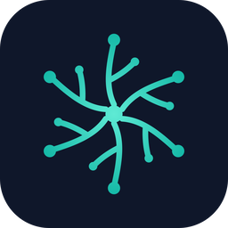

<p align="center">
  
</p>

# RootMind

[English](README.md) | **Deutsch**

[](https://mcprush.com/to/rootmind-mcp?ref=badge) [](https://glama.ai/mcp/servers/cgaeking/rootmind) [](https://github.com/cgaeking/rootmind/releases/latest)
[](https://github.com/cgaeking/rootmind/actions/workflows/backend.yml?query=branch%3Amain)
[](https://github.com/cgaeking/rootmind/actions/workflows/desktop.yml?query=branch%3Amain)
[](LICENSE)
[](#installation)
[](https://github.com/cgaeking/rootmind/releases)

[Schnellstart](#schnellstart) · [Installation](#installation) · [Claude & andere Programme](#rootmind-in-claude-und-anderen-programmen-nutzen) · [Ollama](#lokale-modelle-mit-ollama) · [So funktioniert es](#so-funktioniert-es) · [Sicherheit](#sicherheitsmodell-in-kürze) · [Einschränkungen](#einschränkungen) · [Für Entwickler](#für-entwickler)

**Stell deinen Dokumenten eine Frage. Du bekommst die Antwort mit der Seite, aus der sie stammt.**

RootMind indiziert die Ordner, die du auswählst, auf deinem eigenen Rechner
(PDF, Word, Excel, PowerPoint, CSV, Markdown und Textdateien). Wenn du eine
Frage stellst, durchsucht ein Sprachmodell diesen Index und liest die
Textstellen, die es anfordert. Die Antwort nennt ihre Quellen bis hinunter zu
Seite, Folie oder Tabellenblatt. Es gibt kein Embedding-Modell und keine
Vektordatenbank: Die Indizierung ist eine einfache Volltextsuche in SQLite,
und das Modell steuert die Suche.

https://github.com/user-attachments/assets/d3cc0249-a550-4de5-ae6b-55c1291a282f

- **Antworten mit Quellen.** Jede Antwort nennt ihre Dateien und, wo es sich
  bestimmen lässt, Seite, Folie oder Tabellenblatt.
- **Deine Dateien bleiben auf deinem Rechner.** Indizierung und Suche laufen
  lokal und brauchen weder ein LLM noch einen API-Key. Beim Beantworten einer
  Frage gehen die Frage und die Auszüge, die das Modell liest, an den von dir
  konfigurierten Anbieter (Anthropic, OpenAI oder xAI). Mit einem lokalen
  [Ollama](https://ollama.com)-Server als Anbieter verlässt nichts deinen Rechner
  (siehe [Lokale Modelle mit Ollama](#lokale-modelle-mit-ollama)).
- **Es liest gezielt, es kippt nicht alles hinein.** Statt ganze Dokumente in
  einen Chat zu kopieren, sucht das Modell und liest gezielte Ausschnitte;
  jeder Schritt ist ein sichtbarer Tool-Aufruf. Der Preis sind mehr
  Modellaufrufe als bei klassischem RAG, siehe
  [Warum eine Tool-Schleife statt Embedding-RAG](#warum-eine-tool-schleife-statt-embedding-rag).
- **Aus deinen anderen Werkzeugen nutzbar.** Dieselben lesenden Tools stehen
  über MCP bereit, für Claude Desktop, Claude Code, n8n und andere Agenten.
- **Windows und Linux.** Die Desktop-App gibt es auf Deutsch und Englisch; die
  Lizenz ist MIT.

## Schnellstart

1. **Installieren.** Windows 10 oder 11:
   **[RootMind-Setup-x64.exe](https://github.com/cgaeking/rootmind/releases/latest/download/RootMind-Setup-x64.exe)**
   herunterladen und starten. Linux: das
   [.deb, .rpm oder AppImage](#installation-unter-linux). Zeigt Windows „Der
   Computer wurde durch Windows geschützt“, wähle **Weitere Informationen** und
   dann **Trotzdem ausführen** (der Installer ist noch nicht signiert).
2. **Ordner hinzufügen.** Starte RootMind und füge unter **Ordner** einen
   Ordner mit deinen Dokumenten hinzu. Die Indizierung beginnt nach etwa einer
   Minute.
3. **Fragen.** Im **Chat** mit Haken bei **Nur Suche** suchst du ohne API-Key.
   Für Antworten mit Quellen speicherst du unter **Einstellungen** einen
   API-Key von Anthropic, OpenAI oder xAI oder wählst
   [Ollama](#lokale-modelle-mit-ollama).
4. **In Claude nutzen** (optional):

   | Wo | So geht's |
   | --- | --- |
   | **Lokal**: Claude Desktop auf diesem Computer | **[rootmind.mcpb](https://github.com/cgaeking/rootmind/releases/latest/download/rootmind.mcpb)** herunterladen und doppelklicken. Fertig, nichts einzustellen. |
   | **Remote**: Claude im Web, die Claude-App auf dem Handy, n8n in der Cloud | **Einstellungen → MCP**: Haken bei **Remote / Öffentlicher Zugang mit ngrok**, ngrok Authtoken und Domain eintragen, **Verbinden**, **Einschalten**. Dann zeigt **RootMind in Claude im Web und auf dem Handy nutzen** die Werte für einen Konnektor auf claude.ai ([Schritt für Schritt](#remote-claude-im-web-und-auf-dem-handy)). |

   Der Remote-Konnektor gehört zu deinem Claude-Konto und gilt deshalb auch in
   Claude Desktop. Nutzt du ihn, brauchst du das mcpb nicht; mit beiden zeigt
   Claude jedes Werkzeug doppelt.

## Installation

**Windows 10 oder 11 (x64):** Starte
[RootMind-Setup-x64.exe](https://github.com/cgaeking/rootmind/releases/latest/download/RootMind-Setup-x64.exe)
und bestätige einmal die Administrator-Abfrage; Python ist nicht nötig. Er
installiert die App und den RootMind-Dienst, der deinen Index aktuell hält,
während die App geschlossen ist, und mit Windows startet.

Der Installer ist noch nicht signiert: Windows SmartScreen zeigt eventuell „Der
Computer wurde durch Windows geschützt“ (wähle **Weitere Informationen**, dann
**Trotzdem ausführen**), und die intelligente App-Steuerung kann ihn blockieren,
wenn sie eingeschaltet ist (siehe die
[Code-Signing-Richtlinie](CODE_SIGNING.md), englisch).

### Installation unter Linux

x86-64 mit glibc 2.35 oder neuer (Ubuntu 22.04, Debian 12, Fedora 38, openSUSE
Tumbleweed und neuer):

| Distribution | Download | Installation |
| --- | --- | --- |
| Ubuntu, Debian und Ableger | [RootMind-amd64.deb](https://github.com/cgaeking/rootmind/releases/latest/download/RootMind-amd64.deb) | `sudo apt install ./RootMind-amd64.deb` |
| Fedora, openSUSE Tumbleweed | [RootMind-x86_64.rpm](https://github.com/cgaeking/rootmind/releases/latest/download/RootMind-x86_64.rpm) | `sudo dnf install ./RootMind-x86_64.rpm` (openSUSE: `sudo zypper install ./RootMind-x86_64.rpm`) |
| Jede andere Distribution | [RootMind-x86_64.AppImage](https://github.com/cgaeking/rootmind/releases/latest/download/RootMind-x86_64.AppImage) | `chmod +x RootMind-x86_64.AppImage`, dann starten (braucht `libfuse2`) |

Starte RootMind aus dem App-Menü oder mit `rootmind-desktop`. Beim ersten
Start richtet es seinen Hintergrunddienst für dein Konto ein, ohne root. Damit
er auch läuft, wenn niemand angemeldet ist (etwa für n8n auf demselben
Rechner), führe einmal `loginctl enable-linger "$USER"` aus. Für OCR mit dem
AppImage installierst du `tesseract-ocr` und `tesseract-ocr-deu` selbst.

### Aktualisieren und deinstallieren

- **Aktualisieren:** die neue Version über die alte installieren (Windows: den
  neuen Installer starten; Linux: das neue Paket installieren oder das
  AppImage ersetzen). Ordner, Einstellungen, Index, Tokens und Chats bleiben.
- **Deinstallieren unter Windows:** Windows-Einstellungen → Apps. Deine Daten
  bleiben in `%ProgramData%\RootMind`, außer du setzt den Haken bei **Lösche
  die Anwendungsdaten**.
- **Deinstallieren unter Linux:** zuerst
  `/usr/lib/RootMind/backend/rootmind-backend service uninstall`, dann
  `sudo apt remove root-mind` (oder `sudo dnf remove root-mind`).

### Downloads prüfen

Jedes Release enthält `SHA256SUMS.txt` und einen Herkunftsnachweis
(Attestation) für jede Datei:

```powershell
(Get-FileHash .\RootMind-Setup-x64.exe -Algorithm SHA256).Hash.ToLower()
```

```sh
sha256sum --check --ignore-missing SHA256SUMS.txt
gh attestation verify RootMind-Setup-x64.exe --repo cgaeking/rootmind
```

Stille und verwaltete Installationen (winget, Intune), der Dienst im Detail,
WSL und der Umstieg von 1.x: [docs/INSTALL.de.md](docs/INSTALL.de.md).

## RootMind in Claude und anderen Programmen nutzen

Andere Programme bekommen die lesenden Suchwerkzeuge von RootMind über MCP und
nutzen ihr eigenes Modell; RootMind braucht für sie keinen API-Key.
Einstellungen → **MCP** hat alles: **Lokal** für Programme auf diesem
Computer, **Remote / Öffentlicher Zugang mit ngrok** für alles andere.

### RootMind in Claude Desktop nutzen

Lade
[rootmind.mcpb](https://github.com/cgaeking/rootmind/releases/latest/download/rootmind.mcpb)
herunter und doppelklicke es; Claude Desktop installiert es nach deiner
Bestätigung. Einzustellen gibt es nichts: Es findet RootMind auf diesem
Computer von selbst. Es braucht **MCP über HTTP anbieten** (standardmäßig an).

### Claude Code

**MCP-Token kopieren** unter Einstellungen → MCP → Lokal, dann:

```bash
claude mcp add --transport http rootmind http://127.0.0.1:3000/mcp \
  --header "Authorization: Bearer <MCP-Token>"
```

Zeigen die Einstellungen einen anderen Port als 3000, nimm diesen. **MCP aus
Claude, n8n und anderen Programmen erreichen** in der App zeigt den Befehl mit
eingesetztem Token.

### MCP von n8n aus erreichen

Nimm den Knoten **MCP Client Tool**:

| Feld | Wert |
|---|---|
| Endpoint | `http://127.0.0.1:3000/mcp` (n8n in Docker: `http://host.docker.internal:3000/mcp`) |
| Server Transport | HTTP Streamable |
| Authentication | Header Auth: `Authorization` = `Bearer <MCP-Token>` |

Für n8n in der Cloud oder auf einem anderen Rechner nimm stattdessen die
öffentliche Adresse aus [Remote](#remote-claude-im-web-und-auf-dem-handy).

### Remote: Claude im Web und auf dem Handy

1. Lege ein kostenloses Konto auf [ngrok.com](https://ngrok.com) an. Kopiere
   deinen **ngrok Authtoken** (Dashboard: **Getting Started › Your
   Authtoken**) und lege unter **Domains** deine kostenlose feste Domain an.
2. In RootMind, **Einstellungen → MCP**: Haken bei **Remote / Öffentlicher
   Zugang mit ngrok**, Authtoken und Domain eintragen, **Verbinden**, dann
   **Einschalten**. Der Status wechselt auf **Verbunden**.
3. Auf claude.ai: unter Anpassungen → Konnektoren einen
   benutzerdefinierten Konnektor hinzufügen:

   | Feld | Wert |
   |---|---|
   | Name | `RootMind` |
   | URL | `https://<deine-domain>/mcp` |
   | Authentifizierung | **Keine Anmeldung** |
   | Anfrage-Header | `Authorization` = `Bearer <MCP-Token>` |

   **RootMind in Claude im Web und auf dem Handy nutzen** in der App zeigt
   diese Werte mit Kopier-Knöpfen.

Der Konnektor ist dann auch in der Claude-App auf deinem Handy und in Claude
Desktop. Gut zu wissen:

- Wer das MCP-Token hat, kann über die öffentliche Adresse jedes indizierte
  Dokument lesen. Haken bei **Remote** raus schließt sie sofort.
- Dein Computer muss eingeschaltet und wach sein.
- Was Claude über RootMind liest, geht an Anthropic.

Andere Cloud-Assistenten funktionieren genauso mit der öffentlichen Adresse und
dem MCP-Token. Eigener Tunnel (ngrok-Agent, Tailscale Funnel), das mcpb im
Detail und der Eintrag in der MCP Registry: [docs/MCP.de.md](docs/MCP.de.md).

## Lokale Modelle mit Ollama

Wähle unter **Einstellungen → LLM** den Anbieter **Ollama** (oder `provider:
ollama` unter `llm` in `config.yaml`), damit die Frageschleife mit einem Modell
auf deinem eigenen Rechner läuft. Es gibt keinen API-Key; die Basis-URL ist
standardmäßig `http://localhost:11434` und kann auf einen anderen Rechner im
Netzwerk zeigen.

```yaml
llm:
  provider: ollama
  model: qwen3:8b          # ein beliebiges geladenes Modell mit Tool-Unterstützung
  base_url: http://localhost:11434
```

- **Was lokal bleibt:** Mit Ollama auf diesem Rechner verlassen Frage,
  gelesene Auszüge und Antwort den Rechner nicht. Bei einer Basis-URL auf einem
  anderen Rechner gehen sie dorthin, unverschlüsselt über `http://`.
- **Tool-Unterstützung ist Pflicht.** Wähle ein Modell, das Ollama mit Tools
  anzeigt (`ollama show <modell>`). Ohne sie gibt es eine klare Fehlermeldung.
- **Kontextlänge:** Die Schleife liest Dokumentfenster, und Ollamas
  Standardkontext ist klein. Erhöhe ihn (etwa `OLLAMA_CONTEXT_LENGTH=16384` am
  Server oder ein Modelfile mit `PARAMETER num_ctx 16384`), sonst werden lange
  Dokumente ohne Fehler abgeschnitten.
- **Erst suchen:** Ollama-Modelle werden im ersten Schritt nicht zu einem
  Tool-Aufruf gezwungen, weil nicht jedes Modell das kann. Hat die erste Antwort
  die Dokumente nicht angesehen, fragt RootMind einmal mit einer ausdrücklichen
  Anweisung nach.
- Wie gut ein lokales Modell der Tool-Schleife folgt, hängt vom Modell ab;
  die Messungen stehen in
  [`backend/evals`](backend/evals/README.md#latest-live-run-with-a-local-model-ollama)
  (englisch).

## So funktioniert es

1. **Die Indizierung braucht kein LLM.** RootMind legt den Text deiner Dateien
   in einem lokalen SQLite-Volltextindex ab (mit Markierungen für Seite, Folie
   und Tabellenblatt) und überspringt unveränderte Dateien.
2. **Das Modell entscheidet, was es liest.** Für eine Frage bekommt das Modell
   fünf lesende Werkzeuge (Suche, unscharfe Suche, Liste, Lesen, Statistik).
   Es sucht, liest den Text um einen Treffer, sucht bei Bedarf noch einmal und
   antwortet dann.
3. **Antworten nennen ihre Quellen:** die Dateien mit Seite, Folie oder
   Tabellenblatt, und jeder Werkzeugaufruf ist sichtbar.
4. **MCP-Clients bringen ihr eigenes Modell mit** und nutzen dieselben
   Werkzeuge.

Die Details, mit Diagramm und den Grenzen der Schleife:
[docs/DEVELOPMENT.de.md](docs/DEVELOPMENT.de.md#so-funktioniert-es-im-detail).

## Warum eine Tool-Schleife statt Embedding-RAG

Eine typische RAG-Pipeline zerlegt Dokumente in Abschnitte (Chunks), bettet sie
ein, holt die ähnlichsten Treffer per Vektorähnlichkeit und fügt diese
Abschnitte in den Prompt ein. Das Modell sieht nur, was dieser Abrufschritt
ausgewählt hat.

RootMind hält den vollständigen Text jedes Dokuments in einem Volltextindex
und lässt das Modell die Suche steuern. Es kann suchen, sich die Snippets
ansehen, den Text um einen Treffer lesen und mit anderen Begriffen erneut
suchen, wenn die erste Anfrage danebenliegt. Das wird manchmal RLM-artige oder
agentische Suche genannt. Das Engine-Modul heißt nach dieser Idee
`rlm_engine`; in dieser Codebasis ist es eine begrenzte Tool-Schleife, kein
Modell, das sich rekursiv selbst aufruft.

| Funktioniert gut | Funktioniert weniger gut |
|---|---|
| Exakte Begriffe: Rechnungsnummern, Produktcodes, Namen, Beträge | Synonyme und Umschreibungen: „Urlaub“ findet „bezahlte Freistellung“ nur, wenn das Modell das andere Wort versucht |
| Kein Embedding-Modell und kein Vektorspeicher; die Indizierung parst nur Text und funktioniert offline | Fragen in einer anderen Sprache als die Dokumente |
| Das Modell liest den Kontext um einen Treffer, etwa den Tabellenkopf über einer Zahl, statt eines isolierten Abschnitts | Mehr LLM-Runden pro Frage, also mehr Latenz und Token-Kosten |
| Jeder Suchschritt ist als Tool-Aufruf sichtbar | Die Antwortqualität hängt von der Suchstrategie des Modells ab |

Die Trigramm-Fuzzy-Suche deckt Tippfehler ab, keine Synonyme. Der Eval-Fall
c09 (die Synonym-Falle) hält diese Schwäche sichtbar.

## Sicherheitsmodell in Kürze

- RootMind ist für eine Person auf ihrem eigenen Rechner gebaut. Die REST-API
  bindet an 127.0.0.1, lehnt Verbindungen von anderen Rechnern ab, weist
  fremde `Host`-Header zurück und erlaubt Cross-Origin-Anfragen nur von der
  Desktop-App.
- Der RootMind-Dienst verlangt auf seiner REST-API ein Bearer-Token.
  `rootmind api` aus dem Quellcode läuft ohne Token, solange du keines
  verlangst; ohne Token kann jeder lokale Prozess sie aufrufen.
- Der Dienst läuft als LocalSystem, liest aber nur, was das installierende
  Konto ohne Administratorrechte lesen kann. Installieren und Reparieren
  brauchen eine Bestätigung als Administrator. Unter Linux läuft er als
  systemd-Benutzerdienste deines eigenen Kontos, ohne root; Dateimodi halten
  seine Daten und Tokens für das Konto privat.
- Der MCP-HTTP-Server ist standardmäßig eingeschaltet; er verlangt ein
  Bearer-Token und bindet an 127.0.0.1. Der Fernzugriff (ngrok) ist
  standardmäßig aus; eingeschaltet kann jeder mit dem MCP-Token über die
  öffentliche Adresse jedes indizierte Dokument lesen.
- Die Indizierung bleibt auf deinem Rechner. Beim Beantworten einer Frage
  gehen die Frage, Such-Snippets und Dokumentauszüge an den konfigurierten
  LLM-Anbieter.
- Indizierte Dokumente sind nicht vertrauenswürdige Eingaben. Alle Tools sind
  rein lesend, Dokumenttext ist als Daten gekennzeichnet, und die Tool-Nutzung
  einer Frage ist begrenzt, aber Prompt Injection ist kein gelöstes Problem.

Das vollständige Bedrohungsmodell steht in [SECURITY.md](SECURITY.md)
(englisch).

## Einschränkungen

- Die Desktop-App und den RootMind-Dienst gibt es für Windows und Linux
  (x86-64); einen macOS-Build gibt es nicht. Das Backend ist
  plattformunabhängiges Python; die CI führt seine Tests unter Ubuntu und
  Windows aus.
- Die Release-Binärdateien sind noch nicht codesigniert (siehe
  [Installation](#installation)). RootMind ist noch nicht im
  winget-Repository; die erste Einreichung läuft.
- Die Texterkennung (OCR) für gescannte PDFs und Bilder ist standardmäßig
  aus und wird pro Ordner eingeschaltet. Sie erkennt im Hintergrund eine
  Seite nach der anderen; ein großes Scan-Archiv ist erst nach Stunden
  vollständig durchsuchbar.
- Alte `.doc`- und `.xls`-Dateien gehen an die DOCX- und XLSX-Parser und
  lassen sich meist nicht parsen.
- Kein Streaming: Die Desktop-App wartet auf die vollständige Antwort.
- Die Volltextsuche kennt keine Synonyme und keinen sprachübergreifenden
  Abgleich (siehe die Tabelle der Abwägungen oben).
- Unter Windows braucht die Installation ein Administratorkonto, und der
  Dienst bedient ein Konto pro Computer: das, das RootMind installiert hat.
  Unter Linux bekommt jedes Konto, das RootMind startet, eigene Dienste.
- Der Windows-Dienst kann keine Netzlaufwerke oder Freigaben indizieren.
- Unter Linux läuft der Dienst nur, solange du angemeldet bist, außer
  Lingering ist eingeschaltet (`loginctl enable-linger`).
- Pro Datenbank sollte nur ein Prozess indizieren. Die MCP-Server stellen
  standardmäßig nur bereit; setze `RLM_DISABLE_SCHEDULER=1` bei jeder
  weiteren REST-API, die dieselbe Datenbank nutzt.
- Der MCP-stdio-Server liest die Ordnerliste beim Start; starte ihn nach
  Änderungen an den Ordnern neu.
- Eine inkrementelle Synchronisierung berechnet den Hash jeder Datei in jedem
  konfigurierten Ordner, was bei sehr großen Ordnern langsam ist.

## Für Entwickler

> **Status:** Dies ist ein persönliches Projekt. Es wird nicht kommerziell
> gepflegt, und es gibt keine Support-Zusage. Issues und Pull Requests sind
> willkommen und werden nach bestem Bemühen beantwortet.

- [docs/DEVELOPMENT.de.md](docs/DEVELOPMENT.de.md): so funktioniert es im
  Detail, die Kommandozeile, Installation für Entwicklung und Server, Start aus
  dem Quellcode, den Installer bauen, Tracing, Tests und der Aufbau des
  Repositorys.
- [docs/SERVER.md](docs/SERVER.md) (englisch): RootMind auf einem Server für
  mehrere Personen.
- [ARCHITECTURE.md](ARCHITECTURE.md) und [SECURITY.md](SECURITY.md)
  (englisch): die Architektur und das Bedrohungsmodell.

## Mitwirken

[CONTRIBUTING.md](CONTRIBUTING.md) (englisch) beschreibt die
Entwicklungsumgebung, Prüfungen, Konventionen und die Release-Schritte. Melde
Sicherheitsprobleme bitte vertraulich, wie in [SECURITY.md](SECURITY.md)
beschrieben.

## Lizenz

[MIT](LICENSE), Copyright (c) 2026 Christian Gäking.

Das gepackte Backend und der Installer enthalten Abhängigkeiten von Dritten,
die ihre eigenen Lizenzen behalten.

## Code-Signing-Richtlinie

Die Releases sind noch nicht codesigniert; stattdessen enthält jedes Release
Prüfsummen und Herkunftsnachweise (siehe [Downloads prüfen](#downloads-prüfen)).
Was künftig signiert wird, die Rollen im Team und die Datenschutzerklärung
stehen in [CODE_SIGNING.md](CODE_SIGNING.md) (englisch).
