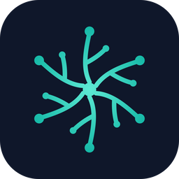

<p align="center">
  
</p>

# RootMind

**English** | [Deutsch](README.de.md)

[](https://mcprush.com/to/rootmind-mcp?ref=badge) [](https://glama.ai/mcp/servers/cgaeking/rootmind) [](https://github.com/cgaeking/rootmind/releases/latest)
[](https://github.com/cgaeking/rootmind/actions/workflows/backend.yml?query=branch%3Amain)
[](https://github.com/cgaeking/rootmind/actions/workflows/desktop.yml?query=branch%3Amain)
[](LICENSE)
[](#install)
[](https://github.com/cgaeking/rootmind/releases)

[Quickstart](#quickstart) · [Install](#install) · [Claude & other tools](#use-rootmind-in-claude-and-other-tools) · [Ollama](#local-models-with-ollama) · [How it works](#how-it-works) · [Security](#security-model-in-short) · [Limitations](#limitations) · [For developers](#for-developers)

**Ask your documents a question. Get the answer with the page it came from.**

RootMind indexes the folders you choose on your own computer (PDF, Word, Excel,
PowerPoint, CSV, Markdown and text files). When you ask a question, a language
model searches that index and reads the passages it asks for, then answers with
sources down to the page, slide or sheet. There is no embedding model and no
vector database: indexing is plain full-text search in SQLite, and the model
drives the retrieval.

https://github.com/user-attachments/assets/d3cc0249-a550-4de5-ae6b-55c1291a282f

- **Cited answers.** Every answer names its files and, where it can be
  resolved, the page, slide or sheet.
- **Your files stay on your computer.** Indexing and search are local and need
  no LLM and no API key. Answering a question sends the question and the
  excerpts the model reads to the provider you configure (Anthropic, OpenAI or
  xAI). With a local [Ollama](https://ollama.com) server as the provider,
  nothing leaves your computer (see [Local models with Ollama](#local-models-with-ollama)).
- **It reads, it does not stuff.** Instead of pasting whole documents into a
  chat, the model searches and reads targeted windows, and every step is a
  visible tool call. The cost is more model round trips than classic RAG; see
  [Why a tool loop instead of embedding RAG](#why-a-tool-loop-instead-of-embedding-rag).
- **Usable from your other tools.** The same read-only tools are served over
  MCP, for Claude Desktop, Claude Code, n8n and other agents.
- **Windows and Linux.** The desktop app is in English and German; the license
  is MIT.

## Quickstart

▶ **Video:** *Set up RootMind in four minutes* (coming soon)

1. **Install.** Windows 10 or 11: download and run
   **[RootMind-Setup-x64.exe](https://github.com/cgaeking/rootmind/releases/latest/download/RootMind-Setup-x64.exe)**.
   Linux: the [.deb, .rpm or AppImage](#install-on-linux). If Windows shows
   "Windows protected your PC", choose **More info**, then **Run anyway** (the
   installer is not code-signed yet).
2. **Add a folder.** Start RootMind and add a folder with your documents under
   **Folders**. Indexing starts within about a minute.
3. **Ask.** In **Chat**, tick **Search only** to search without an API key.
   For answers with sources, save an API key from Anthropic, OpenAI or xAI
   under **Settings**, or choose [Ollama](#local-models-with-ollama).
4. **Use it in Claude** (optional):

   | Where | How |
   | --- | --- |
   | **Local**: Claude Desktop on this computer | Download **[rootmind.mcpb](https://github.com/cgaeking/rootmind/releases/latest/download/rootmind.mcpb)** and double-click it. Done, nothing to configure. |
   | **Remote**: Claude on the web, the Claude app on your phone, n8n in the cloud | **Settings → MCP**: tick **Remote / Public access with ngrok**, enter your ngrok Authtoken and domain, **Connect**, **Turn on**. Then **Use RootMind in Claude on the web and on your phone** shows the values for a connector on claude.ai ([step by step](#remote-claude-on-the-web-and-on-your-phone)). |

   The remote connector belongs to your Claude account, so it works in Claude
   Desktop too. If you use it, you don't need the mcpb; with both, Claude shows
   every tool twice.

## Install

**Windows 10 or 11 (x64):** run
[RootMind-Setup-x64.exe](https://github.com/cgaeking/rootmind/releases/latest/download/RootMind-Setup-x64.exe)
and approve the administrator prompt once; no Python is needed. It installs
the app and the RootMind service, which keeps your index up to date while the
app is closed and starts with Windows.

The installer is not code-signed yet: Windows SmartScreen may show "Windows
protected your PC" (choose **More info**, then **Run anyway**), and Smart App
Control, when it is on, may block it (see the
[code signing policy](CODE_SIGNING.md)).

### Install on Linux

x86-64 with glibc 2.35 or later (Ubuntu 22.04, Debian 12, Fedora 38, openSUSE
Tumbleweed and newer):

| Distribution | Download | Install |
| --- | --- | --- |
| Ubuntu, Debian and their derivatives | [RootMind-amd64.deb](https://github.com/cgaeking/rootmind/releases/latest/download/RootMind-amd64.deb) | `sudo apt install ./RootMind-amd64.deb` |
| Fedora, openSUSE Tumbleweed | [RootMind-x86_64.rpm](https://github.com/cgaeking/rootmind/releases/latest/download/RootMind-x86_64.rpm) | `sudo dnf install ./RootMind-x86_64.rpm` (openSUSE: `sudo zypper install ./RootMind-x86_64.rpm`) |
| Any other distribution | [RootMind-x86_64.AppImage](https://github.com/cgaeking/rootmind/releases/latest/download/RootMind-x86_64.AppImage) | `chmod +x RootMind-x86_64.AppImage`, then run it (needs `libfuse2`) |

Start RootMind from your app menu or with `rootmind-desktop`. On the first
start it sets up its background service for your account, without root. To
keep it running while nobody is logged in (for example for n8n on the same
computer), run `loginctl enable-linger "$USER"` once. For OCR with the
AppImage, install `tesseract-ocr` and `tesseract-ocr-deu` yourself.

### Update and uninstall

- **Update:** install the new version over the old one (Windows: run the new
  installer; Linux: install the new package or replace the AppImage). Folders,
  settings, index, tokens and chats are kept.
- **Uninstall on Windows:** Windows Settings → Apps. Your data stays in
  `%ProgramData%\RootMind` unless you tick **Delete the application data**.
- **Uninstall on Linux:** first
  `/usr/lib/RootMind/backend/rootmind-backend service uninstall`, then
  `sudo apt remove root-mind` (or `sudo dnf remove root-mind`).

### Verify downloads

Every release ships `SHA256SUMS.txt` and a build provenance attestation for
each file:

```powershell
(Get-FileHash .\RootMind-Setup-x64.exe -Algorithm SHA256).Hash.ToLower()
```

```sh
sha256sum --check --ignore-missing SHA256SUMS.txt
gh attestation verify RootMind-Setup-x64.exe --repo cgaeking/rootmind
```

Silent and managed installs (winget, Intune), the service in detail, WSL and
upgrading from 1.x: [docs/INSTALL.md](docs/INSTALL.md).

## Use RootMind in Claude and other tools

Other programs get RootMind's read-only search tools over MCP and use their
own model, so RootMind needs no API key for them. Settings → **MCP** has
everything: **Local** for programs on this computer, **Remote / Public access
with ngrok** for everything else.

### Use RootMind in Claude Desktop

Download
[rootmind.mcpb](https://github.com/cgaeking/rootmind/releases/latest/download/rootmind.mcpb)
and double-click it; Claude Desktop installs it once you confirm. There is
nothing to configure: it finds RootMind on this computer by itself. It needs
**Serve MCP over HTTP** on (the default).

### Claude Code

**Copy MCP token** under Settings → MCP → Local, then:

```bash
claude mcp add --transport http rootmind http://127.0.0.1:3000/mcp \
  --header "Authorization: Bearer <MCP token>"
```

Use the port Settings shows if it is not 3000. **Reach MCP from Claude, n8n
and other clients** in the app shows the command with the token filled in.

### Reach MCP from n8n

Use the **MCP Client Tool** node:

| Field | Value |
|---|---|
| Endpoint | `http://127.0.0.1:3000/mcp` (n8n in Docker: `http://host.docker.internal:3000/mcp`) |
| Server Transport | HTTP Streamable |
| Authentication | Header Auth: `Authorization` = `Bearer <MCP token>` |

For n8n in the cloud or on another machine, use the public address from
[Remote](#remote-claude-on-the-web-and-on-your-phone) instead.

### Remote: Claude on the web and on your phone

1. Create a free account at [ngrok.com](https://ngrok.com). Copy your
   **ngrok Authtoken** (dashboard: **Getting Started › Your Authtoken**) and
   create your free static domain under **Domains**.
2. In RootMind, **Settings → MCP**: tick **Remote / Public access with ngrok**,
   enter the Authtoken and the domain, **Connect**, then **Turn on**. The
   status changes to **Connected**.
3. On claude.ai: **Customize → Connectors → Add custom connector**:

   | Field | Value |
   |---|---|
   | Name | `RootMind` |
   | URL | `https://<your-domain>/mcp` |
   | Authentication | **No sign in** |
   | Request header | `Authorization` = `Bearer <MCP token>` |

   **Use RootMind in Claude on the web and on your phone** in the app shows
   these values with Copy buttons.

The connector is then in the Claude app on your phone and in Claude Desktop
too. Good to know:

- Anyone with the MCP token can read every indexed document through the
  public address. Unticking **Remote** closes it at once.
- Your computer must be on and awake.
- What Claude reads through RootMind goes to Anthropic.

Other cloud assistants work the same way with the public address and the MCP
token. Your own tunnel (ngrok agent, Tailscale Funnel), the mcpb in detail
and the MCP Registry entry: [docs/MCP.md](docs/MCP.md).

## Local models with Ollama

Choose **Ollama** under **Settings → LLM** (or `provider: ollama` under `llm`
in `config.yaml`) to run the question loop against a model on your own
machine. There is no API key; the base URL defaults to
`http://localhost:11434` and can point at another computer on your network.

```yaml
llm:
  provider: ollama
  model: qwen3:8b          # any model you pulled that supports tools
  base_url: http://localhost:11434
```

- **What stays local:** with Ollama on this computer, the question, the
  excerpts the model reads and the answer never leave it. With a base URL on
  another computer, they go to that computer, unencrypted over plain `http://`.
- **Tool support is required.** Pick a model Ollama lists as supporting tools
  (`ollama show <model>`). A model without it fails with a clear message.
- **Context length:** the loop reads document windows, and Ollama's default
  context is small. Raise it (for example `OLLAMA_CONTEXT_LENGTH=16384` for the
  server, or a Modelfile with `PARAMETER num_ctx 16384`), or long documents are
  cut off without an error.
- **Search first:** Ollama models are not forced to call a tool on the first
  turn, since not every model supports that. If the first answer never looked at
  the documents, RootMind asks once more with an explicit instruction.
- How well a local model follows the tool loop depends on the model; the
  measurements are in
  [`backend/evals`](backend/evals/README.md#latest-live-run-with-a-local-model-ollama).

## How it works

1. **Indexing uses no LLM.** RootMind extracts the text of your files into a
   local SQLite full-text index (with page, slide and sheet markers) and skips
   unchanged files.
2. **The model chooses what to read.** For a question, the model gets five
   read-only tools (search, fuzzy search, list, read, statistics). It searches,
   reads the text around a hit, searches again if needed, then answers.
3. **Answers carry sources:** the files with page, slide or sheet, and every
   tool call is visible.
4. **MCP clients bring their own model** and use the same tools.

The details, with a diagram and the limits of the loop:
[docs/DEVELOPMENT.md](docs/DEVELOPMENT.md#how-it-works-in-detail).

## Why a tool loop instead of embedding RAG

A typical RAG pipeline splits documents into chunks, embeds them, retrieves
the top matches by vector similarity and puts those chunks into the prompt.
The model sees only what that retrieval step picked.

RootMind keeps each document's full text in a full-text index and lets the
model drive retrieval. It can search, look at the snippets, read the text
around a hit, and search again with different terms when the first query
misses. This is sometimes called RLM-style or agentic retrieval. The engine
module is named `rlm_engine` after that idea; in this code base it is a bounded
tool-use loop, not a model that calls itself recursively.

| Works well | Works less well |
|---|---|
| Exact terms: invoice numbers, product codes, names, amounts | Synonyms and paraphrases: "vacation" does not match "paid time off" unless the model tries the other word |
| No embedding model or vector store; indexing only parses text and works offline | Questions in a different language than the documents |
| The model reads the context around a hit, such as the table header above a number, instead of an isolated chunk | More LLM round trips per question, so more latency and token cost |
| Every retrieval step is visible as a tool call | Answer quality depends on the model's search strategy |

Trigram fuzzy search covers typos, not synonyms. Eval case c09 (the synonym
trap) keeps that weakness visible.

## Security model in short

- RootMind is built for one person on their own computer. The REST API binds
  to 127.0.0.1, refuses connections from other machines, rejects foreign
  `Host` headers and allows cross-origin requests only from the desktop app.
- The RootMind service requires a bearer token on its REST API. `rootmind api`
  from source runs without a token unless you ask for one; without a token,
  any local process can call it.
- The service runs as LocalSystem but reads only what the installing account
  can read without administrator rights. Installing and repairing it needs
  one administrator approval. On Linux it runs as systemd user services of
  your own account, without root; file modes keep its data and tokens
  private to the account.
- The MCP HTTP server is on by default; it requires a bearer token and binds
  to 127.0.0.1. Remote access (ngrok) is off by default; turned on, anyone
  with the MCP token can read every indexed document through the public
  address.
- Indexing stays on your machine. Answering a question sends the question,
  search snippets and document excerpts to the LLM provider you configured.
- Indexed documents are untrusted input. All tools are read-only, document
  text is marked as data, and a question's tool use is capped, but prompt
  injection is not a solved problem.

The full threat model is in [SECURITY.md](SECURITY.md).

## Limitations

- The desktop app and the RootMind service run on Windows and on Linux
  (x86-64); there is no macOS build. The backend is cross-platform Python;
  CI runs its tests on Ubuntu and Windows.
- The release binaries are not code-signed yet (see [Install](#install)).
  RootMind is not in the winget repository yet; the first submission is
  under way.
- Text recognition (OCR) for scanned PDFs and images is off by default and
  turned on per folder. It recognizes one page at a time in the background,
  so a large archive of scans takes hours before all of it is searchable.
- Legacy `.doc` and `.xls` files go to the DOCX and XLSX parsers and usually
  fail to parse.
- No streaming: the desktop app waits for the complete answer.
- Full-text search has no synonym or cross-language matching (see the
  trade-off table above).
- On Windows, installing needs an administrator account, and the service
  serves one account per computer: the one that installed RootMind. On
  Linux every account that starts RootMind gets services of its own.
- The Windows service cannot index network drives or shares.
- On Linux the service runs only while you are logged in, unless lingering
  is on (`loginctl enable-linger`).
- Only one process per database should index. The MCP servers only serve by
  default; set `RLM_DISABLE_SCHEDULER=1` on any additional REST API that
  shares the database.
- The MCP stdio server reads the list of folders at startup; restart it after
  changing folders.
- An incremental sync hashes every file in every configured folder, which is
  slow for very large folders.

## For developers

> **Status:** this is a personal project. It is not commercially maintained and
> comes with no support commitment. Issues and pull requests are welcome and
> get a best-effort response.

- [docs/DEVELOPMENT.md](docs/DEVELOPMENT.md): how it works in detail, the
  command line, installing for developers and servers, running from source,
  building the installer, tracing, tests and the repository layout.
- [docs/SERVER.md](docs/SERVER.md): RootMind on a server for several people.
- [ARCHITECTURE.md](ARCHITECTURE.md) and [SECURITY.md](SECURITY.md): the
  architecture and the threat model.

## Contributing

See [CONTRIBUTING.md](CONTRIBUTING.md) for the development setup, checks,
conventions and the release steps. Please report security issues privately as
described in [SECURITY.md](SECURITY.md).

## License

[MIT](LICENSE), copyright (c) 2026 Christian Gäking.

The packaged backend and the installer bundle third-party dependencies, which
keep their own licenses.

## Code signing policy

Releases are not code-signed yet; each release ships checksums and build
provenance attestations instead (see [Verify downloads](#verify-downloads)).
[CODE_SIGNING.md](CODE_SIGNING.md) describes what will be signed, the team
roles and the privacy policy.
