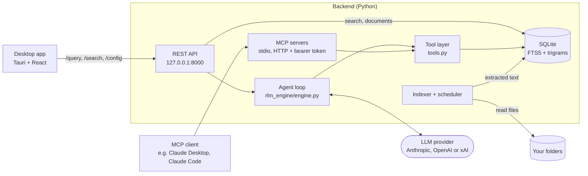

# RootMind

Local document search with an agentic LLM loop. RootMind indexes the files in
folders you choose into SQLite FTS5. When you ask a question, a language model
decides what to search for and which documents to read, using a small set of
read-only tools. It answers with sources, down to the page, slide or sheet
where that can be resolved. The same tools are available to other agents over
MCP.

The repository has two parts:

- **Backend** (Python, FastAPI): indexer, full-text search, the agent loop, a
  localhost REST API, and MCP servers over stdio and HTTP.
- **Desktop app** (Tauri 2 with React and TypeScript, plus a thin Rust shell):
  a chat and search UI for Windows that talks to the REST API.

> **Status:** this is a personal project. It is not commercially maintained and
> comes with no support commitment. Issues and pull requests are welcome and
> get a best-effort response.

## How it works



1. **Indexing uses no LLM.** A connector walks each configured folder. Parsers
   extract text from PDF, DOCX, XLSX, PPTX, CSV, Markdown and other text files.
   The text goes into SQLite: a documents table, an FTS5 index and a trigram
   table for typo-tolerant search. PDF pages, slides and sheets keep markers in
   the text, so a hit can be cited by location. Unchanged files are skipped by
   content hash.
2. **The model chooses what to read.** For `POST /query`, the engine offers the
   model five read-only tools: `search_documents`, `search_fuzzy`,
   `list_documents`, `read_document` and `get_statistics`. A typical run is:
   search, read the window around a hit, perhaps search again with other words,
   then answer.
3. **The loop is bounded.** The loop makes at most 10 model calls that may
   request tools. If the model is still searching after that, one final call
   with tools disabled asks it to answer from what it has found. At most 8
   tool calls run per model turn, and the tool results of one question are
   capped at 200,000 characters; calls beyond that get an error result
   instead of running. Every LLM call has a timeout, a read returns at most
   50,000 characters, tool errors go back to the model as error results
   instead of ending the loop, and an answer cut off by the output token
   limit says so.
4. **Answers carry sources.** The response lists the documents the model read,
   with page, slide or sheet where it can be resolved, every tool call it
   made, and why each LLM call stopped.
5. **MCP clients bring their own model.** Over MCP, RootMind serves the same
   tool definitions and the client's model does the deciding. Search and
   indexing never need an API key; only questions (`POST /query`), chat titles
   and the model list in the settings call the provider.

## Why a tool loop instead of embedding RAG

A typical RAG pipeline splits documents into chunks, embeds them, retrieves
the top matches by vector similarity and puts those chunks into the prompt.
The model sees only what that retrieval step picked.

RootMind keeps each document's full text in a full-text index and lets the
model drive retrieval. It can search, look at the snippets, read the text
around a hit, and search again with different terms when the first query
misses. This is sometimes called RLM-style or agentic retrieval. The engine
module is named `rlm_engine` after that idea; in this code base it is a bounded
tool-use loop, not a model that calls itself recursively.

| Works well | Works less well |
|---|---|
| Exact terms: invoice numbers, product codes, names, amounts | Synonyms and paraphrases: "vacation" does not match "paid time off" unless the model tries the other word |
| No embedding model or vector store; indexing only parses text and works offline | Questions in a different language than the documents |
| The model reads the context around a hit, such as the table header above a number, instead of an isolated chunk | More LLM round trips per question, so more latency and token cost |
| Every retrieval step is visible as a tool call | Answer quality depends on the model's search strategy |

Trigram fuzzy search covers typos, not synonyms. Eval case c09 (the synonym
trap) keeps that weakness visible.

## Quickstart

You need [uv](https://docs.astral.sh/uv/); it installs Python 3.12 if
necessary. The desktop app also needs Node 24, pnpm 11, Rust stable and, on
Windows, the MSVC build tools and WebView2.

### 1. Index and search without an API key

```bash
cd backend
uv sync
cp config.example.yaml config.yaml   # indexes the fictional demo corpus in evals/corpus
uv run rootmind index                # builds data/index.db; no LLM involved
uv run rootmind api                  # REST API on http://127.0.0.1:8000
```

In a second terminal:

```bash
curl "http://127.0.0.1:8000/search?q=total%20due&limit=3&snippets=true"
```

The first hit is `invoice_INV-2026-0142.pdf` with `"page": "Page 2"` and a
snippet around the match. Without `snippets=true` the search returns only the
ranked list, which is faster on large indexes.

The interactive API docs are at <http://127.0.0.1:8000/docs>. While the API
runs, it re-indexes about 30 seconds after start and then every 24 hours
(`indexer.sync_interval_hours`). To index your own files, add entries under
`connectors` in `config.yaml`. Use absolute paths: relative connector paths
resolve against the working directory.

### 2. Ask a question

Set a key for one provider (`ANTHROPIC_API_KEY`, `OPENAI_API_KEY` or
`XAI_API_KEY`) in the environment or in `backend/.env` (see
[`.env.example`](backend/.env.example)). Choose the provider and model under
`llm` in `config.yaml`, restart the API, then:

```bash
curl -X POST http://127.0.0.1:8000/query \
  -H "Content-Type: application/json" \
  -d '{"question": "What is the total amount due on invoice INV-2026-0142?"}'
```

The response contains `answer`, `sources` (with `page` where known),
`tool_calls` and `tokens_used`. The question, search snippets and document
excerpts go to the provider you configured; see [SECURITY.md](SECURITY.md).

### 3. Use the tools from an MCP client

The MCP servers read the same `config.yaml` and database as the REST API. They
only serve and never index, so keep the index current with `rootmind index` or
a running REST API. They read the list of folders at startup: restart them
after adding or removing folders.

Claude Desktop (`claude_desktop_config.json`):

```json
{
  "mcpServers": {
    "rootmind": {
      "command": "uv",
      "args": ["--directory", "/absolute/path/to/rootmind/backend", "run", "rootmind-mcp"]
    }
  }
}
```

If Claude Desktop cannot find `uv`, put the absolute path of the `uv`
executable into `command`. On Windows, write the paths with forward slashes or
escaped backslashes (`C:\\...`).

Claude Code:

```bash
claude mcp add --transport stdio rootmind -- \
  uv --directory /absolute/path/to/rootmind/backend run rootmind-mcp
```

Over HTTP, for MCP clients that cannot start a local process:

```bash
cd backend
uv run rootmind-mcp-http             # http://127.0.0.1:3000/mcp
```

On first start the server generates a token and saves it to
`data/api_token.txt` (under `RLM_HOME`, or the working directory when that is
unset); alternatively, set `MCP_API_TOKEN`. The server prints where the token
came from and a short fingerprint of it, never the token itself. Then:

```bash
claude mcp add --transport http rootmind http://127.0.0.1:3000/mcp \
  --header "Authorization: Bearer <token from data/api_token.txt>"
```

The HTTP server binds to 127.0.0.1 and speaks plain HTTP. To reach it from
another machine, put it behind a TLS-terminating proxy or tunnel; never expose
the plain port. `rootmind-mcp-http --index` also runs the background indexer
in that process. Use it only when no REST API indexes the same database:
every indexing process removes the documents of folders that are missing from
its own copy of the config.

### 4. Run the desktop app (development)

```bash
# terminal 1: backend, with the Vite dev origin allowed by CORS
cd backend
RLM_DEV=1 uv run rootmind api        # PowerShell: $env:RLM_DEV=1; uv run rootmind api

# terminal 2: desktop
cd desktop
pnpm install
pnpm tauri dev
```

More in [desktop/README.md](desktop/README.md).

### 5. Windows installer

There are no published releases. You can build two installers yourself, both
unsigned (Windows SmartScreen will warn):

- an app-only installer: `pnpm tauri build` in `desktop/`. The desktop CI
  workflow also builds it on version tags and keeps it, with a
  `SHA256SUMS.txt`, as a workflow artifact. Run the backend yourself next to
  it (step 1), as your own user;
- a full installer that also installs the backend as the Windows service
  `RootMind-Backend`. **Experimental and not recommended:** the service runs
  as LocalSystem, and its REST API has no authentication, so any local
  process can make it read files with SYSTEM rights (see
  [SECURITY.md](SECURITY.md#windows-service-localsystem-experimental)). Use
  it only on a single-user machine. The build order is in
  [ARCHITECTURE.md](ARCHITECTURE.md#packaging).

## Repository layout

```
backend/
  src/rootmind/
    rlm_engine/engine.py   agent loop
    tools.py               tool registry, argument validation, result formatting
    mcp_stdio.py           MCP server over stdio
    mcp_http.py            MCP server over HTTP with a bearer token
    api/                   REST API (FastAPI)
    database/              SQLite models, FTS5 and trigram search
    indexer/               parsers, indexer, sync scheduler
    connectors/            local folder connector
  tests/                   offline test suite with fake LLM clients
  evals/                   fictional corpus and eval cases
  scripts/                 eval runner and corpus generator
  packaging/               PyInstaller spec for rootmind-backend.exe
  deploy/windows/          Windows service scripts (NSSM)
desktop/
  src/                     React + TypeScript UI
  src-tauri/               Rust shell: chat history storage, permissions, installer config
.github/workflows/         CI for backend and desktop
```

Design decisions, guardrails and trade-offs are described in
[ARCHITECTURE.md](ARCHITECTURE.md), the threat model in [SECURITY.md](SECURITY.md).

## Tests and evals

Both run offline and need no API key:

```bash
cd backend
uv sync
uv run pytest -q                      # fake LLM clients, generated test corpus
uv run python scripts/run_evals.py    # retrieval regression: scripted policy, no model
```

**Tests.** The backend suite runs offline in about half a minute. An autouse
fixture replaces the Anthropic and OpenAI client constructors with functions
that raise and removes API keys from the environment. Tests inject scripted
fake clients ([`tests/fakes.py`](backend/tests/fakes.py)) through the engine's
`client` parameter. Every test gets its own `RLM_HOME` and working directory.
Tests that need documents get a small generated corpus with one PDF, DOCX,
XLSX, PPTX, CSV, Markdown and text file each.

**Evals.** [`scripts/run_evals.py`](backend/scripts/run_evals.py) indexes the
fictional corpus in [`backend/evals/corpus/`](backend/evals/corpus/) with the
real indexer and runs 16 questions through the real engine.

- *Live mode* is the eval: it runs a real model several times per case and
  reports pass rate (expected source cited, required strings present,
  forbidden strings absent), tool-path variance, tool calls, tokens, latency
  and stop reasons. It reads keys only from environment variables and never
  runs in CI. No live results are published yet.
- *Dry mode* is a retrieval regression test, not an eval of the agent: a
  scripted policy replaces the model, searches with a query written by hand
  for each case (`dry_search` in the dataset), reads the suggested window and
  answers with the excerpt. It checks that the index and the tool layer
  still put the right document first (hit@1), among the first five hits
  (hit@5), and cite the right page, slide or sheet. With hand-picked queries
  1.0 on the 15 gated cases is the expected result; c09, the synonym trap,
  is the known miss. CI fails if hit@5 drops below 1.0. It says nothing
  about answer quality.

Details: [backend/evals/README.md](backend/evals/README.md).

**CI.** Two GitHub Actions workflows, with actions pinned by commit SHA,
read-only tokens and no secrets:

| Workflow | What it runs |
|---|---|
| [`backend.yml`](.github/workflows/backend.yml) | ruff check and format check; the version check across backend and desktop; pytest with coverage on Ubuntu (Python 3.12 and 3.14) and Windows (Python 3.12); the dry retrieval regression |
| [`desktop.yml`](.github/workflows/desktop.yml) | ESLint, TypeScript typecheck, Vite build, `cargo fmt`, `cargo clippy`, `cargo check`, `cargo test` on Windows; on version tags and manual runs, the unsigned app-only installer as a workflow artifact |
| [`secrets.yml`](.github/workflows/secrets.yml) | detect-secrets over all tracked files, against the audited baseline `.secrets.baseline` |

Dependabot ([`.github/dependabot.yml`](.github/dependabot.yml)) proposes
monthly dependency updates for all four ecosystems.

## Security model in short

- RootMind is built for one user on one machine. The REST API has no
  authentication. It binds to 127.0.0.1, refuses connections from other
  machines, rejects foreign `Host` headers and allows cross-origin requests
  only from the desktop app, but any local process can call it.
- The MCP HTTP server requires a bearer token and binds to 127.0.0.1 by
  default.
- Indexing stays on your machine. Answering a question sends the question,
  search snippets and document excerpts to the LLM provider you configured.
- Indexed documents are untrusted input. All tools are read-only, document
  text is marked as data, and a question's tool use is capped, but prompt
  injection is not a solved problem.

The full threat model is in [SECURITY.md](SECURITY.md).

## Limitations

- The desktop app is built and tested for Windows only. The backend is
  cross-platform Python; CI runs its tests on Ubuntu and Windows.
- No OCR: scanned PDFs without a text layer produce no text.
- Legacy `.doc` and `.xls` files go to the DOCX and XLSX parsers and usually
  fail to parse.
- No streaming: the desktop app waits for the complete answer.
- Full-text search has no synonym or cross-language matching (see the
  trade-off table above).
- The REST API is unauthenticated by design and meant for localhost only.
- Installers are unsigned. The full installer with the Windows service is
  experimental and has not yet been verified end to end in this repository.
- Only one process per database should index. The MCP servers only serve by
  default; set `RLM_DISABLE_SCHEDULER=1` on any additional REST API that
  shares the database.
- MCP servers read the list of folders at startup; restart them after
  changing folders.
- An incremental sync hashes every file in every configured folder, which is
  slow for very large folders.

## Contributing

See [CONTRIBUTING.md](CONTRIBUTING.md) for the development setup, checks and
conventions. Please report security issues privately as described in
[SECURITY.md](SECURITY.md).

## License

[MIT](LICENSE), copyright (c) 2026 Christian Gäking.

The Windows service wrapper [NSSM](https://nssm.cc/) is public domain. It is
downloaded and checked against a pinned SHA-256 at build time and is not part
of this repository. The packaged backend and the installers bundle third-party
dependencies, which keep their own licenses.
