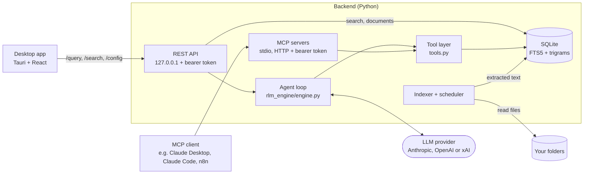

# RootMind

Local document search with an agentic LLM loop. RootMind indexes the files in
folders you choose into SQLite FTS5. When you ask a question, a language model
decides what to search for and which documents to read, using a small set of
read-only tools. It answers with sources, down to the page, slide or sheet
where that can be resolved. The same tools are available to other agents over
MCP.

The repository has two parts:

- **Backend** (Python, FastAPI): indexer, full-text search, the agent loop, a
  localhost REST API, and MCP servers over stdio and HTTP.
- **Desktop app** (Tauri 2 with React and TypeScript, plus a Rust shell): a
  chat and search UI for Windows that ships with the backend and runs it.

> **Status:** this is a personal project. It is not commercially maintained and
> comes with no support commitment. Issues and pull requests are welcome and
> get a best-effort response.

## Install

Windows 10 or 11 (x64): download
**[RootMind-Setup-x64.exe](https://github.com/cgaeking/rootmind/releases/latest/download/RootMind-Setup-x64.exe)**
and run it. It installs RootMind for your account, with no administrator rights
and no Python needed. The app starts and stops its own backend.

The installer is not code-signed yet. Windows SmartScreen may show "Windows
protected your PC": choose **More info**, then **Run anyway**. If Smart App
Control is on, it may block the installer or the app's backend without that
choice; a blocked backend is reported in the app. Smart App Control has no
exception for a single app; signed releases, which are planned, will avoid
this.

Then add a folder under **Folders**. Indexing starts within about a minute,
and search works without an API key once the folder is indexed. To ask
questions, add an API key for Anthropic, OpenAI or xAI under **Settings**.

### Verify downloads

Each release lists the installer's size in its notes and ships `SHA256SUMS.txt`
and a build provenance attestation for every file. The hash must match the
file's line in `SHA256SUMS.txt`:

```powershell
(Get-FileHash .\RootMind-Setup-x64.exe -Algorithm SHA256).Hash.ToLower()
```

```sh
sha256sum --check --ignore-missing SHA256SUMS.txt
gh attestation verify RootMind-Setup-x64.exe --repo cgaeking/rootmind
```

### Update and uninstall

To update, run the installer of the new version. It asks you to close the app
if it is running, and keeps your settings, index and chats. If the background
service is on, it keeps running, and Settings then offers **Update service**
(one administrator approval). MCP clients that use the built-in backend over
stdio (see [Connect MCP clients](#connect-mcp-clients)) are stopped too, since
their program is replaced; restart them after the update.

Uninstall RootMind from Windows Settings → Apps. The option **Delete the
application data** also removes your chats and the built-in backend's
settings, index and logs. If the background service is installed, the
uninstaller asks whether to remove it too. A silent uninstall (`/S`, as
package managers run it) leaves the service in place. To remove it afterwards,
use an elevated PowerShell:

```powershell
sc.exe qc RootMind-Backend      # BINARY_PATH_NAME is the service's program
& "C:\Program Files\RootMind Service\<version>-<id>\rootmind-backend.exe" service uninstall
```

The service's data stays in `%ProgramData%\RootMind` (without its REST token).
Add `--purge` to delete it as well.

### Background service

By default the backend runs only while the app is open. Settings →
**Background service** turns it into the Windows service `RootMind-Backend`:
it keeps the index up to date while the app is closed and starts with Windows.

- It is offered to administrator accounts and needs one administrator
  approval. Turning it on carries your folders and settings over; the index
  is rebuilt for the service.
- The service runs as LocalSystem, but it reads **only folders and files your
  account can open without administrator rights**. Network drives and shares,
  system folders and other users' profiles are not available to it, and the
  Folders screen marks a folder it cannot read.
- Its REST API requires a token. The token is in
  `%ProgramData%\RootMind\data\rest_token.txt`, which only your account,
  SYSTEM and administrators can read. The app uses it only after checking that
  the service's own process listens on the port.
- The option **Also serve MCP over HTTP** adds a second service,
  `RootMind-MCP-HTTP`, for n8n and other remote agents (see below).

Turning the service off brings your settings back to the built-in backend.
[SECURITY.md](SECURITY.md#background-service) describes the security model.

## Connect MCP clients

MCP clients get the same read-only tools as the app's agent and use their own
model.

**Built-in backend (stdio).** The MCP client starts the bundled backend with
`mcp` and points it at the app's data folder. Replace `<you>` with your Windows
user name (the paths are the installer's defaults). Claude Desktop
(`claude_desktop_config.json`):

```json
{
  "mcpServers": {
    "rootmind": {
      "command": "C:\\Users\\<you>\\AppData\\Local\\RootMind\\backend\\rootmind-backend.exe",
      "args": ["mcp"],
      "env": {
        "RLM_HOME": "C:\\Users\\<you>\\AppData\\Local\\io.github.cgaeking.rootmind\\backend"
      }
    }
  }
}
```

Claude Code (one line; forward slashes work in every shell):

```bash
claude mcp add --transport stdio rootmind --env RLM_HOME=C:/Users/<you>/AppData/Local/io.github.cgaeking.rootmind/backend -- C:/Users/<you>/AppData/Local/RootMind/backend/rootmind-backend.exe mcp
```

The stdio server only serves; the index is updated while the app runs. It
reads the folder list when it starts, so restart the MCP client after you add
or remove folders.

MCP clients packaged as MSIX apps, such as Claude Desktop from the Microsoft
Store, run their servers in an app container: Windows keeps new files those
processes create under AppData in a private copy. SQLite's shared index files
are among them, so such a client may not see index updates reliably,
especially when it starts the server while the app is closed. With the
background service on, MCP over HTTP (below) avoids this.

**Background service (HTTP).** In service mode, use MCP over HTTP: tick
**Serve MCP over HTTP** under Settings → Background service. Settings then
shows the endpoint and the token, with copy buttons:

```bash
claude mcp add --transport http rootmind http://127.0.0.1:<port>/mcp \
  --header "Authorization: Bearer <token>"
```

The port is 3000 when it is free, otherwise one from 18400–18499. The token
is kept across updates, and the HTTP server picks up folder changes without a
restart.

### Reach MCP from n8n

Use n8n's **MCP Client Tool** node with the values that Settings → Background
service shows and copies:

| Field | Value |
|---|---|
| Endpoint | `http://127.0.0.1:<port>/mcp` |
| Server Transport | HTTP Streamable |
| Authentication | Header Auth |
| Header Name | `Authorization` |
| Header Value | `Bearer <token>` |

- **n8n on the same machine:** use the endpoint as shown.
- **n8n in Docker on the same machine:** inside a container, `127.0.0.1` is
  the container itself. Use `http://host.docker.internal:<port>/mcp`. Docker
  Desktop forwards that name to the host. If the connection is refused, run a
  reverse proxy on the host that listens on an address the container can
  reach and forwards to `127.0.0.1:<port>`, and keep that address closed to
  other machines.
- **n8n on another machine:** only through a TLS-terminating reverse proxy or
  a tunnel in front of `127.0.0.1:<port>`. Never expose the plain HTTP port:
  the server speaks plain HTTP, and anyone with the token can read every
  indexed document.

## How it works



1. **Indexing uses no LLM.** A connector walks each configured folder. Parsers
   extract text from PDF, DOCX, XLSX, PPTX, CSV, Markdown and other text files.
   The text goes into SQLite: a documents table, an FTS5 index and a trigram
   table for typo-tolerant search. PDF pages, slides and sheets keep markers in
   the text, so a hit can be cited by location. Unchanged files are skipped by
   content hash.
2. **The model chooses what to read.** For `POST /query`, the engine offers the
   model five read-only tools: `search_documents`, `search_fuzzy`,
   `list_documents`, `read_document` and `get_statistics`. A typical run is:
   search, read the window around a hit, perhaps search again with other words,
   then answer.
3. **The loop is bounded.** The loop makes at most 10 model calls that may
   request tools. If the model is still searching after that, one final call
   with tools disabled asks it to answer from what it has found. At most 8
   tool calls run per model turn, and the tool results of one question are
   capped at 200,000 characters; calls beyond that get an error result
   instead of running. Every LLM call has a timeout, a read returns at most
   50,000 characters, tool errors go back to the model as error results
   instead of ending the loop, and an answer cut off by the output token
   limit says so.
4. **Answers carry sources.** The response lists the documents the model read,
   with page, slide or sheet where it can be resolved, every tool call it
   made, and why each LLM call stopped.
5. **MCP clients bring their own model.** Over MCP, RootMind serves the same
   tool definitions and the client's model does the deciding. Search and
   indexing never need an API key; only questions (`POST /query`), chat titles
   and the model list in the settings call the provider.

The desktop app runs the backend in one of three ways: the **built-in**
backend (a child process of the app, the default), the **background service**,
or a **custom** backend at an address you enter under Settings → Advanced.
[ARCHITECTURE.md](ARCHITECTURE.md#deployment-modes) has the details.

## Why a tool loop instead of embedding RAG

A typical RAG pipeline splits documents into chunks, embeds them, retrieves
the top matches by vector similarity and puts those chunks into the prompt.
The model sees only what that retrieval step picked.

RootMind keeps each document's full text in a full-text index and lets the
model drive retrieval. It can search, look at the snippets, read the text
around a hit, and search again with different terms when the first query
misses. This is sometimes called RLM-style or agentic retrieval. The engine
module is named `rlm_engine` after that idea; in this code base it is a bounded
tool-use loop, not a model that calls itself recursively.

| Works well | Works less well |
|---|---|
| Exact terms: invoice numbers, product codes, names, amounts | Synonyms and paraphrases: "vacation" does not match "paid time off" unless the model tries the other word |
| No embedding model or vector store; indexing only parses text and works offline | Questions in a different language than the documents |
| The model reads the context around a hit, such as the table header above a number, instead of an isolated chunk | More LLM round trips per question, so more latency and token cost |
| Every retrieval step is visible as a tool call | Answer quality depends on the model's search strategy |

Trigram fuzzy search covers typos, not synonyms. Eval case c09 (the synonym
trap) keeps that weakness visible.

## Install for developers and servers

**With uv** (any OS with Python 3.12 or newer; uv installs it if needed):

```bash
uv tool install "git+https://github.com/cgaeking/rootmind@v1.2.0#subdirectory=backend"
rootmind --help        # api, index, rebuild-trigrams, mcp, mcp-http, service
```

This installs the commands `rootmind`, `rootmind-mcp` and `rootmind-mcp-http`.
On Windows, `rootmind service status` and `rootmind service uninstall` work
from such an install, but `rootmind service install` is refused and prints the
download address of the release build. The service runs as SYSTEM, so it may
only run a program from a folder that administrators alone can change;
`service install` copies the release build into such a folder, while a uv or
pip environment lives in a folder your account can change.

**Windows server or a machine without the app.** The release also contains
the backend alone, `rootmind-backend-windows-x64.zip`. Download and check it
in PowerShell:

```powershell
$base = "https://github.com/cgaeking/rootmind/releases/latest/download"
Invoke-WebRequest "$base/rootmind-backend-windows-x64.zip" -OutFile rootmind-backend-windows-x64.zip -UseBasicParsing
Invoke-WebRequest "$base/SHA256SUMS.txt" -OutFile SHA256SUMS.txt -UseBasicParsing
$line = Select-String -Path SHA256SUMS.txt -SimpleMatch "rootmind-backend-windows-x64.zip"
$expected = ($line.Line -split '\s+')[0]
$actual = (Get-FileHash rootmind-backend-windows-x64.zip -Algorithm SHA256).Hash.ToLower()
if ($actual -ne $expected) { throw "Checksum mismatch: $actual" }
Expand-Archive rootmind-backend-windows-x64.zip -DestinationPath .
```

Then, from an elevated PowerShell of the account whose folders RootMind should
index (it must be a local administrator), in the folder where you unzipped it:

```powershell
Set-Location <download folder>   # the folder that holds rootmind-backend
# install, or update an installed service
.\rootmind-backend\rootmind-backend.exe service install --import-config C:\path\to\config.yaml
# state, port, version and token files (works without elevation)
.\rootmind-backend\rootmind-backend.exe service status
# remove the service; --purge also deletes its data
.\rootmind-backend\rootmind-backend.exe service uninstall
```

`service install` copies the program to
`%ProgramFiles%\RootMind Service\<version>-<id>\`, so the unzipped folder is
not needed afterwards. It uses port 8000 and, with `--mcp-http`, port 3000 for
MCP; `--port auto` and `--mcp-port auto` fall back to 18300–18399 and
18400–18499 when those are taken. `--import-config` takes the folders and
settings from a `config.yaml` like
[`backend/config.example.yaml`](backend/config.example.yaml). Running
`service install` again updates the service and keeps its ports, tokens and
data; `service install --help` lists every option. The REST token is in
`%ProgramData%\RootMind\data\rest_token.txt` and the MCP token in
`%ProgramData%\RootMind\data\api_token.txt`.

The zip also runs without a service, for example
`rootmind-backend.exe api --require-token` or `rootmind-backend.exe mcp-http`.

## Run from source

You need [uv](https://docs.astral.sh/uv/); it installs Python 3.12 if
necessary. The desktop app also needs Node 24, pnpm 11, Rust 1.96 or newer and, on
Windows, the MSVC build tools and WebView2.

### 1. Index and search without an API key

```bash
cd backend
uv sync
cp config.example.yaml config.yaml   # indexes the fictional demo corpus in evals/corpus
uv run rootmind index                # builds data/index.db; no LLM involved
uv run rootmind api                  # REST API on http://127.0.0.1:8000, no token
```

In a second terminal:

```bash
curl "http://127.0.0.1:8000/search?q=total%20due&limit=3&snippets=true"
```

The first hit is `invoice_INV-2026-0142.pdf` with `"page": "Page 2"` and a
snippet around the match. Without `snippets=true` the search returns only the
ranked list, which is faster on large indexes.

The interactive API docs are at <http://127.0.0.1:8000/docs>. While the API
runs, it re-indexes about 30 seconds after start and then every 24 hours
(`indexer.sync_interval_hours`). To index your own files, add entries under
`connectors` in `config.yaml`. Use absolute paths: relative connector paths
resolve against the working directory.

`rootmind api` started this way requires no token, as before. To require one,
set `RLM_API_TOKEN` or pass `--require-token`, which creates
`data/rest_token.txt`, and send `Authorization: Bearer <token>` with each
request. The docs pages are off while a token is required.

### 2. Ask a question

Set a key for one provider (`ANTHROPIC_API_KEY`, `OPENAI_API_KEY` or
`XAI_API_KEY`) in the environment or in `backend/.env` (see
[`.env.example`](backend/.env.example)). Choose the provider and model under
`llm` in `config.yaml`, restart the API, then:

```bash
curl -X POST http://127.0.0.1:8000/query \
  -H "Content-Type: application/json" \
  -d '{"question": "What is the total amount due on invoice INV-2026-0142?"}'
```

The response contains `answer`, `sources` (with `page` where known),
`tool_calls` and `tokens_used`. The question, search snippets and document
excerpts go to the provider you configured; see [SECURITY.md](SECURITY.md).

### 3. Use the tools from an MCP client

The MCP servers read the same `config.yaml` and database as the REST API. They
only serve and never index, so keep the index current with `rootmind index` or
a running REST API.

Claude Desktop (`claude_desktop_config.json`):

```json
{
  "mcpServers": {
    "rootmind": {
      "command": "uv",
      "args": ["--directory", "/absolute/path/to/rootmind/backend", "run", "rootmind-mcp"]
    }
  }
}
```

If Claude Desktop cannot find `uv`, put the absolute path of the `uv`
executable into `command`. On Windows, write the paths with forward slashes or
escaped backslashes (`C:\\...`).

Claude Code:

```bash
claude mcp add --transport stdio rootmind -- \
  uv --directory /absolute/path/to/rootmind/backend run rootmind-mcp
```

Over HTTP, for MCP clients that cannot start a local process:

```bash
cd backend
uv run rootmind-mcp-http             # http://127.0.0.1:3000/mcp
```

On first start the server generates a token and saves it to
`data/api_token.txt` (under `RLM_HOME`, or the working directory when that is
unset); alternatively, set `MCP_API_TOKEN`. The server prints where the token
came from and a short fingerprint of it, never the token itself. Then:

```bash
claude mcp add --transport http rootmind http://127.0.0.1:3000/mcp \
  --header "Authorization: Bearer <token from data/api_token.txt>"
```

The stdio server reads the folder list at startup, so restart it (the MCP
client) after adding or removing folders. The HTTP server re-reads it when
`config.yaml` changes. The HTTP server binds to 127.0.0.1 and speaks plain
HTTP; to reach it from another machine, put it behind a TLS-terminating proxy
or tunnel and never expose the plain port. `rootmind-mcp-http --index` also
runs the background indexer in that process. Use it only when no REST API
indexes the same database: every indexing process removes the documents of
folders that are missing from its own copy of the config.

### 4. Run the desktop app (development)

```bash
# terminal 1: backend, with the Vite dev origin allowed by CORS
cd backend
RLM_DEV=1 uv run rootmind api        # PowerShell: $env:RLM_DEV=1; uv run rootmind api

# terminal 2: desktop
cd desktop
pnpm install
pnpm tauri dev
```

A development build has no bundled backend, so the app asks for a backend
address: confirm `http://127.0.0.1:8000`. More in
[desktop/README.md](desktop/README.md).

### Build the installer yourself

On Windows, from the repository root:

```powershell
# 1. Backend: PyInstaller onedir build -> backend/dist/rootmind-backend/
cd backend
uv sync --locked --no-dev --group build
uv run --no-sync pyinstaller packaging/rootmind-backend.spec --noconfirm --clean --distpath dist
cd ..

# 2. Copy it to desktop/src-tauri/binaries/rootmind-backend/ and check it
python scripts/prepare_backend.py

# 3. Installer with the release overlay, which adds the backend
cd desktop
pnpm install
pnpm tauri build --config src-tauri/tauri.release.conf.json
```

The installer is written to `desktop/src-tauri/target/release/bundle/nsis/`.
Run `uv sync` in `backend/` afterwards to get the development tools back.
Without the overlay, `pnpm tauri build` builds an app without a backend. Set
`VITE_APP_LANG=de` before step 3 for the German UI.

## Repository layout

```
backend/
  src/rootmind/
    rlm_engine/engine.py   agent loop
    tools.py               tool registry, argument validation, result formatting
    mcp_stdio.py           MCP server over stdio
    mcp_http.py            MCP server over HTTP with a bearer token
    api/                   REST API (FastAPI)
    auth.py, access.py     REST token handling; folder access policy interface
    winaccess.py           folder access policy of the Windows service (AuthZ)
    service/               Windows service: install, uninstall, status, service host
    database/              SQLite models, FTS5 and trigram search
    indexer/               parsers, indexer, sync scheduler
    connectors/            local folder connector
  tests/                   offline test suite with fake LLM clients; e2e/ service test
  evals/                   fictional corpus and eval cases
  scripts/                 eval runner and corpus generator
  packaging/               PyInstaller spec, smoke test, tree hash
  deploy/windows/          run-backend.bat and notes on older service setups
desktop/
  src/                     React + TypeScript UI
  src-tauri/               Rust shell: built-in backend, service commands, chat history, installer hooks
  scripts/                 installer smoke test
packaging/winget/          winget manifest templates
scripts/                   version check, release notes, backend preparation, winget rendering
.github/workflows/         CI and release
```

Design decisions, guardrails and trade-offs are described in
[ARCHITECTURE.md](ARCHITECTURE.md), the threat model in [SECURITY.md](SECURITY.md),
and the changes per version in [CHANGELOG.md](CHANGELOG.md).

## Tests and evals

Both run offline and need no API key:

```bash
cd backend
uv sync
uv run pytest -q                      # fake LLM clients, generated test corpus
uv run python scripts/run_evals.py    # retrieval regression: scripted policy, no model
```

**Tests.** An autouse fixture replaces the Anthropic and OpenAI client
constructors with functions that raise and removes API keys from the
environment. Tests inject scripted fake clients
([`tests/fakes.py`](backend/tests/fakes.py)) through the engine's `client`
parameter. Every test gets its own `RLM_HOME` and working directory. Tests
that need documents get a small generated corpus with one PDF, DOCX, XLSX,
PPTX, CSV, Markdown and text file each. Tests of the Windows folder access
policy and of the service's folder permissions run on Windows only; installing
real services is left to the CI end-to-end test.

**Evals.** [`scripts/run_evals.py`](backend/scripts/run_evals.py) indexes the
fictional corpus in [`backend/evals/corpus/`](backend/evals/corpus/) with the
real indexer and runs 16 questions through the real engine.

- *Live mode* is the eval: it runs a real model several times per case and
  reports pass rate (expected source cited, required strings present,
  forbidden strings absent), tool-path variance, tool calls, tokens, latency
  and stop reasons. It reads keys only from environment variables and never
  runs in CI.
- *Dry mode* is a retrieval regression test, not an eval of the agent: a
  scripted policy replaces the model, searches with a query written by hand
  for each case (`dry_search` in the dataset), reads the suggested window and
  answers with the excerpt. It checks that the index and the tool layer
  still put the right document first (hit@1), among the first five hits
  (hit@5), and cite the right page, slide or sheet. With hand-picked queries
  1.0 on the 15 gated cases is the expected result; c09, the synonym trap,
  is the known miss. CI fails if hit@5 drops below 1.0. It says nothing
  about answer quality.

Details: [backend/evals/README.md](backend/evals/README.md).

**CI.** GitHub Actions workflows with actions pinned by commit SHA and no
secrets. Only the release job can write to the repository:

| Workflow | What it runs |
|---|---|
| [`backend.yml`](.github/workflows/backend.yml) | ruff check and format check; the version check across backend and desktop; the tests of the release scripts on Ubuntu and Windows; pytest with coverage on Ubuntu (Python 3.12 and 3.14) and Windows (Python 3.12); the dry retrieval regression |
| [`backend-exe.yml`](.github/workflows/backend-exe.yml) | The PyInstaller onedir build on Windows, a smoke test of the executable (REST, MCP over HTTP and stdio, indexing of every file type) and its tree hash; then an end-to-end test of the Windows service on the elevated runner: install, permissions, tokens, read confinement, update and uninstall. On pull requests the service test runs only when service-related code changed |
| [`desktop.yml`](.github/workflows/desktop.yml) | ESLint, TypeScript typecheck, vitest, Vite build, `cargo fmt`, `cargo clippy`, `cargo check`, `cargo test` on Windows |
| [`release.yml`](.github/workflows/release.yml) | For a version tag `v*`: the backend through `backend-exe.yml`, the installer with that backend and an install/update/uninstall smoke test, the winget manifests validated against their schemas, then a GitHub Release with `SHA256SUMS.txt` and attestations. Manual runs and pull requests that change the packaging are dry runs that publish nothing |
| [`secrets.yml`](.github/workflows/secrets.yml) | detect-secrets over all tracked files, against the audited baseline `.secrets.baseline` |

Dependabot ([`.github/dependabot.yml`](.github/dependabot.yml)) proposes
monthly dependency updates for all four ecosystems.

## Security model in short

- RootMind is built for one person on their own computer. The REST API binds
  to 127.0.0.1, refuses connections from other machines, rejects foreign
  `Host` headers and allows cross-origin requests only from the desktop app.
- The app's built-in backend and the background service require a bearer
  token on the REST API. `rootmind api` from source runs without a token
  unless you ask for one; without a token, any local process can call it.
- The background service runs as LocalSystem but reads only what the
  installing account can read without administrator rights. It is offered to
  administrator accounts only.
- The MCP HTTP server requires a bearer token and binds to 127.0.0.1.
- Indexing stays on your machine. Answering a question sends the question,
  search snippets and document excerpts to the LLM provider you configured.
- Indexed documents are untrusted input. All tools are read-only, document
  text is marked as data, and a question's tool use is capped, but prompt
  injection is not a solved problem.

The full threat model is in [SECURITY.md](SECURITY.md).

## Limitations

- The desktop app, its installer and the background service are Windows only.
  The backend is cross-platform Python; CI runs its tests on Ubuntu and
  Windows.
- The release binaries are not code-signed yet (see [Install](#install)).
  RootMind is not in the winget repository yet; submitting it is planned once
  the binaries are signed.
- No OCR: scanned PDFs without a text layer produce no text.
- Legacy `.doc` and `.xls` files go to the DOCX and XLSX parsers and usually
  fail to parse.
- No streaming: the desktop app waits for the complete answer.
- Full-text search has no synonym or cross-language matching (see the
  trade-off table above).
- The built-in backend and the background service each keep their own index.
  The service builds its index from scratch, and sources in older chats may
  not open until it has caught up.
- The background service cannot index network drives or shares.
- Only one process per database should index. The MCP servers only serve by
  default; set `RLM_DISABLE_SCHEDULER=1` on any additional REST API that
  shares the database.
- The MCP stdio server reads the list of folders at startup; restart it after
  changing folders.
- An incremental sync hashes every file in every configured folder, which is
  slow for very large folders.

## Contributing

See [CONTRIBUTING.md](CONTRIBUTING.md) for the development setup, checks,
conventions and the release steps. Please report security issues privately as
described in [SECURITY.md](SECURITY.md).

## License

[MIT](LICENSE), copyright (c) 2026 Christian Gäking.

The packaged backend and the installer bundle third-party dependencies, which
keep their own licenses.
