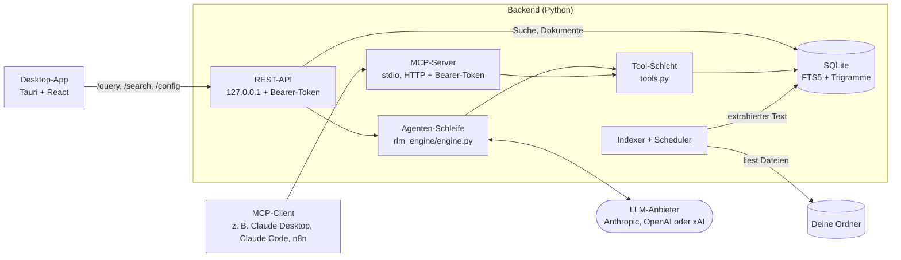

# Für Entwickler

[English](DEVELOPMENT.md) | **Deutsch**

Hintergrund für Entwickler und Administratoren: wie RootMind aufgebaut ist, wie man es aus dem Quellcode und auf Servern betreibt, die Kommandozeile, Tracing und Tests. Nutzer beginnen mit der [README](../README.de.md).

## Was es ist

Das Repository hat zwei Teile:

- **Backend** (Python, FastAPI): Indexer, Volltextsuche, die Agenten-Schleife,
  eine REST-API auf localhost und MCP-Server über stdio und HTTP.
- **Desktop-App** (Tauri 2 mit React und TypeScript, dazu eine Rust-Shell):
  eine Chat- und Suchoberfläche für Windows und Linux, auf Deutsch und
  Englisch. Unter Windows richtet ihr Installer das Backend als Windows-Dienst
  ein, unter Linux richtet die App es als systemd-Benutzerdienste deines
  Kontos ein. Die App spricht mit diesem Dienst.

> **Status:** Dies ist ein persönliches Projekt. Es wird nicht kommerziell
> gepflegt, und es gibt keine Support-Zusage. Issues und Pull Requests sind
> willkommen und werden nach bestem Bemühen beantwortet.

## So funktioniert es im Detail



1. **Die Indizierung nutzt kein LLM.** Ein Connector durchläuft jeden
   konfigurierten Ordner. Parser extrahieren Text aus PDF, DOCX, XLSX, PPTX,
   CSV, Markdown und anderen Textdateien. Der Text landet in SQLite: in einer
   Dokumenttabelle, einem FTS5-Index und einer Trigramm-Tabelle für
   tippfehlertolerante Suche. PDF-Seiten, Folien und Tabellenblätter behalten
   Markierungen im Text, sodass sich ein Treffer mit seiner Fundstelle
   zitieren lässt. Unveränderte Dateien werden anhand ihres Inhalts-Hashs
   übersprungen.
2. **Das Modell wählt, was es liest.** Für `POST /query` bietet die Engine dem
   Modell fünf lesende Tools an: `search_documents`, `search_fuzzy`,
   `list_documents`, `read_document` und `get_statistics`. Ein typischer
   Ablauf: suchen, den Bereich um einen Treffer lesen, eventuell mit anderen
   Wörtern erneut suchen, dann antworten.
3. **Die Schleife ist begrenzt.** Die Schleife macht höchstens 10
   Modellaufrufe, die Tools anfordern dürfen. Sucht das Modell danach noch,
   bittet ein letzter Aufruf mit abgeschalteten Tools um eine Antwort aus dem
   bisher Gefundenen. Pro Modell-Zug laufen höchstens 8 Tool-Aufrufe, und die
   Tool-Ergebnisse einer Frage sind auf 200.000 Zeichen begrenzt; Aufrufe
   darüber hinaus bekommen ein Fehlerergebnis, statt zu laufen. Jeder
   LLM-Aufruf hat ein Timeout, ein Lesevorgang liefert höchstens 50.000
   Zeichen, Tool-Fehler gehen als Fehlerergebnis an das Modell zurück, statt
   die Schleife zu beenden, und eine Antwort, die am Ausgabe-Token-Limit
   abgeschnitten wurde, sagt das.
4. **Antworten nennen ihre Quellen.** Die Antwort listet die Dokumente, die das
   Modell gelesen hat, mit Seite, Folie oder Tabellenblatt, wo sich das
   bestimmen lässt, jeden Tool-Aufruf und warum jeder LLM-Aufruf geendet hat.
   `POST /query/stream` liefert dieselbe Antwort und meldet jeden Modell- und
   Tool-Aufruf, wenn er beginnt und endet (Server-Sent Events), sodass ein
   Client zeigen kann, was der Agent gerade tut; wird die Verbindung
   geschlossen, endet die Frage.
5. **MCP-Clients bringen ihr eigenes Modell mit.** Über MCP stellt RootMind
   dieselben Tool-Definitionen bereit, und das Modell des Clients entscheidet.
   Suche und Indizierung brauchen nie einen API-Key; nur Fragen
   (`POST /query`), Chat-Titel und die Modell-Liste in den Einstellungen rufen
   den Anbieter auf.

Die Desktop-App spricht mit dem **RootMind-Dienst** auf demselben Computer
oder mit einem **eigenen** Backend unter einer Adresse, die du unter
Einstellungen → **RootMind-Dienst** → **Remote** einträgst. Entwicklungs-Builds nutzen den Dienst
nicht und fragen nach einer Backend-Adresse.
[ARCHITECTURE.md](../ARCHITECTURE.md#deployment-modes) (englisch) beschreibt die
Details.

## Installation für Entwicklung und Server

**Mit uv** (jedes Betriebssystem mit Python 3.12 oder neuer; uv installiert
es bei Bedarf):

```bash
uv tool install "git+https://github.com/cgaeking/rootmind@v2.9.0#subdirectory=backend"
rootmind --help        # api, index, mcp, mcp-http, service, status, folders, search, ask, ...
```

Das installiert die Befehle `rootmind`, `rootmind-mcp` und
`rootmind-mcp-http`. Unter Windows funktionieren `rootmind service status` und
`rootmind service uninstall` aus einer solchen Installation, aber
`rootmind service install` wird abgelehnt und gibt die Download-Adresse des
Release-Builds aus. Der Dienst läuft als SYSTEM und darf deshalb nur ein
Programm aus einem Ordner ausführen, den allein Administratoren ändern können;
`service install` kopiert den Release-Build in einen solchen Ordner, während
eine uv- oder pip-Umgebung in einem Ordner liegt, den dein Konto ändern kann.

**Windows-Server oder ein Rechner ohne die App.** Das Release enthält auch das
Backend allein, `rootmind-backend-windows-x64.zip`. Lade es in PowerShell
herunter und prüfe es:

```powershell
$base = "https://github.com/cgaeking/rootmind/releases/latest/download"
Invoke-WebRequest "$base/rootmind-backend-windows-x64.zip" -OutFile rootmind-backend-windows-x64.zip -UseBasicParsing
Invoke-WebRequest "$base/SHA256SUMS.txt" -OutFile SHA256SUMS.txt -UseBasicParsing
$line = Select-String -Path SHA256SUMS.txt -SimpleMatch "rootmind-backend-windows-x64.zip"
$expected = ($line.Line -split '\s+')[0]
$actual = (Get-FileHash rootmind-backend-windows-x64.zip -Algorithm SHA256).Hash.ToLower()
if ($actual -ne $expected) { throw "Checksum mismatch: $actual" }
```

Entpacke es dann, aus einer PowerShell als Administrator des Kontos, dessen
Ordner RootMind indizieren soll (es muss ein lokaler Administrator sein), in
einen Ordner, den nur Administratoren ändern können, und installiere den
Dienst von dort. `service install` lehnt ein Programm in einem Ordner, den
andere Konten ändern können, etwa einem Download-Ordner, mit Exit-Code 10 ab:

```powershell
$dir = Join-Path $env:ProgramFiles "RootMind Backend"
Expand-Archive rootmind-backend-windows-x64.zip -DestinationPath $dir -Force
$exe = Join-Path $dir "rootmind-backend\rootmind-backend.exe"
# installieren oder einen installierten Dienst aktualisieren
& $exe service install
# Zustand, Port, Version und Token-Dateien (funktioniert ohne Administratorrechte)
& $exe service status
# den Dienst entfernen; --purge löscht auch seine Daten
& $exe service uninstall
```

`service install` kopiert das Programm nach
`%ProgramFiles%\RootMind Service\<version>-<id>\`, der entpackte Ordner wird
danach also nicht mehr gebraucht. Der Dienst nutzt Port 8000 und für MCP über
HTTP Port 3000; `--port auto` und `--mcp-port auto` weichen auf 18300–18399
und 18400–18499 aus, wenn diese belegt sind. MCP über HTTP ist bei einer
Neuinstallation eingeschaltet; `--no-mcp-http` lässt es weg. Ein erneutes
`service install` aktualisiert den Dienst und behält seine Ports, die
MCP-Einstellung, Tokens und Daten; `service install --help` listet alle
Optionen. Das REST-Token liegt in `%ProgramData%\RootMind\data\rest_token.txt`
und das MCP-Token in `%ProgramData%\RootMind\data\api_token.txt`.

Ein neu installierter Dienst startet ohne Ordner. Füge sie mit
`& $exe folders add D:\Freigaben\Projekte` hinzu (siehe
[Kommandozeile](#kommandozeile), ohne Administratorrechte), oder trage sie
unter `connectors` in `%ProgramData%\RootMind\config.yaml` ein (wie in
[`backend/config.example.yaml`](../backend/config.example.yaml); die Datei lässt
sich nur in einer Eingabeaufforderung als Administrator ändern) und starte den
Dienst mit `Restart-Service RootMind-Backend` neu.

Das Zip läuft auch ohne Dienst, zum Beispiel
`rootmind-backend.exe api --require-token` oder
`rootmind-backend.exe mcp-http`.

**Linux-Server oder ein Rechner ohne die App.** Das Release enthält das
Linux-Backend allein, `rootmind-backend-linux-x64.tar.gz` (x86-64, glibc 2.35
oder neuer). Entpacke es als das Konto, dessen Ordner RootMind indizieren soll
(nicht root), in einen Ordner, den nur du ändern kannst, und installiere den
Dienst von dort:

```sh
base=https://github.com/cgaeking/rootmind/releases/latest/download
curl -L -O "$base/rootmind-backend-linux-x64.tar.gz" -O "$base/SHA256SUMS.txt"
sha256sum --check --ignore-missing SHA256SUMS.txt
mkdir -p ~/opt && tar -xzf rootmind-backend-linux-x64.tar.gz -C ~/opt
exe=~/opt/rootmind-backend/rootmind-backend
"$exe" service install      # installieren oder die installierten Dienste aktualisieren
"$exe" service status       # Zustand, Port, Version und Token-Dateien
"$exe" service uninstall    # entfernen; --purge löscht auch die Daten
loginctl enable-linger "$USER"   # auch ohne Anmeldung laufen lassen
```

`service install` kopiert das Programm nach
`~/.local/share/rootmind/runtime/<version>-<id>/` und schreibt die beiden
Units nach `~/.config/systemd/user/`; es braucht den systemd-Benutzermanager
des Kontos, den eine Desktop- oder SSH-Anmeldung startet
(Exit-Code 11 ohne ihn, zum Beispiel unter `su` oder `sudo`). Ports, Optionen
und Tokens sind die von Windows; die Daten liegen in `~/.local/share/rootmind`
(`config.yaml`, `data/rest_token.txt`, `data/api_token.txt`). Die
Ordner und den LLM-Key setzt du mit `"$exe" folders add` und
`"$exe" config llm` (siehe [Kommandozeile](#kommandozeile)); nach einer
Änderung an `config.yaml` von Hand startest du den Dienst mit
`systemctl --user restart rootmind-backend` neu.

## Kommandozeile

Dasselbe Programm, das den Dienst ausführt, verwaltet ihn auch. Diese Befehle
sprechen über die REST-API mit dem RootMind-Dienst deines Kontos, unter
Windows wie unter Linux, und brauchen nie root oder eine
Administrator-Eingabeaufforderung:

```sh
rootmind status                                  # Dienst, Index, Ordner, MCP-Endpunkt, Fernzugriff
rootmind folders list
rootmind folders add /srv/shares/projekte --name projekte [--rescan-minutes 10]
rootmind folders remove projekte
rootmind index [--full] [--folder projekte] [--wait]
rootmind search "rechnung telekom" [--limit 10] [--snippets]
rootmind ask "Was sagt der Vertrag mit Fjordhaus zu Kündigungsfristen?"
rootmind config llm                              # Anbieter, Modell, welche Keys gespeichert sind
rootmind config llm --provider anthropic --model claude-sonnet-5-5 --key-file ~/anthropic.key
rootmind mcp tokens list                         # Namen, Ordner, Fingerabdrücke
rootmind mcp tokens create alice --folders projekte --out alice.token
rootmind mcp tokens revoke alice
rootmind remote-access on|off|status             # der ngrok-Tunnel
rootmind check-models [--provider openai] [--write DATEI]  # jedes Chat-Modell der gespeicherten Keys prüfen
```

`rootmind` ist der Befehl einer uv- oder pip-Installation. Mit der App oder
dem Backend-Archiv rufst du das Backend selbst auf: `rootmind-backend` (Linux:
`/usr/lib/RootMind/backend/rootmind-backend` aus dem .deb und .rpm,
`~/opt/rootmind-backend/rootmind-backend` aus dem tar.gz) oder unter Windows
`& "$env:ProgramFiles\RootMind\backend\rootmind-backend.exe"`. Jeder Befehl
kennt `--json` für Skripte und `--help`.

- **Wie er den Dienst findet.** Wie die App fragt er `service status` nach
  dem Port und der Token-Datei, lässt den Dienst auf dem Port beweisen, dass
  er das Token kennt, und schickt erst dann das REST-Token. Das Token steht
  in `data/rest_token.txt` im Datenordner, den nur das Konto lesen kann, das
  den Dienst eingerichtet hat (unter Windows auch SYSTEM und Administratoren
  aus einer Eingabeaufforderung als Administrator). Von einem anderen Konto
  oder mit `sudo` brechen die Befehle mit Exit-Code 4 ab und sagen, warum.
- **Geheimnisse bleiben aus der Kommandozeile heraus.** `config llm` liest
  den API-Key aus einer Datei (`--key-file DATEI`) oder von stdin
  (`--key-file -`, im Terminal ohne Echo), nie aus einem Argument, und gibt
  nie einen Key aus, auch nicht maskiert; `--remove-key` entfernt ihn.
  `remote-access on --authtoken-file DATEI` speichert das ngrok-Authtoken
  ebenso. Tokens werden nie ausgegeben; `mcp tokens list` zeigt den
  Fingerabdruck, den auch der MCP-Dienst protokolliert, und
  `mcp tokens create` schreibt ein neues Token in eine neue Datei (unter
  Linux mit Modus 0600, unter Windows nur für dein Konto lesbar; `--out DATEI`,
  oder `--out -` gibt es stattdessen aus).
- **Ein anderes Backend.** `--url http://127.0.0.1:18000 --token-file DATEI`
  (oder `RLM_URL` und `RLM_TOKEN_FILE`) nimmt stattdessen diese REST-API,
  etwa ein Entwicklungs-Backend (`rootmind api`). Unverschlüsseltes `http://`
  wird nur für `127.0.0.1`, `localhost` und `::1` angenommen; für alles andere
  `https://` oder einen SSH-Tunnel verwenden.
- **`index` in diesem Prozess.** `rootmind index --local` indiziert die
  Ordner aus `config.yaml` (in `RLM_HOME` oder dem Arbeitsordner) im Prozess
  des Befehls selbst, wie `rootmind index` vor 2.5. `--local` gilt auch bei
  einem globalen `--config`, bei gesetztem `RLM_HOME` und wenn dein Konto
  keinen RootMind-Dienst hat (dann sagt ein Hinweis das).
- **Exit-Codes:** 0 erledigt, 1 der Dienst hat die Anfrage abgelehnt oder
  sie ist fehlgeschlagen, 2 falscher Aufruf, 3 kein Dienst gefunden, gestoppt
  oder keine Antwort (oder ein anderes Programm auf seinem Port), 4 das Token
  ist nicht lesbar oder wurde abgelehnt.

**RootMind auf einem Server.** Ein Linux-Server kann freigegebene Ordner
indizieren (`--rescan-minutes` durchsucht eingehängte Netzwerkfreigaben
regelmäßig neu) und MCP über TLS oder hinter einem Reverse Proxy an andere
Rechner ausliefern, mit einem benannten Token pro Person oder Client, jedes
auf bestimmte Ordner beschränkt (`mcp tokens create --folders`). Die
Anleitung (englisch) ist [docs/SERVER.md](SERVER.md); lies vorher das
[Bedrohungsmodell für den Serverbetrieb](../SECURITY.md#server-use): Die
Ordner-Beschränkung eines Tokens ist die einzige Zugriffskontrolle,
Freigabe-Rechte werden nicht pro Benutzer geprüft.

## Die Agenten-Schleife nachverfolgen (Tracing)

Tracing ist standardmäßig aus. Eingeschaltet zeichnet es jeden Schritt einer
Frage auf: jeden Modellaufruf (Zweck, Tokens, Stop-Grund, die angeforderten
Tools, Dauer), jeden Tool-Aufruf (Argumente, Ergebnisgröße, die Treffer einer
Suche, die gelesenen Fenster) und die Antwort.

- **Evals:** `scripts/run_evals.py --trace <Ordner>` schreibt pro Eval-Lauf
  eine JSONL-Datei und eine lesbare Markdown-Zusammenfassung (siehe
  [`backend/evals`](../backend/evals/README.md#tracing-a-run)).
- **Backend:** `tracing: {local: true}` in der `config.yaml` schreibt dieselben
  Dateien nach `logs/traces/` im Datenordner von RootMind. Nichts verlässt den
  Rechner.
- **Langfuse (optional):** `tracing: {langfuse: true}` oder `--langfuse` beim
  Eval-Runner exportiert Traces an einen Langfuse-Server. Das braucht das Extra
  `tracing` (`uv sync --extra tracing`; nicht im paketierten Backend) und
  `LANGFUSE_PUBLIC_KEY`, `LANGFUSE_SECRET_KEY` und `LANGFUSE_BASE_URL` in der
  Umgebung. Ein selbst betriebenes Langfuse behält die Traces in deinem Netz;
  Langfuse Cloud ist ein Drittanbieter.

Traces enthalten deine Fragen, die Tool-Argumente des Modells und den
Dokumenttext, den es gelesen hat. API-Keys enthalten sie nie. Siehe
[SECURITY.md](../SECURITY.md#what-leaves-the-machine).

## Aus dem Quellcode starten

Du brauchst [uv](https://docs.astral.sh/uv/); es installiert bei Bedarf
Python 3.12. Die Desktop-App braucht außerdem Node 24, pnpm 11, Rust 1.96
oder neuer und unter Windows die MSVC Build Tools und WebView2.

### 1. Indizieren und suchen ohne API-Key

```bash
cd backend
uv sync
cp config.example.yaml config.yaml   # indiziert den fiktiven Demo-Korpus in evals/corpus
uv run rootmind index --local        # baut data/index.db; kein LLM beteiligt
uv run rootmind api                  # REST-API auf http://127.0.0.1:8000, ohne Token
```

In einem zweiten Terminal:

```bash
curl "http://127.0.0.1:8000/search?q=total%20due&limit=3&snippets=true"
```

Der erste Treffer ist `invoice_INV-2026-0142.pdf` mit `"page": "Page 2"` und
einem Snippet um die Fundstelle. Ohne `snippets=true` liefert die Suche nur
die sortierte Liste, was bei großen Indizes schneller ist.

Die interaktive API-Dokumentation liegt unter <http://127.0.0.1:8000/docs>.
Solange die API läuft, indiziert sie etwa 30 Sekunden nach dem Start neu und
danach alle 24 Stunden (`indexer.sync_interval_hours`). Um eigene Dateien zu
indizieren, füge in `config.yaml` Einträge unter `connectors` hinzu. Nutze
absolute Pfade: Relative Connector-Pfade werden relativ zum
Arbeitsverzeichnis aufgelöst.

`rootmind api`, so gestartet, verlangt kein Token. Um eines zu verlangen,
setze `RLM_API_TOKEN` oder übergib `--require-token`, was
`data/rest_token.txt` anlegt, und sende `Authorization: Bearer <token>` mit
jeder Anfrage. Die Dokumentationsseiten sind abgeschaltet, solange ein Token
verlangt wird.

### 2. Eine Frage stellen

Setze einen Key für einen Anbieter (`ANTHROPIC_API_KEY`, `OPENAI_API_KEY` oder
`XAI_API_KEY`) in der Umgebung oder in `backend/.env` (siehe
[`.env.example`](../backend/.env.example)). Wähle Anbieter und Modell unter `llm`
in `config.yaml`, starte die API neu und dann:

```bash
curl -X POST http://127.0.0.1:8000/query \
  -H "Content-Type: application/json" \
  -d '{"question": "What is the total amount due on invoice INV-2026-0142?"}'
```

Die Antwort enthält `answer`, `sources` (mit `page`, wo bekannt),
`tool_calls` und `tokens_used`. Die Frage, Such-Snippets und
Dokumentauszüge gehen an den konfigurierten Anbieter; siehe
[SECURITY.md](../SECURITY.md) (englisch).

### 3. Die Tools aus einem MCP-Client nutzen

Die MCP-Server lesen dieselbe `config.yaml` und Datenbank wie die REST-API.
Sie stellen nur bereit und indizieren nie; halte den Index also mit
`rootmind index --local` oder einer laufenden REST-API aktuell.

Claude Desktop (`claude_desktop_config.json`):

```json
{
  "mcpServers": {
    "rootmind": {
      "command": "uv",
      "args": ["--directory", "/absolute/path/to/rootmind/backend", "run", "rootmind-mcp"]
    }
  }
}
```

Findet Claude Desktop `uv` nicht, trage den absoluten Pfad der
`uv`-Programmdatei unter `command` ein. Unter Windows schreibst du die Pfade
mit Schrägstrichen oder mit maskierten Backslashes (`C:\\...`).

Claude Code:

```bash
claude mcp add --transport stdio rootmind -- \
  uv --directory /absolute/path/to/rootmind/backend run rootmind-mcp
```

Über HTTP, für MCP-Clients, die keinen lokalen Prozess starten können:

```bash
cd backend
uv run rootmind-mcp-http             # http://127.0.0.1:3000/mcp
```

Beim ersten Start erzeugt der Server ein Token und speichert es in
`data/api_token.txt` (unter `RLM_HOME` oder, wenn das nicht gesetzt ist, im
Arbeitsverzeichnis); alternativ setzt du `MCP_API_TOKEN`. Der Server gibt aus,
woher das Token stammt, und einen kurzen Fingerabdruck davon, nie das Token
selbst. Dann:

```bash
claude mcp add --transport http rootmind http://127.0.0.1:3000/mcp \
  --header "Authorization: Bearer <token from data/api_token.txt>"
```

Der stdio-Server liest die Ordnerliste beim Start; starte ihn (den
MCP-Client) also neu, nachdem du Ordner hinzugefügt oder entfernt hast. Der
HTTP-Server liest sie neu ein, wenn sich `config.yaml` ändert. Der
HTTP-Server bindet an 127.0.0.1 und spricht reines HTTP; um ihn von einem
anderen Rechner aus zu erreichen, stelle einen Proxy mit TLS-Terminierung
oder einen Tunnel davor und gib den unverschlüsselten Port nie frei.
`rootmind-mcp-http --index` startet in diesem Prozess zusätzlich den
Hintergrund-Indexer. Nutze das nur, wenn keine REST-API dieselbe Datenbank
indiziert: Jeder indizierende Prozess entfernt die Dokumente von Ordnern, die
in seiner eigenen Kopie der Konfiguration fehlen.

In einem LangChain- oder LangGraph-Agenten lassen sich dieselben Tools über
`langchain-mcp-adapters` laden: [examples/langchain_mcp](../examples/langchain_mcp/README.md)
startet `rootmind-mcp` über stdio und lässt den Standard-Agenten von LangChain
mit einem lokalen Ollama-Modell laufen (englisch).

### 4. Die Desktop-App starten (Entwicklung)

```bash
# Terminal 1: Backend, mit dem Vite-Dev-Origin in CORS erlaubt
cd backend
RLM_DEV=1 uv run rootmind api        # PowerShell: $env:RLM_DEV=1; uv run rootmind api

# Terminal 2: Desktop
cd desktop
pnpm install
pnpm tauri dev
```

Ein Entwicklungs-Build nutzt den RootMind-Dienst nicht, daher fragt die App
nach einer Backend-Adresse: Bestätige `http://127.0.0.1:8000`. Mehr dazu in
[desktop/README.md](../desktop/README.md) (englisch).

### Den Installer selbst bauen

Unter Windows, im Wurzelverzeichnis des Repositorys:

```powershell
# 1. Backend: PyInstaller-onedir-Build -> backend/dist/rootmind-backend/
cd backend
uv sync --locked --no-dev --group build
uv run --no-sync pyinstaller packaging/rootmind-backend.spec --noconfirm --clean --distpath dist
cd ..

# 2. Nach desktop/src-tauri/binaries/rootmind-backend/ kopieren und prüfen
python scripts/prepare_backend.py

# 3. Installer mit dem Release-Overlay, das das Backend hinzufügt
cd desktop
pnpm install
pnpm tauri build --config src-tauri/tauri.release.conf.json
```

Der Installer landet in `desktop/src-tauri/target/release/bundle/nsis/`.
Führe danach `uv sync` in `backend/` aus, um die Entwicklungswerkzeuge
zurückzubekommen. Ohne das Overlay baut `pnpm tauri build` eine App ohne
Backend.

## Aufbau des Repositorys

```
backend/
  src/rootmind/
    rlm_engine/engine.py   Agenten-Schleife
    tools.py               Tool-Registry, Argumentprüfung, Ergebnisformatierung
    tracing/               optionales Tracing der Agenten-Schleife: lokales JSONL, Langfuse-Export
    mcp_stdio.py           MCP-Server über stdio
    mcp_http.py            MCP-Server über HTTP mit Bearer-Token
    api/                   REST-API (FastAPI)
    auth.py, access.py     REST-Token; Schnittstelle der Ordner-Zugriffsregeln
    winaccess.py           Ordner-Zugriffsregeln des Windows-Dienstes (AuthZ)
    service/               Hintergrunddienst: install, uninstall, status, Dienst-Host;
                           Windows-Dienste und Linux-systemd-Benutzer-Units (linux*.py, systemd.py)
    database/              SQLite-Modelle, FTS5- und Trigramm-Suche
    indexer/               Parser, Indexer, Sync-Scheduler
    connectors/            Connector für lokale Ordner
  tests/                   Offline-Testsuite mit Fake-LLM-Clients; e2e/ Dienst-Test
  evals/                   fiktiver Korpus und Eval-Fälle
  scripts/                 Eval-Runner und Korpus-Generator
  packaging/               PyInstaller-Spec, Smoke-Test, Tree-Hash
  deploy/windows/          run-backend.bat: die REST-API aus dem Quellcode in einem Konsolenfenster
desktop/
  src/                     React- und TypeScript-Oberfläche
  src-tauri/               Rust-Shell: Verbindung zum Dienst, Dienst-Befehle, Chat-Verlauf;
                           installer/ mit NSIS-Vorlage und den Dienst-Hooks;
                           linux/ und tauri.linux.conf.json für Linux-Dienst und -Pakete
  scripts/                 Smoke-Test des Installers
packaging/winget/          Vorlagen für winget-Manifeste
packaging/mcpb/            Bundle für Claude Desktop (rootmind.mcpb): Brücke von stdio zu HTTP, Manifest, Tests, Vorlage für die MCP Registry
examples/langchain_mcp/    RootMinds MCP-Server als Tools in einem LangChain-Agenten (eigene Umgebung)
scripts/                   Versionsprüfung, Release Notes, Backend-Vorbereitung, winget-Rendering,
                           Aktualisierung der NSIS-Vorlage
.github/workflows/         CI und Release
```

Designentscheidungen, Schutzmechanismen und Abwägungen beschreibt
[ARCHITECTURE.md](../ARCHITECTURE.md), das Bedrohungsmodell
[SECURITY.md](../SECURITY.md) und die Änderungen je Version
[CHANGELOG.md](../CHANGELOG.md) (alle englisch).

## Tests und Evals

Beide laufen offline und brauchen keinen API-Key:

```bash
cd backend
uv sync
uv run pytest -q                      # Fake-LLM-Clients, generierter Test-Korpus
uv run python scripts/run_evals.py    # Such-Regressionstest: geskriptete Policy, kein Modell
```

**Tests.** Eine Autouse-Fixture ersetzt die Konstruktoren der Anthropic- und
OpenAI-Clients durch Funktionen, die eine Ausnahme werfen, und entfernt
API-Keys aus der Umgebung. Tests injizieren geskriptete Fake-Clients
([`tests/fakes.py`](../backend/tests/fakes.py)) über den Parameter `client` der
Engine. Jeder Test bekommt ein eigenes `RLM_HOME` und Arbeitsverzeichnis.
Tests, die Dokumente brauchen, bekommen einen kleinen generierten Korpus mit
je einer PDF-, DOCX-, XLSX-, PPTX-, CSV-, Markdown- und Textdatei. Tests der
Windows-Ordner-Zugriffsregeln und der Ordnerrechte des Dienstes laufen nur
unter Windows, die der Linux-Dateimodi nur unter Linux (die Logik des
Linux-Dienstes selbst, mit einem Fake-`systemctl`, läuft überall); echte
Dienste installieren erst die End-to-End-Tests in der CI.

**Evals.** [`scripts/run_evals.py`](../backend/scripts/run_evals.py) indiziert den
fiktiven Korpus in [`backend/evals/corpus/`](../backend/evals/corpus) mit dem
echten Indexer und schickt 16 Fragen durch die echte Engine.

- Der *Live-Modus* ist das eigentliche Eval: Er lässt ein echtes Modell
  mehrmals pro Fall laufen und meldet die Erfolgsquote (erwartete Quelle
  zitiert, geforderte Zeichenketten vorhanden, verbotene abwesend), die
  Varianz der Tool-Pfade, Tool-Aufrufe, Tokens, Latenz und Stop-Gründe. Er
  liest Keys nur aus Umgebungsvariablen und läuft nie in der CI.
- Der *Dry-Modus* ist ein Such-Regressionstest, kein Eval des Agenten: Eine
  geskriptete Policy ersetzt das Modell, sucht mit einer für jeden Fall von
  Hand geschriebenen Anfrage (`dry_search` im Datensatz), liest das
  vorgeschlagene Fenster und antwortet mit dem Auszug. Er prüft, dass Index
  und Tool-Schicht das richtige Dokument weiterhin an erster Stelle (hit@1)
  und unter den ersten fünf Treffern (hit@5) liefern und die richtige Seite,
  Folie oder das richtige Tabellenblatt zitieren. Mit handverlesenen Anfragen
  ist 1.0 auf den 15 bewerteten Fällen das erwartete Ergebnis; c09, die
  Synonym-Falle, ist der bekannte Fehlgriff. Die CI schlägt fehl, wenn hit@5
  unter 1.0 fällt. Über die Antwortqualität sagt er nichts.
- *`--agent langgraph`* lässt dieselben Fälle mit denselben Tools, demselben
  System-Prompt und derselben Bewertung im Standard-Agenten von LangChain
  (LangGraph) laufen, in einer eigenen Umgebung (das Backend hängt nicht von
  LangChain ab). Mit `granite4.1:8b` über Ollama, 3 Läufe pro Fall, kamen
  beide Agenten auf 98 % (15 von 16 Fällen in jedem Lauf) bei etwa gleichen
  Tool-Aufrufen, Tokens und Latenzen; die Stellen, an denen sich die
  Schleifen unterscheiden (Iterationsgrenze, Such-Nachfrage), kamen in diesen
  Läufen nicht vor. Gehostete Modelle wurden nicht verglichen.

Details: [backend/evals/README.md](../backend/evals/README.md) (englisch).

**CI.** GitHub-Actions-Workflows mit per Commit-SHA gepinnten Actions und ohne
Secrets. Nur der Release-Job darf in das Repository schreiben:

| Workflow | Was er ausführt |
|---|---|
| [`backend.yml`](../.github/workflows/backend.yml) | ruff check und Format-Prüfung; die Versionsprüfung über Backend, Desktop und das Bundle für Claude Desktop; die Tests der Release-Skripte unter Ubuntu und Windows; pytest mit Coverage unter Ubuntu (Python 3.12 und 3.14) und Windows (Python 3.12); den Such-Regressionstest im Dry-Modus |
| [`backend-exe.yml`](../.github/workflows/backend-exe.yml) | Die PyInstaller-onedir-Builds unter Windows und unter Ubuntu 22.04, je einen Smoke-Test der Programmdatei (REST, MCP über HTTP und stdio, Indizierung jedes Dateityps) und ihre Tree-Hashes; danach End-to-End-Tests des Dienstes: auf dem Windows-Runner mit Administratorrechten die Windows-Dienste (Installation, Berechtigungen, Tokens, Lese-Beschränkung, Update und Deinstallation), unter Ubuntu die systemd-Benutzer-Units des Runner-Kontos (Ablehnungen, Installation, Dateimodi, Tokens, Indizierung, Neustarts, Update, MCP aus und an, Deinstallation). Bei Pull Requests laufen die Dienst-Tests nur, wenn sich dienstbezogener Code geändert hat |
| [`desktop.yml`](../.github/workflows/desktop.yml) | ESLint, TypeScript-Typprüfung, vitest, Vite-Build, `cargo fmt`, `cargo clippy`, `cargo check`, `cargo test` unter Windows; `cargo clippy` und `cargo test` unter Ubuntu 22.04 |
| [`release.yml`](../.github/workflows/release.yml) | Für einen Versions-Tag `v*`: das Backend über `backend-exe.yml`; den Installer für alle Benutzer mit diesem Backend, eine Prüfung, dass er eine installierte Version ohne Neuinstallations-Seite an Ort und Stelle aktualisiert, und einen Smoke-Test auf dem Runner mit Administratorrechten, der RootMind mit seinen Windows-Diensten installiert, aktualisiert, neu installiert und deinstalliert und es still als SYSTEM installiert (nur die App), den Dienst wie die App einrichtet und ihn als SYSTEM aktualisiert; die winget-Manifeste, gegen ihre Schemas geprüft; `rootmind.mcpb` für Claude Desktop, getestet, geprüft und gepackt; die Linux-Pakete (.deb, .rpm, AppImage) mit dem Linux-Backend, wobei das .deb auf dem Runner installiert und beide gepackten Backends gestartet werden; dann ein GitHub-Release mit Installer, Linux-Paketen, Bundle, beiden Backend-Archiven, `SHA256SUMS.txt` und Attestierungen; danach, außer bei Vorabreleases, den Eintrag des Bundles in der MCP Registry (`server.json` aus der `rootmind.mcpb` des Releases erzeugt und mit `mcp-publisher` über GitHub OIDC veröffentlicht). Manuelle Läufe und Pull Requests, die das Packaging ändern, sind Probeläufe, die nichts veröffentlichen; sie erzeugen und prüfen `server.json` |
| [`mcpb.yml`](../.github/workflows/mcpb.yml) | Das Bundle für Claude Desktop: die `node:test`-Tests der Brücke unter Ubuntu und Windows, dann das Manifest mit der mcpb-CLI geprüft und das Bundle gepackt |
| [`secrets.yml`](../.github/workflows/secrets.yml) | detect-secrets über alle versionierten Dateien, gegen die geprüfte Baseline `.secrets.baseline` |

Dependabot ([`.github/dependabot.yml`](../.github/dependabot.yml)) schlägt
monatlich Abhängigkeits-Updates für alle vier Ökosysteme vor.
