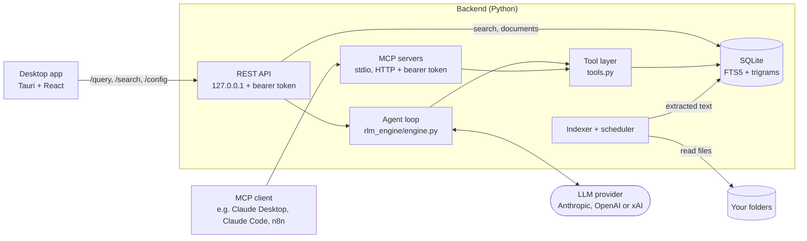

# For developers

**English** | [Deutsch](DEVELOPMENT.de.md)

Background for developers and administrators: how RootMind is built, how to run it from source and on servers, the command line, tracing and tests. Users start with the [README](../README.md).

## What it is

The repository has two parts:

- **Backend** (Python, FastAPI): indexer, full-text search, the agent loop, a
  localhost REST API, and MCP servers over stdio and HTTP.
- **Desktop app** (Tauri 2 with React and TypeScript, plus a Rust shell): a
  chat and search UI for Windows and Linux, in English and German. On Windows
  its installer sets up the backend as a Windows service; on Linux the app
  sets it up as systemd user services of your account. The app talks to that
  service.

> **Status:** this is a personal project. It is not commercially maintained and
> comes with no support commitment. Issues and pull requests are welcome and
> get a best-effort response.

## How it works in detail



1. **Indexing uses no LLM.** A connector walks each configured folder. Parsers
   extract text from PDF, DOCX, XLSX, PPTX, CSV, Markdown and other text files.
   The text goes into SQLite: a documents table, an FTS5 index and a trigram
   table for typo-tolerant search. PDF pages, slides and sheets keep markers in
   the text, so a hit can be cited by location. Unchanged files are skipped by
   content hash.
2. **The model chooses what to read.** For `POST /query`, the engine offers the
   model five read-only tools: `search_documents`, `search_fuzzy`,
   `list_documents`, `read_document` and `get_statistics`. A typical run is:
   search, read the window around a hit, perhaps search again with other words,
   then answer.
3. **The loop is bounded.** The loop makes at most 10 model calls that may
   request tools. If the model is still searching after that, one final call
   with tools disabled asks it to answer from what it has found. At most 8
   tool calls run per model turn, and the tool results of one question are
   capped at 200,000 characters; calls beyond that get an error result
   instead of running. Every LLM call has a timeout, a read returns at most
   50,000 characters, tool errors go back to the model as error results
   instead of ending the loop, and an answer cut off by the output token
   limit says so.
4. **Answers carry sources.** The response lists the documents the model read,
   with page, slide or sheet where it can be resolved, every tool call it
   made, and why each LLM call stopped.
   `POST /query/stream` returns the same answer and sends every model and
   tool call as it starts and ends (server-sent events), so a client can show
   what the agent is doing; closing that connection stops the question.
5. **MCP clients bring their own model.** Over MCP, RootMind serves the same
   tool definitions and the client's model does the deciding. Search and
   indexing never need an API key; only questions (`POST /query`), chat titles
   and the model list in the settings call the provider.

The desktop app talks to the **RootMind service** on the same computer, or to
a **custom** backend at an address you enter under Settings → RootMind
Service → Remote.
Development builds do not use the service and ask for a backend address.
[ARCHITECTURE.md](../ARCHITECTURE.md#deployment-modes) has the details.

## Install for developers and servers

**With uv** (any OS with Python 3.12 or newer; uv installs it if needed):

```bash
uv tool install "git+https://github.com/cgaeking/rootmind@v2.9.2#subdirectory=backend"
rootmind --help        # api, index, mcp, mcp-http, service, status, folders, search, ask, ...
```

This installs the commands `rootmind`, `rootmind-mcp` and `rootmind-mcp-http`.
On Windows, `rootmind service status` and `rootmind service uninstall` work
from such an install, but `rootmind service install` is refused and prints the
download address of the release build. The service runs as SYSTEM, so it may
only run a program from a folder that administrators alone can change;
`service install` copies the release build into such a folder, while a uv or
pip environment lives in a folder your account can change.

**Windows server or a machine without the app.** The release also contains
the backend alone, `rootmind-backend-windows-x64.zip`. Download and check it
in PowerShell:

```powershell
$base = "https://github.com/cgaeking/rootmind/releases/latest/download"
Invoke-WebRequest "$base/rootmind-backend-windows-x64.zip" -OutFile rootmind-backend-windows-x64.zip -UseBasicParsing
Invoke-WebRequest "$base/SHA256SUMS.txt" -OutFile SHA256SUMS.txt -UseBasicParsing
$line = Select-String -Path SHA256SUMS.txt -SimpleMatch "rootmind-backend-windows-x64.zip"
$expected = ($line.Line -split '\s+')[0]
$actual = (Get-FileHash rootmind-backend-windows-x64.zip -Algorithm SHA256).Hash.ToLower()
if ($actual -ne $expected) { throw "Checksum mismatch: $actual" }
```

Then, from an elevated PowerShell of the account whose folders RootMind should
index (it must be a local administrator), unzip it into a folder that only
administrators can change and install the service from there.
`service install` refuses, with exit code 10, a program in a folder that other
accounts can change, such as a download folder:

```powershell
$dir = Join-Path $env:ProgramFiles "RootMind Backend"
Expand-Archive rootmind-backend-windows-x64.zip -DestinationPath $dir -Force
$exe = Join-Path $dir "rootmind-backend\rootmind-backend.exe"
# install, or update an installed service
& $exe service install
# state, port, version and token files (works without elevation)
& $exe service status
# remove the service; --purge also deletes its data
& $exe service uninstall
```

`service install` copies the program to
`%ProgramFiles%\RootMind Service\<version>-<id>\`, so the unzipped folder is
not needed afterwards. It uses port 8000 and, for MCP over HTTP, port 3000;
`--port auto` and `--mcp-port auto` fall back to 18300–18399 and 18400–18499
when those are taken. MCP over HTTP is on for a new install; `--no-mcp-http`
leaves it out. Running `service install` again updates the service and keeps
its ports, MCP setting, tokens and data; `service install --help` lists every
option. The REST token is in `%ProgramData%\RootMind\data\rest_token.txt` and
the MCP token in `%ProgramData%\RootMind\data\api_token.txt`.

A new service starts without folders. Add them with
`& $exe folders add D:\Shares\Projects` (see [Command line](#command-line),
no elevation needed), or under `connectors` in
`%ProgramData%\RootMind\config.yaml` (as in
[`backend/config.example.yaml`](../backend/config.example.yaml); the file can
only be changed from an elevated prompt) followed by
`Restart-Service RootMind-Backend`.

The zip also runs without a service, for example
`rootmind-backend.exe api --require-token` or `rootmind-backend.exe mcp-http`.

**Linux server or a machine without the app.** The release contains the Linux
backend alone, `rootmind-backend-linux-x64.tar.gz` (x86-64, glibc 2.35 or
later). As the account whose folders RootMind should index (not root), unpack
it into a folder that only you can change and install the service from there:

```sh
base=https://github.com/cgaeking/rootmind/releases/latest/download
curl -L -O "$base/rootmind-backend-linux-x64.tar.gz" -O "$base/SHA256SUMS.txt"
sha256sum --check --ignore-missing SHA256SUMS.txt
mkdir -p ~/opt && tar -xzf rootmind-backend-linux-x64.tar.gz -C ~/opt
exe=~/opt/rootmind-backend/rootmind-backend
"$exe" service install      # install, or update the installed services
"$exe" service status       # state, port, version and token files
"$exe" service uninstall    # remove them; --purge also deletes the data
loginctl enable-linger "$USER"   # keep them running without a login
```

`service install` copies the program into
`~/.local/share/rootmind/runtime/<version>-<id>/` and writes the two units to
`~/.config/systemd/user/`; it needs a systemd user manager for the account,
which a desktop or SSH login starts (exit code 11 without one, for example
under `su` or `sudo`). The ports, options and tokens are those of Windows; the
data is in `~/.local/share/rootmind` (`config.yaml`, `data/rest_token.txt`,
`data/api_token.txt`). Add folders and the LLM key with `"$exe" folders add`
and `"$exe" config llm` (see [Command line](#command-line)); after editing
`config.yaml` by hand, restart the service with
`systemctl --user restart rootmind-backend`.

## Command line

The same program that runs the service also manages it. These commands talk
to the RootMind service of your account through its REST API, on Windows and
Linux alike, and never need root or an administrator prompt:

```sh
rootmind status                                  # service, index, folders, MCP endpoint, remote access
rootmind folders list
rootmind folders add /srv/shares/projects --name projects [--rescan-minutes 10]
rootmind folders remove projects
rootmind index [--full] [--folder projects] [--wait]
rootmind search "invoice telekom" [--limit 10] [--snippets]
rootmind ask "What does the contract with Fjordhaus say about notice periods?"
rootmind config llm                              # provider, model, which keys are saved
rootmind config llm --provider anthropic --model claude-sonnet-5-5 --key-file ~/anthropic.key
rootmind mcp tokens list                         # names, folders, fingerprints
rootmind mcp tokens create alice --folders projects --out alice.token
rootmind mcp tokens revoke alice
rootmind remote-access on|off|status             # the ngrok tunnel
rootmind check-models [--provider openai] [--write FILE]  # check every chat model of the saved keys
```

`rootmind` is the command of a uv or pip install. With the app or the
backend archive, call the backend itself: `rootmind-backend` (Linux:
`/usr/lib/RootMind/backend/rootmind-backend` from the .deb and .rpm,
`~/opt/rootmind-backend/rootmind-backend` from the tar.gz) or
`& "$env:ProgramFiles\RootMind\backend\rootmind-backend.exe"` on Windows.
Every command takes `--json` for scripts and `--help`.

- **How it finds the service.** Like the app, it asks `service status` for
  the port and the token file, lets the service on that port prove that it
  knows the token, and only then sends the REST token. The token is read from
  `data/rest_token.txt` in the data folder, which only the account that set
  up the service can read (on Windows also SYSTEM and administrators from an
  elevated prompt). From another account, or with `sudo`, the commands stop
  with exit code 4 and say why.
- **Secrets stay off the command line.** `config llm` reads the API key from
  a file (`--key-file FILE`) or from stdin (`--key-file -`, which asks
  without echo in a terminal), never from an argument, and never prints a key,
  not even masked; `--remove-key` removes it. `remote-access on
  --authtoken-file FILE` saves the ngrok authtoken the same way. Tokens are
  never printed; `mcp tokens list` shows the fingerprint the MCP service logs,
  and `mcp tokens create` writes a new token to a new file (mode 0600
  on Linux, readable by your account alone on Windows; `--out FILE`, or
  `--out -` to print it instead).
- **Another backend.** `--url http://127.0.0.1:18000 --token-file FILE` (or
  `RLM_URL` and `RLM_TOKEN_FILE`) uses that REST API instead, for example a
  development backend (`rootmind api`). Plain `http://` is accepted only for
  `127.0.0.1`, `localhost` and `::1`; use `https://` or an SSH tunnel for
  anything else.
- **`index` in this process.** `rootmind index --local` indexes the folders
  of `config.yaml` (in `RLM_HOME` or the working folder) in the command's own
  process, as `rootmind index` did before 2.5. `--local` is implied by a
  global `--config`, by `RLM_HOME`, and when your account has no RootMind
  service (then a note says so).
- **Exit codes:** 0 done, 1 the service refused or failed the request,
  2 wrong usage, 3 no service found, stopped or not answering (or another
  program on its port), 4 the token cannot be read or was refused.

**Run RootMind on a server.** A Linux server can index shared folders
(`--rescan-minutes` re-scans mounted network shares) and serve MCP to other
machines over TLS or behind a reverse proxy, with one named token per person
or client, each limited to some folders (`mcp tokens create --folders`). The
guide is [docs/SERVER.md](SERVER.md); read the
[threat model for server use](../SECURITY.md#server-use) first: the folder scope
of a token is the only access control, share permissions are not checked per
user.

## Tracing the agent loop

Tracing is off by default. Turned on, it records every step of a question:
each model call (purpose, tokens, stop reason, the tools it asked for, time)
and each tool call (arguments, result size, the documents a search returned,
the windows a read returned), and the answer.

- **Evals:** `scripts/run_evals.py --trace <folder>` writes a JSONL file and
  a readable Markdown summary per eval run (see
  [`backend/evals`](../backend/evals/README.md#tracing-a-run)).
- **Backend:** `tracing: {local: true}` in `config.yaml` writes the same
  files under `logs/traces/` in RootMind's data folder. Nothing leaves the
  computer.
- **Langfuse (optional):** `tracing: {langfuse: true}`, or `--langfuse` for the
  eval runner, exports traces to a Langfuse server. It needs the `tracing`
  extra (`uv sync --extra tracing`; not part of the packaged backend) and
  `LANGFUSE_PUBLIC_KEY`, `LANGFUSE_SECRET_KEY` and `LANGFUSE_BASE_URL` in the
  environment. A self-hosted Langfuse keeps traces on your network; Langfuse
  Cloud is a third party.

Traces contain your questions, the model's tool arguments and the document
text it read. They never contain API keys. See
[SECURITY.md](../SECURITY.md#what-leaves-the-machine).

## Run from source

You need [uv](https://docs.astral.sh/uv/); it installs Python 3.12 if
necessary. The desktop app also needs Node 24, pnpm 11, Rust 1.96 or newer and, on
Windows, the MSVC build tools and WebView2.

### 1. Index and search without an API key

```bash
cd backend
uv sync
cp config.example.yaml config.yaml   # indexes the fictional demo corpus in evals/corpus
uv run rootmind index --local        # builds data/index.db; no LLM involved
uv run rootmind api                  # REST API on http://127.0.0.1:8000, no token
```

In a second terminal:

```bash
curl "http://127.0.0.1:8000/search?q=total%20due&limit=3&snippets=true"
```

The first hit is `invoice_INV-2026-0142.pdf` with `"page": "Page 2"` and a
snippet around the match. Without `snippets=true` the search returns only the
ranked list, which is faster on large indexes.

The interactive API docs are at <http://127.0.0.1:8000/docs>. While the API
runs, it re-indexes about 30 seconds after start and then every 24 hours
(`indexer.sync_interval_hours`). To index your own files, add entries under
`connectors` in `config.yaml`. Use absolute paths: relative connector paths
resolve against the working directory.

`rootmind api` started this way requires no token. To require one,
set `RLM_API_TOKEN` or pass `--require-token`, which creates
`data/rest_token.txt`, and send `Authorization: Bearer <token>` with each
request. The docs pages are off while a token is required.

### 2. Ask a question

Set a key for one provider (`ANTHROPIC_API_KEY`, `OPENAI_API_KEY` or
`XAI_API_KEY`; Ollama needs none, see
[Local models with Ollama](../README.md#local-models-with-ollama)) in the environment or in `backend/.env` (see
[`.env.example`](../backend/.env.example)). Choose the provider and model under
`llm` in `config.yaml`, restart the API, then:

```bash
curl -X POST http://127.0.0.1:8000/query \
  -H "Content-Type: application/json" \
  -d '{"question": "What is the total amount due on invoice INV-2026-0142?"}'
```

The response contains `answer`, `sources` (with `page` where known),
`tool_calls` and `tokens_used`. The question, search snippets and document
excerpts go to the provider you configured; see [SECURITY.md](../SECURITY.md).

### 3. Use the tools from an MCP client

The MCP servers read the same `config.yaml` and database as the REST API. They
only serve and never index, so keep the index current with `rootmind index --local` or
a running REST API.

Claude Desktop (`claude_desktop_config.json`):

```json
{
  "mcpServers": {
    "rootmind": {
      "command": "uv",
      "args": ["--directory", "/absolute/path/to/rootmind/backend", "run", "rootmind-mcp"]
    }
  }
}
```

If Claude Desktop cannot find `uv`, put the absolute path of the `uv`
executable into `command`. On Windows, write the paths with forward slashes or
escaped backslashes (`C:\\...`).

Claude Code:

```bash
claude mcp add --transport stdio rootmind -- \
  uv --directory /absolute/path/to/rootmind/backend run rootmind-mcp
```

Over HTTP, for MCP clients that cannot start a local process:

```bash
cd backend
uv run rootmind-mcp-http             # http://127.0.0.1:3000/mcp
```

On first start the server generates a token and saves it to
`data/api_token.txt` (under `RLM_HOME`, or the working directory when that is
unset); alternatively, set `MCP_API_TOKEN`. The server prints where the token
came from and a short fingerprint of it, never the token itself. Then:

```bash
claude mcp add --transport http rootmind http://127.0.0.1:3000/mcp \
  --header "Authorization: Bearer <token from data/api_token.txt>"
```

The stdio server reads the folder list at startup, so restart it (the MCP
client) after adding or removing folders. The HTTP server re-reads it when
`config.yaml` changes. The HTTP server binds to 127.0.0.1 and speaks plain
HTTP; to reach it from another machine, put it behind a TLS-terminating proxy
or tunnel and never expose the plain port. `rootmind-mcp-http --index` also
runs the background indexer in that process. Use it only when no REST API
indexes the same database: every indexing process removes the documents of
folders that are missing from its own copy of the config.

In a LangChain or LangGraph agent, load the same tools through
`langchain-mcp-adapters`: [examples/langchain_mcp](../examples/langchain_mcp/README.md)
starts `rootmind-mcp` over stdio and runs LangChain's stock agent with a local
Ollama model.

### 4. Run the desktop app (development)

```bash
# terminal 1: backend, with the Vite dev origin allowed by CORS
cd backend
RLM_DEV=1 uv run rootmind api        # PowerShell: $env:RLM_DEV=1; uv run rootmind api

# terminal 2: desktop
cd desktop
pnpm install
pnpm tauri dev
```

A development build does not use the RootMind service, so the app asks for a
backend address: confirm `http://127.0.0.1:8000`. More in
[desktop/README.md](../desktop/README.md).

### Build the installer yourself

On Windows, from the repository root:

```powershell
# 1. Backend: PyInstaller onedir build -> backend/dist/rootmind-backend/
cd backend
uv sync --locked --no-dev --group build
uv run --no-sync pyinstaller packaging/rootmind-backend.spec --noconfirm --clean --distpath dist
cd ..

# 2. Copy it to desktop/src-tauri/binaries/rootmind-backend/ and check it
python scripts/prepare_backend.py

# 3. Installer with the release overlay, which adds the backend
cd desktop
pnpm install
pnpm tauri build --config src-tauri/tauri.release.conf.json
```

The installer is written to `desktop/src-tauri/target/release/bundle/nsis/`.
Run `uv sync` in `backend/` afterwards to get the development tools back.
Without the overlay, `pnpm tauri build` builds an app without a backend.

## Repository layout

```
backend/
  src/rootmind/
    rlm_engine/engine.py   agent loop
    tools.py               tool registry, argument validation, result formatting
    tracing/               optional tracing of the agent loop: local JSONL, Langfuse export
    mcp_stdio.py           MCP server over stdio
    mcp_http.py            MCP server over HTTP with a bearer token
    api/                   REST API (FastAPI)
    auth.py, access.py     REST token handling; folder access policy interface
    winaccess.py           folder access policy of the Windows service (AuthZ)
    service/               background service: install, uninstall, status, service host;
                           Windows services and Linux systemd user units (linux*.py, systemd.py)
    database/              SQLite models, FTS5 and trigram search
    indexer/               parsers, indexer, sync scheduler
    connectors/            local folder connector
  tests/                   offline test suite with fake LLM clients; e2e/ service test
  evals/                   fictional corpus and eval cases; baselines/langgraph: the
                           LangGraph baseline (own environment)
  scripts/                 eval runner and corpus generator
  packaging/               PyInstaller spec, smoke test, tree hash
  deploy/windows/          run-backend.bat: the REST API from source in a console window
desktop/
  src/                     React + TypeScript UI
  src-tauri/               Rust shell: service connection and commands, chat history;
                           installer/ with the NSIS template and the service hooks;
                           linux/ and tauri.linux.conf.json for the Linux service and packages
  scripts/                 installer smoke test
packaging/winget/          winget manifest templates
packaging/mcpb/            Claude Desktop bundle (rootmind.mcpb): stdio-to-HTTP bridge, manifest, tests, MCP Registry template
examples/langchain_mcp/    RootMind's MCP server as tools in a LangChain agent (own environment)
scripts/                   version check, release notes, backend preparation, winget rendering,
                           NSIS template refresh
.github/workflows/         CI and release
```

Design decisions, guardrails and trade-offs are described in
[ARCHITECTURE.md](../ARCHITECTURE.md), the threat model in [SECURITY.md](../SECURITY.md),
and the changes per version in [CHANGELOG.md](../CHANGELOG.md).

## Tests and evals

Both run offline and need no API key:

```bash
cd backend
uv sync
uv run pytest -q                      # fake LLM clients, generated test corpus
uv run python scripts/run_evals.py    # retrieval regression: scripted policy, no model
```

**Tests.** An autouse fixture replaces the Anthropic and OpenAI client
constructors with functions that raise and removes API keys from the
environment. Tests inject scripted fake clients
([`tests/fakes.py`](../backend/tests/fakes.py)) through the engine's `client`
parameter. Every test gets its own `RLM_HOME` and working directory. Tests
that need documents get a small generated corpus with one PDF, DOCX, XLSX,
PPTX, CSV, Markdown and text file each. Tests of the Windows folder access
policy and of the service's folder permissions run on Windows only, those of
the Linux file modes on Linux only (the Linux service logic itself, with a
fake `systemctl`, runs everywhere); installing real services is left to the
CI end-to-end tests.

**Evals.** [`scripts/run_evals.py`](../backend/scripts/run_evals.py) indexes the
fictional corpus in [`backend/evals/corpus/`](../backend/evals/corpus) with the
real indexer and runs 16 questions through the real engine.

- *Live mode* is the eval: it runs a real model several times per case and
  reports pass rate (expected source cited, required strings present,
  forbidden strings absent), tool-path variance, tool calls, tokens, latency
  and stop reasons. It reads keys only from environment variables and never
  runs in CI.
- *Dry mode* is a retrieval regression test, not an eval of the agent: a
  scripted policy replaces the model, searches with a query written by hand
  for each case (`dry_search` in the dataset), reads the suggested window and
  answers with the excerpt. It checks that the index and the tool layer
  still put the right document first (hit@1), among the first five hits
  (hit@5), and cite the right page, slide or sheet. With hand-picked queries
  1.0 on the 15 gated cases is the expected result; c09, the synonym trap,
  is the known miss. CI fails if hit@5 drops below 1.0. It says nothing
  about answer quality.
- *`--agent langgraph`* runs the same cases with the same tools, system
  prompt and scoring in LangChain's stock LangGraph agent, from its own
  environment (the backend does not depend on LangChain). With
  `granite4.1:8b` through Ollama, 3 runs per case, both agents passed 98%
  (15 of 16 cases every run) with about the same tool calls, tokens and
  latency; the edges where the loops differ (iteration limit, search nudge)
  did not occur in those runs. Hosted models were not compared.

Details: [backend/evals/README.md](../backend/evals/README.md).

**CI.** GitHub Actions workflows with actions pinned by commit SHA and no
secrets. Only the release job can write to the repository:

| Workflow | What it runs |
|---|---|
| [`backend.yml`](../.github/workflows/backend.yml) | ruff check and format check; the version check across backend, desktop and the Claude Desktop bundle; the tests of the release scripts on Ubuntu and Windows; pytest with coverage on Ubuntu (Python 3.12 and 3.14) and Windows (Python 3.12); the dry retrieval regression |
| [`backend-exe.yml`](../.github/workflows/backend-exe.yml) | The PyInstaller onedir builds on Windows and on Ubuntu 22.04, a smoke test of each executable (REST, MCP over HTTP and stdio, indexing of every file type) and their tree hashes; then end-to-end tests of the service: on the elevated Windows runner the Windows services (install, permissions, tokens, read confinement, update and uninstall), on Ubuntu the systemd user units of the runner's account (refusals, install, file modes, tokens, indexing, restarts, update, MCP off and on, uninstall). On pull requests the service tests run only when service-related code changed |
| [`desktop.yml`](../.github/workflows/desktop.yml) | ESLint, TypeScript typecheck, vitest, Vite build, `cargo fmt`, `cargo clippy`, `cargo check`, `cargo test` on Windows; `cargo clippy` and `cargo test` on Ubuntu 22.04 |
| [`release.yml`](../.github/workflows/release.yml) | For a version tag `v*`: the backend through `backend-exe.yml`; the per-machine installer with that backend, a check that it updates an installed version in place without a reinstall page, and a smoke test on the elevated runner that installs, updates, reinstalls and uninstalls RootMind with its Windows services, and installs it silently as SYSTEM (app only), sets the service up as the app does and updates it as SYSTEM; the winget manifests validated against their schemas; `rootmind.mcpb` for Claude Desktop, tested, validated and packed; the Linux packages (.deb, .rpm, AppImage) with the Linux backend, the .deb installed on the runner and both packaged backends started; then a GitHub Release with the installer, the Linux packages, the bundle, both backend archives, `SHA256SUMS.txt` and attestations; then, except for prereleases, the bundle's entry in the MCP Registry (`server.json` rendered from the release's `rootmind.mcpb` and published with `mcp-publisher` through GitHub OIDC). Manual runs and pull requests that change the packaging are dry runs that publish nothing; they render and validate `server.json` |
| [`mcpb.yml`](../.github/workflows/mcpb.yml) | The Claude Desktop bundle: the bridge's `node:test` tests on Ubuntu and Windows, then the manifest validated and the bundle packed with the mcpb CLI |
| [`secrets.yml`](../.github/workflows/secrets.yml) | detect-secrets over all tracked files, against the audited baseline `.secrets.baseline` |

Dependabot ([`.github/dependabot.yml`](../.github/dependabot.yml)) proposes
monthly dependency updates for all four ecosystems.
